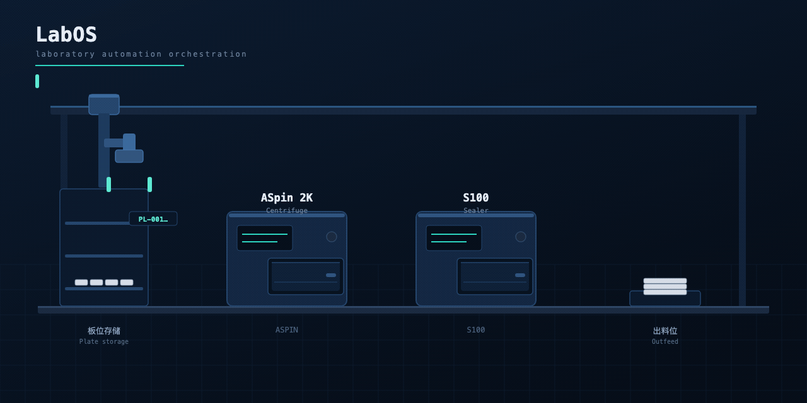

[](https://github.com/rogerlzp/labos/actions/workflows/ci.yml)
[](LICENSE)
[](ROADMAP.md)

> **English** · **[简体中文](README.zh-CN.md)**
>
> This repository ships bilingual documentation: the console switches between
> Chinese and English at runtime (top-right selector), and the English
> documentation index and translation ledger live in
> [`docs/en/INDEX.md`](docs/en/INDEX.md).

# LabOS · Laboratory Automation Control System

> **English edition.** The Chinese README is [`README.zh-CN.md`](README.zh-CN.md); this file is the
> English counterpart. Nothing in the Chinese documentation was modified to produce it.
> See [`docs/en/INDEX.md`](docs/en/INDEX.md) for the full English documentation index
> and the translation ledger.

LabOS is a control kernel for automated bio-pharma laboratories. It translates
*“how an experiment runs”* into *“how the devices move”*, and — when several
experiments run in parallel — it guarantees that plates never get mixed up and
devices never collide.

```
Experiment definition (multi-workflow + variables + loops)
    ↓
Scheduling (parallel experiments, island-level mutual exclusion)
    ↓
Workflow execution (BPMN graph → nodes → device commands)
    ↓
Plate tracking (which position holds which plate + atomic reservation)
```

## Demo — one plate, two devices, one workflow

A gantry arm carries a single plate from the storage rack through the centrifuge
(**ASpin 2K**) and the sealer (**S100**) to the outfeed. The command trace shows the
real sidecar commands and their real timeouts: `MoveTray` 3 s, `Seal` 12 s,
`RunProgram` 300 s (compressed for the demo).



> The device models, commands and timeouts shown here are the ones in
> [`sidecar-dotnet/models.json`](sidecar-dotnet/models.json) — the same file the
> kernel exports from its device library. The animation source is
> [`docs/media/labos-flow-source.html`](docs/media/labos-flow-source.html).

---

## What it does

| Capability | Description |
|---|---|
| **Workflow execution** | Parses a BPMN graph and executes node by node; supports parallel gateways, exclusive gateways and loops |
| **Parallel experiments** | Island-level mutual exclusion + EDD ordering + queueing; no two experiments share an island, separate islands never interfere |
| **Plate & position management** | Position-level reservation (atomic write), dual locks for plate moves (deadlock-free), three-tier plate-ID resolution |
| **Device drivers** | Short-connection and persistent-connection modes; contract validation (four required response fields) |
| **Shadow mode** | Single-command probe + whole-workflow dry run: issues no commands, only reports *what would be sent* |
| **Crash recovery** | Idempotency keys (resending a command never re-executes it) + startup reconciliation |
| **Alerts** | Missing plate, timeout, failure, contract mismatch; deduplicated and merged |
| **Dual canvases** | Island canvas (device wiring = plate moves) + experiment canvas (devices + variables + loops + branches) |

---

## Quick start

### Requirements

- **JDK 17** — the kernel runs inside a **Spring Boot 3.2.5** container (Spring MVC for HTTP,
  Spring-managed transactions, HikariCP for pooling, MyBatis XML for SQL)
- **PostgreSQL** (default database `labdb`, override with `LABOS_DB_NAME`)
- **Node 18+** (frontend)
- **Redis** (optional, only needed in gateway mode)
- **Maven** — only to resolve dependencies; `scripts/build-kernel.sh` downloads it on demand

### Run the kernel

```bash
./scripts/build-kernel.sh                      # resolve dependencies + compile main/boot
LABOS_DB_NAME=<your-db> ./scripts/start-kernel.sh
```

`start-kernel.sh` is the **only** entry point. It launches the Spring Boot container
(`com.labos.boot.LabosApplication`), which serves the API on port 18080 through Tomcat and
starts the kernel once the container is ready.

### Run the frontend

```bash
cd webapp
npm install && npm run dev      # http://localhost:5173
```

Default account: `admin` / `admin123`.

### Run the device gateway (optional)

```bash
cd labos-gateway
mvn -q -B dependency:copy-dependencies -DincludeScope=runtime -DoutputDirectory=lib
javac -encoding UTF-8 -d out -cp "lib/*" $(find src -name '*.java')
LABOS_REDIS_HOST=127.0.0.1 \
LABOS_GATEWAY_DRIVERS="DRV-A=tcp://192.0.2.10:8501" \
java -cp "out:lib/*" com.labos.gateway.GatewayMain
```

The gateway deliberately stays on **bare JDK + Lettuce**: it is a separate process whose only
jobs are holding connections, moving bytes and writing state — pulling Spring in would add
roughly 30MB of dependencies and 2–3 seconds of start-up time, which is inconvenient on site.

### Environment variables

| Variable | Default | Description |
|---|---|---|
| `LABOS_DB_HOST` | 127.0.0.1 | |
| `LABOS_DB_PORT` | 5432 | |
| `LABOS_DB_NAME` | labdb | **Must be set on site** |
| `LABOS_DB_USER` | postgres | |
| `LABOS_DB_PASS` | empty | |
| `LABOS_AUTH` | 1 | Set to 0 to disable authentication (integration only) |
| `LABOS_DRIVER_PORT` | 19301 | Vendor driver service port |
| `LABOS_EXEC_GRAPH` | 1 | Set to 0 to fall back to sequential execution |
| `LABOS_DRIVER_MODE` | short connection | `persistent` for long-lived connections |
| `LABOS_REDIS_HOST` | 127.0.0.1 | Used by the gateway |
| `LABOS_GATEWAY_DRIVERS` | required | `code=tcp://host:port`, comma-separated |
| `VITE_DEFAULT_LOCALE` | `zh-CN` | Frontend build-time default language (`zh-CN` / `en-US`) |

### Verify

> **⚠ DEPRECATED (2026-11-08)**: this section is superseded by the single entry point
> `docs/测试总纲.md` (Chinese, authoritative; English edition pending). Current tiers
> and the "what changed → what to run" mapping live in the Testing Master §2 / §4.
> Kept as historical context.

```bash
cd labos-kernel
LABOS_DB_NAME=<your-db> java -cp "out:lib/postgresql-42.7.3.jar:lib/spring/*" \
     com.labos.kernel.recovery.RecoverySelfTest
LABOS_DB_NAME=<your-db> java -cp "out:lib/postgresql-42.7.3.jar:lib/spring/*" \
     com.labos.kernel.engine.EngineSelfTest
LABOS_DB_NAME=<your-db> java -cp "out:lib/postgresql-42.7.3.jar:lib/spring/*" \
     com.labos.kernel.workflow.GraphRunnerTest
LABOS_DB_NAME=<your-db> ./scripts/start-kernel.sh \
     com.labos.kernel.workflow.RealWorkflowRunner --all
```

**Note:** `RealWorkflowRunner --all` walks the graph on the **simulation bus**. It
reports which branches the parallel and exclusive gateways took — it is **not**
a real-device verification.

The frontend has its own gates:

```bash
cd webapp && npx tsc -b --force     # type check, must be 0 errors
python3 scripts/scan-i18n.py        # i18n ledger: key parity + code coverage
```

---

## Architecture

```
┌────────────────────────────────────────────┐
│  Browser (React 18 + TS + Ant Design)       │
└───────────────────┬────────────────────────┘
                    │ HTTP/JSON  :18080
┌───────────────────▼────────────────────────┐
│  Kernel `labos-kernel`                      │
│  Spring Boot 3.2.5 · Java 17 · Tomcat       │
│                                            │
│  src/boot/    container layer               │
│   web/controller/  12 @RestController       │
│   web/service/     RunService · Workflow…   │
│   web/             auth · CORS · MVC · audit│
│                                            │
│  src/main/    domain layer                  │
│   workflow/ engine/ driver/ recovery/       │
│   alert/ expr/ persistence/                 │
└──────┬───────────────────────┬─────────────┘
       │ JDBC (HikariCP)        │ TCP + JSON
┌──────▼───────────┐   ┌───────▼─────────────────┐
│  PostgreSQL      │   │  Vendor driver service  │
│  (MyBatis XML)   │   │  (.NET sidecar / mock)   │
└──────────────────┘   └───────┬─────────────────┘
                              │ vendor DLL / serial port
                    ┌─────────▼─────────────────┐
                    │  Devices / robot arms     │
                    └───────────────────────────┘
```

**Optional gateway path**: kernel → Redis → `labos-gateway` → devices. The gateway
keeps long-lived connections, so restarting the kernel does not interrupt a running
device command.

Full module map: [`docs/en/architecture.md`](docs/en/architecture.md)
(Chinese original: [`docs/技术架构与模块地图.md`](docs/技术架构与模块地图.md)).
The Spring Boot migration itself — scope, per-batch decisions and measured evidence — is in
[`docs/architecture/SPRING_BOOT_MIGRATION_20261109.md`](docs/architecture/SPRING_BOOT_MIGRATION_20261109.md).

---

## Key design decisions

| # | Decision | Why |
|---|---|---|
| 1 | **Position-level mutual exclusion > island-level** | Positions are shared across islands and plates already in the lab may still exist; island-level exclusion was the 2.0 simplification |
| 2 | **Atomic reservation** (`INSERT ON CONFLICT DO UPDATE WHERE`) | SELECT-then-UPDATE leaves a window in which two experiments both believe the position is free |
| 3 | **Plate moves take both locks in ascending id order** | Removes circular wait (one of the four deadlock conditions); the second failure releases the first |
| 4 | **No `eval` for condition evaluation** | Canvas content comes from user input — `eval` hands the browser to someone else |
| 5 | **An unresolved variable keeps `${name}` verbatim** | Errors stay obvious and debuggable; substituting an empty string makes it look like a missing parameter |
| 6 | **Fail fast, never skip** | Skipping a step leaves the plate position unknown, and every later step is then wrong |
| 7 | **No pure DP scheduling** | State space 2^50, work-time variance 13.5×; a rolling time horizon is used instead (2.0 implements only the greedy variant) |
| 8 | **The gateway is a pipe, not a decision maker** | The cleverer it gets, the harder it is to locate a problem |
| 9 | **Three-tier plate-ID resolution**: parameter → device response → `AUTO-<runId>` | The fallback is not a UUID: `AUTO-` makes it obvious at a glance that the plate was never scanned |

---

## Internationalization

The web console ships with a **runtime** i18n layer (no i18n library, no build-time
split) and two language packs:

- `webapp/src/i18n/messages/zh-CN.ts` — the **master pack**: it defines the complete
  key set.
- `webapp/src/i18n/messages/en-US.ts` — typed as
  `Record<keyof typeof zhCN, string>`, so a missing, extra or misspelled key is a
  **compile error**, not a runtime surprise.
- `webapp/src/i18n/codes.ts` — English labels for **domain codes** (run/node/step/
  experiment/batch statuses, pause kinds, on-site hold kinds and scopes).

Two rules govern how text is looked up:

1. **UI text is looked up by key.** Pages call `t('runs.col.progress')`; they never
   branch on the Chinese string.
2. **Domain codes are looked up by code, never by Chinese text.** The backend
   vocabulary (`GET /api/meta/status-vocabulary`) is the authority for the Chinese
   label, so a status added on the backend appears immediately in the Chinese UI.
   The English side resolves the same **code** against the local table and falls
   back to the raw code — an English screen never shows a Chinese label.

Switching language at runtime: the header has a `中文 / English` selector; the
choice is stored in `localStorage` and survives reloads. The build-time default is
`VITE_DEFAULT_LOCALE` (defaults to `zh-CN`).

`scripts/scan-i18n.py` is the ledger tool. It loads the packs with esbuild, runs
the real localisation code over the backend vocabulary, and fails when:

- the two packs are not key-aligned, or an English value contains Chinese;
- a backend code has no English entry (it would render as a bare code);
- the English UI would display any Chinese text.

**Current state: all 26 console pages are fully translated — 1 248 message keys
(zh/en aligned), 63 domain codes covered, 1 315 reachable English strings with zero
Chinese characters, and 0 residual user-facing Chinese in `webapp/src`.**
The Chinese console is unchanged: the default locale is still `zh-CN`.

---

## Documentation

**Every document in this repository now has an English edition.** The index and the
translation ledger live in [`docs/en/INDEX.md`](docs/en/INDEX.md); the Chinese
originals remain the authoritative reference for implementation detail, and the
English files are kept in step with them.

**Overseas market research is deliberately not published.** Buyer maps, competitor
positioning, pricing intelligence and the standards-alignment analysis are market
intelligence rather than product documentation; they live in the local, git-ignored
`private/` directory and are not part of this repository.

| Document | Contents |
|---|---|
| **[`docs/en/INDEX.md`](docs/en/INDEX.md)** | **English documentation index + translation ledger** — every Chinese document has an English edition |
| **[`docs/en/roadmap.md`](docs/en/roadmap.md)** | **Single source of truth for what comes next**: phases M6–M11, feature list, acceptance criteria, P0/P1/P2 placement, definition of done |
| [`docs/en/onboarding.md`](docs/en/onboarding.md) | Start here for a new reader: 30 minutes to understand the project + the known-issue list |
| [`docs/en/functional-specification.md`](docs/en/functional-specification.md) | The functional specification — authoritative for what the features are |
| [`docs/en/architecture.md`](docs/en/architecture.md) | Package layout, key classes, data flow |
| [`docs/architecture/SPRING_BOOT_MIGRATION_20261109.md`](docs/architecture/SPRING_BOOT_MIGRATION_20261109.md) | **The Spring Boot migration**: container, Spring-managed transactions, MyBatis XML, SLF4J — scope, per-batch decisions, measured evidence |
| [`docs/en/deployment.md`](docs/en/deployment.md) | Complete on-site deployment steps and pass criteria |
| [`docs/en/production-roadmap.md`](docs/en/production-roadmap.md) | How far production is, and staged estimates |
| [`docs/en/experiment-orchestration-design.md`](docs/en/experiment-orchestration-design.md) | Experiment orchestration, canvas, variable passing, execution model |
| [`docs/en/workflow-control-guide.md`](docs/en/workflow-control-guide.md) | Conditional branches / loops / variables: how to configure them and what the UI shows |
| [`docs/en/parallel-scheduling-design.md`](docs/en/parallel-scheduling-design.md) | Island locks, EDD, deadlock avoidance |
| [`docs/en/position-occupancy-and-mutual-exclusion-design.md`](docs/en/position-occupancy-and-mutual-exclusion-design.md) | Position locks, move atomicity |
| [`docs/en/local-simulation-guide.md`](docs/en/local-simulation-guide.md) | One simulator per device, run the whole island locally |
| [`docs/en/devices/model-library-and-error-code-mapping.md`](docs/en/devices/model-library-and-error-code-mapping.md) | **How to onboard a new device**: device code → LabOS code → recovery action |
| [`sidecar-dotnet/README.en.md`](sidecar-dotnet/README.en.md) | **Real-device sidecar**: serial framing / Cluster.dll / forwarding simulator |
| [`docs/media/labos-flow-source.html`](docs/media/labos-flow-source.html) | Source of the demo animation at the top of this page (self-contained HTML/SVG, no build step) |
| [`docs/en/development-log.md`](docs/en/development-log.md) | Where every decision and every pitfall came from |
| [`docs/en/review-20261105/00-index.md`](docs/en/review-20261105/00-index.md) | **Latest review entry point** |
| [`docs/en/review-20261104/00-index.md`](docs/en/review-20261104/00-index.md) | Previous review bundle |
| [`docs/en/review-20261103/00-index.md`](docs/en/review-20261103/00-index.md) | Functional / technical / design / test review bundle |
| [`docs/en/contribution-guidelines.md`](docs/en/contribution-guidelines.md) | How a commit message is written, when to commit, what must not be committed |
| [`docs/en/review-guidelines.md`](docs/en/review-guidelines.md) | How to review, how to record a review, how the reviewed party responds |

---

## Known limitations

**The current state is an implementation baseline, not a production release.**

| Item | Description |
|---|---|
| **Verification level** | the workflows are walked end-to-end on the **simulation bus**; **no real device has been verified** |
| **Scheduler** | Island-level mutual exclusion + greedy ordering; the rolling time horizon exists only in the design document |
| **Two ID spaces** | `device_instance.id` and `resource_node.id` are both `long`, and callers must convert (this has caused five separate bugs) |
| **Two execution paths** | `WorkflowService` and `ExperimentFlowRunner` each have their own device-allocation logic |
| **Persistent “running”** | `method_status=1` is judged a failure directly, so long tasks (a 30-minute incubation) are misjudged |
| **Device photos** | The repository contains **no images** (copyright); drop them into `webapp/public/devices/` yourself |

The full list is in section 6 of [`docs/评审指引.md`](docs/en/onboarding.md) (Chinese).

---

## Status and interoperability roadmap

Status: **pre-alpha**. The kernel runs workflows, scheduling, position-level occupancy and the audit trail today; device coverage is small and there is **no independent real-hardware validation report** yet.

Interoperability is a roadmap item, not a shipped feature:

- **SiLA 2 adapter** — consume/expose SiLA 2 features as a separate adapter process, so the
  interoperability layer does not add dependencies to the kernel itself.
- **SiLA Converter pattern** — wrap existing .NET / private-TCP instruments as standard features instead of rewriting drivers.
- **OPC UA LADS** — evaluated as a companion interface, not a replacement for SiLA 2.
- **MCP** — an outbound agent-facing interface, complementary to SiLA 2. MCP does not replace device standards.

There is **no SiLA 2 implementation and no SiLA certification** today, and nothing in this repository should be read as a compliance claim.

## Historical documents

The repository root also holds historical documents (`LabOS功能规格说明书.md`,
`LabOS实现总纲_20261029.md`, `决策记录.md`,
`前后端实施方案_编译甘特就绪调度.md`).

**They record the design reasoning, not an accurate description of the current
implementation.** Where they conflict with the code or with the documents under
`docs/`, trust the code — do not treat the existing documents as the yardstick.

## Device photos (optional)

The repository contains **no device images**. `webapp/public/devices/` is empty and
the UI degrades to "colour block + identifier"; functionality is unaffected.

To add photos, drop files named after the capability into that directory
(`INCUBATE.jpg`, `TRANSFER.jpg`, …) — **no code change required**. See the README
in that directory.

---

## License

[Apache License 2.0](LICENSE)

Copyright 2026 LabOS Contributors
