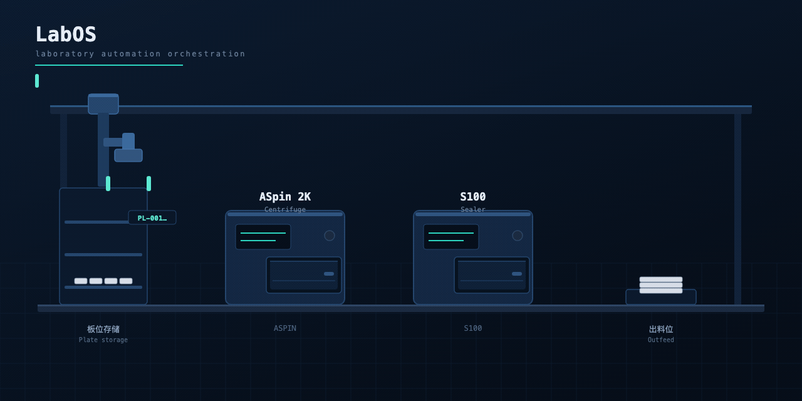

[](https://github.com/rogerlzp/labos/actions/workflows/ci.yml)
[](LICENSE)
[](ROADMAP.md)

> **[English](README.md)** · 简体中文
>
> 本仓库提供中英双语文档：界面已支持运行时切换中/英文（右上角），
> 英文文档索引与翻译台账见 [`docs/en/INDEX.md`](docs/en/INDEX.md)。
>
> **English summary** — LabOS is an Apache-2.0 open-source orchestration kernel for laboratory automation: BPMN workflow execution, multi-experiment scheduling, position-level plate occupancy, device contracts and a plate-movement audit trail. It is **pre-alpha**: there is no SiLA 2 implementation and no SiLA certification yet. The interoperability roadmap (SiLA 2 adapter / SiLA Converter for existing devices / OPC UA LADS) is in [README.md](README.md#status-and-interoperability-roadmap).

# LabOS · 实验室自动化中控系统

面向生物医药实验室的自动化控制内核。把「实验怎么跑」翻译成「设备怎么动」，
并在多个实验并行时保证板子不出错、设备不撞车。

```
实验定义（多流程 + 变量 + 循环）
    ↓
调度（多实验并行，岛级互斥）
    ↓
流程执行（BPMN 图 → 节点 → 设备动作）
    ↓
板位跟踪（哪个位置有哪块板 + 抢占防冲突）
```

## 演示 — 一块板、两台设备、一条工作流

龙门机械臂把一块板从板位存储位，经离心机（**ASpin 2K**）、封膜机（**S100**），
一路搬到出料位。右下角的指令轨迹是 sidecar 的**真实指令与真实超时**：
`MoveTray` 3 秒、`Seal` 12 秒、`RunProgram` 300 秒（演示中已压缩）。



> 图中的设备型号、指令与超时都取自
> [`sidecar-dotnet/models.json`](sidecar-dotnet/models.json) —— 与内核从型号库导出的
> 是同一份文件。动画源码见
> [`docs/media/labos-flow-source.html`](docs/media/labos-flow-source.html)。

---

## 能做什么

| 能力 | 说明 |
|---|---|
| **流程执行** | 解析 BPMN 图，按图执行节点；支持并行网关、异或网关、回环 |
| **多实验并行** | 岛级互斥 + EDD 排序 + 排队；同岛不并行，不同岛互不影响 |
| **板位管理** | 位置级抢占（原子写入）、搬运双锁（防死锁）、板号三级解析 |
| **设备驱动** | 短连接 / 长连接两种模式；契约校验（回包四字段） |
| **影子模式** | 单命令探针 + 整流程试跑，不发命令只看"会发什么" |
| **崩溃恢复** | 幂等键（同一命令重发不重复执行）+ 启动收尾 |
| **告警** | 漏板、超时、失败、契约不符；去重合并 |
| **双画布编排** | 岛屿编排（设备连线=搬板）+ 实验画布（设备+变量+循环+分叉） |

---

## 快速开始

### 依赖

- **JDK 17** —— 内核跑在 **Spring Boot 3.2.5** 容器里（HTTP 用 Spring MVC，事务与连接池归 Spring 管，SQL 走 MyBatis XML）
- **PostgreSQL**（默认库名 `labdb`，可用 `LABOS_DB_NAME` 覆盖）
- **Node 18+**（前端）
- **Redis**（可选，只有网关模式需要）
- **Maven**（只用于拉依赖；`scripts/build-kernel.sh` 在本机没有时会自动下载）

### 启动内核

```bash
./scripts/build-kernel.sh                      # 拉依赖 + 编译 main/boot
LABOS_DB_NAME=<你的库名> ./scripts/start-kernel.sh
```

`start-kernel.sh` 是**唯一**启动入口：拉起 Spring Boot 容器
（`com.labos.boot.LabosApplication`），由 Tomcat 在 18080 提供 API，
容器就绪后再拉起内核。

### 启动前端

```bash
cd webapp
npm install && npm run dev      # http://localhost:5173
```

默认账号 `admin` / `admin123`。

### 启动设备网关（可选）

```bash
cd labos-gateway
mvn -q -B dependency:copy-dependencies -DincludeScope=runtime -DoutputDirectory=lib
javac -encoding UTF-8 -d out -cp "lib/*" $(find src -name '*.java')
LABOS_REDIS_HOST=127.0.0.1 \
LABOS_GATEWAY_DRIVERS="DRV-A=tcp://192.0.2.10:8501" \
java -cp "out:lib/*" com.labos.gateway.GatewayMain
```

网关**刻意保持裸 JDK + Lettuce**：它是独立进程，只干三件事——维持连接、收发字节、写状态；
引 Spring 会带来约 30MB 依赖和 2–3 秒启动时间，现场重启不方便。

### 环境变量

| 变量 | 默认 | 说明 |
|---|---|---|
| `LABOS_DB_HOST` | 127.0.0.1 | |
| `LABOS_DB_PORT` | 5432 | |
| `LABOS_DB_NAME` | labdb | **现场必须指定** |
| `LABOS_DB_USER` | postgres | |
| `LABOS_DB_PASS` | 空 | |
| `LABOS_AUTH` | 1 | 设 0 关闭鉴权（仅联调） |
| `LABOS_DRIVER_PORT` | 19301 | 厂商驱动服务端口 |
| `LABOS_EXEC_GRAPH` | 1 | 设 0 退回顺序执行 |
| `LABOS_DRIVER_MODE` | 短连接 | `persistent` 走长连接 |
| `LABOS_REDIS_HOST` | 127.0.0.1 | 网关用 |
| `LABOS_GATEWAY_DRIVERS` | 必填 | `code=tcp://host:port` 逗号分隔 |

### 验证

> **⚠ DEPRECATED（2026-11-08）**：本节验证命令已并入 [测试总纲](docs/测试总纲.md)（唯一入口），
> 现行分档与「改哪儿 → 跑什么」以总纲 §2 / §4 为准。以下保留作历史背景。

```bash
cd labos-kernel
LABOS_DB_NAME=<你的库名> java -cp "out:lib/postgresql-42.7.3.jar:lib/spring/*" \
     com.labos.kernel.recovery.RecoverySelfTest
LABOS_DB_NAME=<你的库名> java -cp "out:lib/postgresql-42.7.3.jar:lib/spring/*" \
     com.labos.kernel.engine.EngineSelfTest
LABOS_DB_NAME=<你的库名> java -cp "out:lib/postgresql-42.7.3.jar:lib/spring/*" \
     com.labos.kernel.workflow.GraphRunnerTest
LABOS_DB_NAME=<你的库名> ./scripts/start-kernel.sh \
     com.labos.kernel.workflow.RealWorkflowRunner --all
```

**注意**：`RealWorkflowRunner --all` 是**仿真总线按图走**，会统计并行网关与异或网关走了几条边，
**不是真设备验证**。

---

## 架构

```
┌────────────────────────────────────────────┐
│ 浏览器（React 18 + TS + Antd）               │
└───────────────────┬────────────────────────┘
                    │ HTTP/JSON  :18080
┌───────────────────▼────────────────────────┐
│ 内核 labos-kernel                            │
│ Spring Boot 3.2.5 · Java 17 · Tomcat          │
│                                             │
│ src/boot/    容器层                           │
│  web/controller/  12 个 @RestController       │
│  web/service/     RunService · Workflow…      │
│  web/             鉴权 · CORS · MVC · 审计     │
│                                             │
│ src/main/    领域层                           │
│  workflow/ engine/ driver/ recovery/          │
│  alert/ expr/ persistence/                    │
└──────┬───────────────────────┬──────────────┘
       │ JDBC（HikariCP）       │ TCP + JSON
┌──────▼───────────┐   ┌───────▼─────────────────┐
│ PostgreSQL       │   │ 厂商驱动服务              │
│ （MyBatis XML）  │   │（.NET Sidecar / Mock）     │
└──────────────────┘   └───────┬─────────────────┘
                              │ 厂商 DLL / 串口
                    ┌─────────▼─────────────────┐
                    │ 设备 / 机械臂               │
                    └───────────────────────────┘
```

**可选网关路径**：内核 → Redis → `labos-gateway` → 设备。
网关常驻长连接，内核重启不影响设备执行。

详细模块地图见 [`docs/技术架构与模块地图.md`](docs/技术架构与模块地图.md)。
Spring Boot 迁移本身（范围、分批决策与实测证据）见
[`docs/architecture/SPRING_BOOT_MIGRATION_20261109.md`](docs/architecture/SPRING_BOOT_MIGRATION_20261109.md)。

---

## 关键设计决策

| # | 决策 | 为什么 |
|---|---|---|
| 1 | **位置级互斥 > 岛级互斥** | 跨岛共享位置、既有板；岛级互斥是 2.0 的简化 |
| 2 | **原子抢占**（`INSERT ON CONFLICT DO UPDATE WHERE`） | 先 SELECT 再 UPDATE 有窗口，两个实验会同时认为位置空闲 |
| 3 | **搬运双锁按 id 升序** | 消除循环等待（死锁四条件之一）；第二个失败就释放第一个 |
| 4 | **不用 eval 求值条件** | 画布内容来自用户输入，eval 等于把浏览器交给别人 |
| 5 | **变量找不到保留 `${name}` 原样** | 报错更直观，好排查；替换成空串会让人以为参数漏填 |
| 6 | **失败即停，不跳过** | 跳过一步意味着板子位置未知，后续步骤全是错的 |
| 7 | **不用纯 DP 调度** | 状态空间 2^50、工时波动 13.5×；改用滚动时域（**2.0 只实现贪心**） |
| 8 | **网关只做管道，不判断业务** | 越聪明越难定位问题 |
| 9 | **板号三级解析**：参数 → 设备返回 → `AUTO-<runId>` | 兜底不用 UUID：`AUTO-` 一眼看出"这板没扫描" |

---

## 文档

| 文档 | 内容 |
|---|---|
| **[`docs/测试总纲.md`](docs/测试总纲.md)** | **⭐ 测试唯一入口（2026-11-08 起，以本次为准）**：三档执行矩阵 / 「改哪儿 → 跑什么」映射 / 改功能·分模块·提交时规则 / 有效测试红线 / 废弃清单与整理讨论。其余测试文档均已标 `DEPRECATED` |
| **[`docs/en/INDEX.md`](docs/en/INDEX.md)** | **英文文档索引 + 翻译台账**：全部中文文档的英文名对照表（已译 / 待译状态） |
| **[`ROADMAP.md`](ROADMAP.md)** | **⭐ 后续规划唯一权威**：M6–M11 阶段、功能清单、验收标准、P0/P1/P2 落位、完成定义 |
| **[`docs/评审包-20261105/`](docs/评审包-20261105/00-索引与评审须知.md)** | **最新评审入口（三件套）**：[索引与评审须知](docs/评审包-20261105/00-索引与评审须知.md) · [交付清单与验证](docs/评审包-20261105/01-本轮交付清单与验证.md) · [遗留与后续规划](docs/评审包-20261105/02-遗留与后续规划.md) |
| [`docs/评审包-20261103/`](docs/评审包-20261103/00-索引与评审须知.md) | 上一轮评审包（四件套）：[功能](docs/评审包-20261103/01-功能文档.md) · [技术](docs/评审包-20261103/02-技术文档.md) · [设计](docs/评审包-20261103/03-设计文档.md) · [测试](docs/评审包-20261103/04-测试文档.md) |
| [`docs/评审指引.md`](docs/评审指引.md) | 新读者从这里开始：30 分钟理解项目 + 已知问题清单 |
| [`docs/复核包-20261102-审后.md`](docs/复核包-20261102-审后.md) | **审后复核入口：P0 18/18、P1 26/33、6 条重点复核项** |
| [`docs/评审包-20261102.md`](docs/评审包-20261102.md) | **本轮评审入口：做了什么/验证结果/7 个待审点** |
| [`docs/设计审核包.md`](docs/设计审核包.md) | **要审设计？从这里进**：7 个待审点 + 状态对照 |
| [`docs/技术架构与模块地图.md`](docs/技术架构与模块地图.md) | 包结构、关键类职责、数据流 |
| [`docs/architecture/SPRING_BOOT_MIGRATION_20261109.md`](docs/architecture/SPRING_BOOT_MIGRATION_20261109.md) | **Spring Boot 迁移档案**：容器 / 事务 / MyBatis XML / 日志的范围、分批决策与实测证据 |
| [`docs/开发日志.md`](docs/开发日志.md) | 每个决策和每个坑的来龙去脉 |
| [`docs/实验编排-功能设计.md`](docs/实验编排-功能设计.md) | 实验编排、画布、变量传递、执行模型 |
| [`docs/流程控制-功能说明.md`](docs/流程控制-功能说明.md) | **条件分支 / 循环 / 变量**：怎么配、页面上怎么看、已知限制 |
| [`docs/流程控制-技术设计.md`](docs/流程控制-技术设计.md) | 求值器语法与安全边界、`bypassed`、回边重入、变量数据流 |
| [`docs/流程控制-测试报告.md`](docs/流程控制-测试报告.md) | 23 条求值器用例 + 6 个端到端场景 + 未覆盖清单 |
| [`docs/多实验并行调度-设计.md`](docs/多实验并行调度-设计.md) | 岛锁、EDD、死锁避免 |
| [`docs/板位级占用与位置互斥-设计.md`](docs/板位级占用与位置互斥-设计.md) | 位置锁、搬运原子性 |
| [`docs/设备网关与Redis状态中心-设计.md`](docs/设备网关与Redis状态中心-设计.md) | 网关架构与 Redis 结构 |
| [`docs/设备状态与心跳-设计.md`](docs/设备状态与心跳-设计.md) | **在线/离线、三态流转、结果怎么取** |
| [`docs/本机仿真指南.md`](docs/本机仿真指南.md) | **每台设备一个模拟器，本机跑通全岛** |
| [`docs/全链路验证报告-模拟器.md`](docs/全链路验证报告-模拟器.md) | **P0 八步验证的实测结果（13 项全过）** |
| [`docs/压测报告-多实验并行.md`](docs/压测报告-多实验并行.md) | **16 并发零失败，但发现岛锁可绕过** |
| [`docs/仿真与验证指南.md`](docs/仿真与验证指南.md) | 三层仿真、怎么看到结果 |
| [`docs/现场部署手册.md`](docs/现场部署手册.md) | **上现场的完整步骤与通过标准** |
| [`docs/测试与上线策略.md`](docs/测试与上线策略.md) | 五层验证模型 |
| [`docs/生产化路线图.md`](docs/生产化路线图.md) | **离生产还差多远、分阶段估时** |
| [`docs/评审规范.md`](docs/评审规范.md) / [`docs/提交规范.md`](docs/提交规范.md) | 协作规范 |
| [`docs/操作手册-岛屿与搬运.md`](docs/操作手册-岛屿与搬运.md) | 现场操作 |
| [`docs/设备/型号库与错误码映射.md`](docs/设备/型号库与错误码映射.md) | **接一台新设备怎么改**；设备码→中控码→恢复动作 |
| [`sidecar-dotnet/README.md`](sidecar-dotnet/README.md) | **真机 sidecar**：串口帧 / Cluster.dll / 转发模拟器 |
| [`docs/media/labos-flow-source.html`](docs/media/labos-flow-source.html) | 页面顶部演示动画的源文件（单文件 HTML/SVG，无需构建） |
| [`docs/设备/现场确认清单.md`](docs/设备/现场确认清单.md) | 手册没写、接真机前必须测的项 |
| [`docs/初始化与设备接入指南.md`](docs/初始化与设备接入指南.md) | 设备接入 |

---

## 已知限制

**当前状态是实现基线，不是生产发布物。**

| 项 | 说明 |
|---|---|
| **验证程度** | 流程在**仿真总线**上按图走通，**未经真设备验证** |
| **调度器** | 岛级互斥 + 贪心排序；滚动时域只在设计文档里，未实现 |
| **两套 ID** | `device_instance.id` 与 `resource_node.id` 都是 `long`，靠调用方转换（踩过 5 次坑） |
| **双执行路径** | `WorkflowService` 与 `ExperimentFlowRunner` 各有一套设备分配 |
| **长连接「运行中」** | `method_status=1` 直接判失败，长任务（孵育 30 分钟）会误判 |
| **设备照片** | 仓库**不含图片**（避免版权问题），可自行放入 `webapp/public/devices/` |

完整清单见 [`docs/评审指引.md`](docs/评审指引.md) 第六节。

---

## 根目录文档

根目录还有几份文档（`LabOS功能规格说明书.md`、`LabOS实现总纲_20261029.md`、
`LabOS系统_现状梳理与架构方案_20261029.md`、`决策记录.md`、`前后端实施方案_编译甘特就绪调度.md`）。

**它们记录的是设计推演过程，不是当前实现的准确描述。**
当前行为以代码和 `docs/` 下的设计文档为准——冲突时不要拿现有文档当准绳。

## 设备照片（可选）

仓库**不含任何设备图片**。`webapp/public/devices/` 目录为空，
界面会退化为"色块 + 编号"显示，功能不受影响。

想加的话，把照片按能力命名放进该目录即可（`INCUBATE.jpg`、`TRANSFER.jpg` 等），
**不需要改代码**。详见该目录下的 README。

---

## 许可证

[Apache License 2.0](LICENSE)

Copyright 2026 LabOS Contributors
