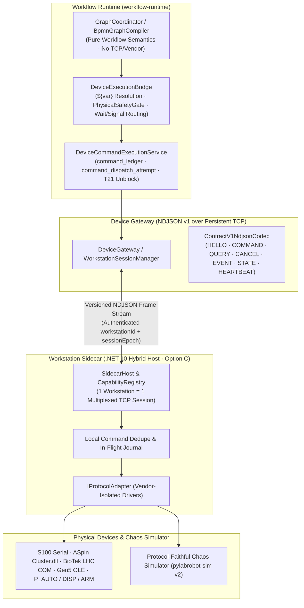
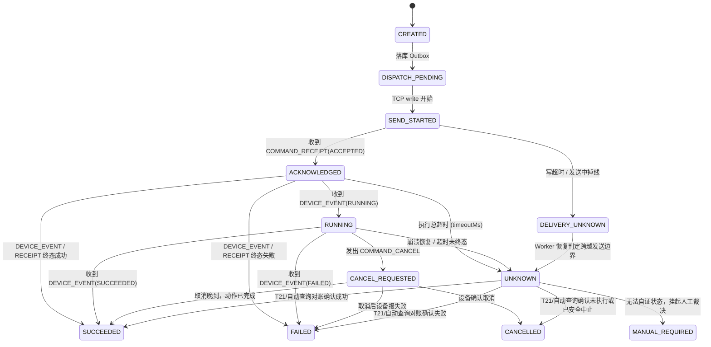

# LabOS Device Execution Contract v1.1（Freeze Candidate · 纯净新模型版）

> **状态**：`Freeze Candidate v1.1`（等待契约冻结确认后进入 Phase 3B 编码）  
> **基准代码**：`origin/main` @ `4b8e9d76`（PR #14 已合入，`main` 分支已同步，PostgreSQL 17 `labdb` 迁移账本 `001/003/004/005` 已对齐）  
> **三大已拍板前提（2026-11-21）**：
> 1. **Sidecar 部署架构选型 = 方案 C（Hybrid Workstation Sidecar，混合工位侧边代理）**：一台工控机运行一个 `.NET 10` Sidecar Host，向下托管该工位所有串口 / Vendor DLL / COM / OLE / 本地虚拟模拟器适配器，向上以单个物理连接多路复用的方式接入 Kernel `DeviceGateway`；无物理串口/COM 依赖的独立网络模拟设备亦可作为一个虚拟 Workstation Sidecar 接入同一契约。
> 2. **Kernel ↔ Sidecar 零历史兼容**：**不保留任何历史兼容层**。新 Runtime 体系内彻底移除 `#!LABSEP!#` 旧帧编码、Redis `labos:link:*` 在线状态权威、`/api/device-events` 无关停绕路，以及旧 `TcpDriverAdapter` / `TcpPersistentDriver` 模型；老内核与旧表仅静态封存，不侵入新运行时代码路径。
> 3. **新工艺从头构建，不做旧流程迁移**：不为历史 `1001017` / `1001041` 编写 `__awaitEvent` 翻译器或迁移脚本，直接在契约 v1.1 底座上新建标准化工艺 **`EXT-STD-SINGLE-V1`**（首发）与 **`EXT-STD-BATCH4-V1`**（第二批）。

---

## 1. 目标分层架构与清理边界

### 1.1 分层拓扑图



### 1.2 分层职责矩阵

| 层级 | 拥有（Owns） | 严禁（Must Never） |
| :--- | :--- | :--- |
| **Workflow Runtime** (`GraphCoordinator`, `WorkflowRunFactory`) | 流程拓扑、Token/Activation/Wait/Timer、并发栅栏、流程级 PAUSE/STOP | 感知 TCP 连接、`host:port`、串口号、Vendor DLL/COM 协议、物理坐标字符串 |
| **Device Execution Layer** (`DeviceExecutionBridge`, `PhysicalSafetyGate`, `DeviceCommandExecutionService`) | `${var}` 变量注入、`PhysicalSafetyGate` 安全门控、`device:<id>` 容量锁、`command_ledger` 状态机、自发事件→G5 Wait Inbox 路由与早到缓冲、T21 对账解冻 | 直接发送原始厂商报文；在未经持久化确认前自动重发非幂等命令；绕过 `inbox_receipt` 直接推进流程 |
| **Device Gateway** (`DeviceGateway`, `ContractV1NdjsonCodec`) | `workstationId` 长连接管理、心跳保活、帧编解码、会话纪元隔离、`COMMAND_QUERY`/`COMMAND_CANCEL`/`EVENT_ACK`/`EVENT_NACK` | 操作 `GraphCoordinator` / `WorkflowRuntimeRepository`；私自重发 `COMMAND_SEND`；在断线时自行伪造终端失败 |
| **Workstation Sidecar** (`Sidecar.Host`, `.NET 10`) | 托管工控机内多台本地设备驱动、`HELLO` 上报 `DeviceCapabilities`、本地防重缓存（按 `commandId`）、离线事件 Outbox 重传直至收到 `EVENT_ACK` | 推进 BPMN 状态；决定流程暂停/重试策略；在收到 `EVENT_ACK` 前丢弃关键设备完成事件 |
| **Protocol Adapter / Chaos Simulator** (`IProtocolAdapter`, `pylabrobot-sim`) | 将标准 `operation + structuredParams` 映射为设备二进制串口/XML-DLL/COM/TCP 帧，真实还原异步长耗时、状态机拒绝与异常注入 | 知道 `runId`、`activationId` 或任何 Workflow Runtime 语义 |

### 1.3 明确废弃与剥离清单（Zero Legacy Compat）

在新运行时与新 Sidecar 主线中执行彻底清理（不动老分支静态源码本身，只在构建新链路时完全脱离并标记清理）：

| 旧组件 / 旧机制 | 处理决策 | 说明 |
| :--- | :--- | :--- |
| `labos-kernel/sidecar-dotnet/`（旧 Protobuf 雏形） | **废弃归档** | 与当前 `.NET 10` `sidecar-dotnet/` 重复，不再维护 |
| `labos-gateway/`（独立 Redis 中转网关骨架） | **废弃归档** | 引入额外进程与 Redis 状态脑裂，由内置 `DeviceGateway` + Workstation Sidecar 替代 |
| `LabSepWireCodec.java` 与 `#!LABSEP!#` 协议 | **从新运行时移除** | `DeviceGateway` 新契约仅支持版本化 NDJSON v1，不再支持协议双轨兼容 |
| `sidecar-dotnet/Labos.Sidecar/RedisLinkState.cs`（Redis `labos:link:*` 权威） | **移除权威地位** | 设备在线、占用、隔离状态权威统一收敛至 Kernel PG `workstation_sidecar` + `device_state_projection` + `scheduler_capacity` + `quarantine_record` |
| Sidecar 直连旧接口 `POST /api/device-events` | **新运行时禁用** | 设备事件统一走长连接 `DEVICE_EVENT` → `DeviceGateway` → `RuntimeDeviceEventBridge`（强制带 `EVENT_ACK`/`EVENT_NACK` 闭环） |
| 旧驱动类 `TcpDriverAdapter`、`TcpPersistentDriver` | **不接入新引擎** | 由 `DeviceCommandExecutionService` + Contract v1.1 Gateway 彻底替代 |
| 协议适配文件 `S100SerialTransport.cs`、`AspinClusterTransport.cs`、`LhcRunnerTransport.cs`、`Gen5OleTransport.cs`、`SimBridgeTransport.cs` | **保留并下沉重构** | 厂商通信细节极有价值，全部重构封装进 Sidecar 内部 `IProtocolAdapter`，隐藏在契约之下 |
| 旧物理互锁类 `PositionLock`、`TransferPlan`、`RailZoneGuard`、`TurntableGuard`、`StirrerDispenserGuard`、`GrabScanGate`、`DeviceAccessManager` | **逻辑重构为 SPI** | 不直接复用旧线程/Redis 实现，而是将其业务规则重构为新引擎的纯 PG 事务化 `PhysicalSafetyGate` SPI |

---

## 2. 严格 5-ID 纪律（Identifier Discipline）

跨 Kernel ↔ Gateway ↔ Sidecar 全链路强制区分 5 个互不混用的标识：

| 标识 | 生成方 | 粒度与生命周期 | 不可变性 / 语义约束 |
| :--- | :--- | :--- | :--- |
| `commandId` (UUID) | Kernel (`command_ledger`) | 一条逻辑物理动作（对应一次 `node_attempt`） | **跨重连、跨崩溃恒定**；Sidecar 本地去重表的主键 |
| `idempotencyKey` (String) | Kernel（确定性派生：`runId:activationId:attemptNo:commandKind`） | 逻辑幂等身份，用于 Sidecar 与设备侧识别重复请求 | 与 `commandId` 1:1 绑定持久化落库，绝不随重连改变 |
| `dispatchId` (UUID) | Kernel (`command_dispatch_attempt`) | 单次网络投递/恢复查询尝试 | `SEND` 与后续 `COMMAND_QUERY` 可携带各自新的 `dispatchId` 以便链路排障追踪 |
| `sourceMessageId` (String) | Sidecar / 设备事件源 | 单条上行状态或自发事件帧的唯一消息 ID | 由 Sidecar 在本地持久 Outbox 生成并保持不变直至收到 `EVENT_ACK`，驱动 `inbox_receipt(tenant_id, source, source_message_id)` 精确去重 |
| `deviceSequence` (String) | Sidecar / 物理设备 | 设备侧单调执行序号或任务句柄（如设备内部 `jobId`/`seq`） | 随 `COMMAND_RECEIPT` / `DEVICE_EVENT` / `COMMAND_QUERY_RESULT` 返回，作为设备已真实接单的不可抵赖证据写入 `command_ledger.device_sequence` |

---

## 3. 核心契约对象（8 Core Contract Objects）

### 3.1 `DeviceDescriptor` & `DeviceCapabilities`
Sidecar 启动建立会话或设备热插拔变化时，通过 `HELLO` 帧向 Kernel 声明其托管的每台设备身份与能力元数据（替代当前 `GatewayDeviceTaskBridge.java:187` 硬编码 `"QUERYABLE"` 与全局固定 `commandTimeout`）：

```json
{
  "workstationId": "ws-extract-island-01",
  "sidecarVersion": "1.1.0",
  "devices": [
    {
      "descriptor": {
        "deviceId": "EXTRACTOR-01",
        "deviceModel": "P_AUTO",
        "vendor": "LabPartner",
        "transportKind": "TCP_ADAPTER",
        "adapterVersion": "2.0.0"
      },
      "capabilities": {
        "maxConcurrentCommands": 1,
        "supportsQuery": true,
        "supportsCancel": true,
        "supportsSpontaneousEvents": true,
        "heartbeatIntervalMs": 3000,
        "operations": {
          "Bind": {
            "idempotencyClass": "NON_IDEMPOTENT",
            "defaultTimeoutMs": 600000,
            "interruptible": false,
            "emitsWaitingEvents": ["waiting_interaction"]
          },
          "Elute": {
            "idempotencyClass": "NON_IDEMPOTENT",
            "defaultTimeoutMs": 750000,
            "interruptible": false,
            "emitsWaitingEvents": ["waiting_interaction"]
          },
          "GetStatus": {
            "idempotencyClass": "QUERYABLE",
            "defaultTimeoutMs": 5000,
            "interruptible": true,
            "emitsWaitingEvents": []
          }
        }
      }
    }
  ]
}
```

> **规则**：当某操作未在 `DeviceCapabilities.operations` 显式声明时，Kernel Fail-Closed 拒绝派发（禁止猜测默认超时与默认幂等性）；`idempotencyClass` 仅允许 `IDEMPOTENT`、`QUERYABLE`、`NON_IDEMPOTENT`。

### 3.2 `DeviceCommand`
Kernel 在写入 `command_ledger` **之前** 完成 `${var}` 参数解析（结合 `workflow_run.input` 与 `flow_variable`），确保落库 `command_payload` 与网络发送载荷 100% 确定性一致，绝不在 Gateway/Sidecar 做模板解析。

核心字段：`commandId`, `idempotencyKey`, `dispatchId`, `runId`, `attemptId`, `workstationId`, `deviceId`, `operation`, `idempotencyClass`, `timeoutMs`, `interruptible`, `params` (resolved JSON object)。

### 3.3 `CommandReceipt`
Sidecar 收到 `COMMAND_SEND` 后的立即结构化回执（同步边界确认，区别于长耗时的动作完成事件）：
- `receiptStatus`: `ACCEPTED`（已投递进设备队列/开始执行） | `COMPLETED_IMMEDIATELY`（短同步命令如 `GetVersion`/`MoveTray` 已当场终态完成） | `FAILED_IMMEDIATELY`（参数非法、物理拒收或未达副作用边界的确定失败） | `DUPLICATE_IN_FLIGHT`（Sidecar 重连后检测到该 `commandId` 仍在执行中）。
- 包含 `commandId`, `dispatchId`, `deviceId`, `receiptStatus`, `deviceSequence`, `acceptedAtEpochMs`, `outcome`（仅立即终态时填充）。

### 3.4 `CommandExecution` 状态机（与 PG `command_ledger.command_state` 对齐）



### 3.5 `DeviceEvent`
涵盖两类上行事件：
1. **命令关联事件**（`eventScope = "COMMAND"`）：携带 `commandId`，对应 `COMMAND_PROGRESS`、`COMMAND_COMPLETED`、`COMMAND_FAILED`、`COMMAND_CANCELLED`，必须映射到 `command_ledger` 目标态。
2. **设备自发事件**（`eventScope = "SPONTANEOUS"`）：设备主动上浮（例如提取仪到达开盖交互点上报 `eventName = "waiting_interaction"`，无需携带 `commandId`），携带 `deviceId`、`eventName`（如 `waiting_interaction` / `door_opened` / `consumable_empty`）、`correlationHint`、`payload`。Kernel 根据当前租户和运行中激活 `device:<id>` 归属 Run 将其路由至 **G5 Wait Inbox + 早到信号缓冲**。

### 3.6 `DeviceState` & `ReconciliationResult`
- **`DeviceState`**：由 Sidecar 周期或状态变更时上报的结构化设备运行投影（`ONLINE_IDLE` | `BUSY` | `WAITING_INTERACTION` | `FAULTED` | `OFFLINE`、`activeCommandId`、`deviceSequence`、`faultCode`、`observedAtEpochMs`），写入 Kernel `device_state_projection` 供监控与派发前校验（不直接替代 `scheduler_capacity`）。
- **`ReconciliationResult`（按 `idempotencyClass` 严格分流）**：
  - `QUERYABLE`：崩溃/断线重连或 `UNKNOWN` 恢复时，允许自动向 Sidecar 下发 `COMMAND_QUERY(commandId, idempotencyKey)`：
    - 返回 `CONFIRMED_SUCCEEDED` / `CONFIRMED_FAILED` / `CONFIRMED_CANCELLED` → **自动结算并推进 Run**；
    - 返回 `CONFIRMED_NOT_EXECUTED`（Sidecar 与设备均无该 `commandId`/`deviceSequence` 记录）→ 仅安全中止当前 Attempt，重新入队新 Attempt 调度；
    - 返回 `STILL_RUNNING` → 保持挂接继续等待完成事件。
  - `IDEMPOTENT`（且未确认状态）：允许策略受控重发或先查后重发，**绝不可与 `NON_IDEMPOTENT` 混淆**。
  - `NON_IDEMPOTENT`（未返回 `CONFIRMED_*` 或 Sidecar 无确定结果时）：**严禁自动重发**，必须返回 `INDETERMINATE` 并进入 `UNKNOWN → MANUAL_REQUIRED` 等待 T21 人工核实。

---

## 4. 版本化 NDJSON 长连接线协议（Wire Protocol v1.1）

固定编码：**UTF-8 单行 JSON (`\n` 分隔，NDJSON)**；所有帧必须包含顶层 `"protocolVersion": "1.1"`、`"frameType"`、`"sentAtEpochMs"`；**严禁同一 TCP 会话上出现任何 `#!LABSEP!#` 帧或裸文本帧**（收到非法协议帧直接返回 `EVENT_NACK` / 记录协议违规并断开重建会话）。

| `frameType` | 方向 | 关键字段 | 语义与幂等 / 确认规则 |
| :--- | :--- | :--- | :--- |
| `HELLO` | Sidecar → Gateway | `workstationId`, `sessionId`, `sidecarVersion`, `devices[]` | TCP 建连后首帧握手，注册工位身份与 `DeviceCapabilities` |
| `HELLO_ACK` | Gateway → Sidecar | `workstationId`, `sessionEpoch`, `acceptedDevices[]`, `rejectedReason?` | Kernel 分配单调递增 `sessionEpoch` 鉴权通过；未完成握手前拒绝一切业务帧 |
| `HEARTBEAT_PING` | Gateway → Sidecar | `workstationId`, `pingId`, `sessionEpoch` | 传输层存活性探测，绝不触发命令状态转换 |
| `HEARTBEAT_PONG` | Sidecar → Gateway | `workstationId`, `pingId`, `sessionEpoch`, `deviceEpochMs` | 必须匹配当前 `sessionEpoch` 与活跃 `pingId` |
| `COMMAND_SEND` | Gateway → Sidecar | `commandId`, `idempotencyKey`, `dispatchId`, `runId`, `attemptId`, `deviceId`, `operation`, `idempotencyClass`, `timeoutMs`, `interruptible`, `params` | 单次 Attempt 派发；Sidecar 本地按 `commandId` 严格去重，**Gateway 重连时绝不自动重放** |
| `COMMAND_RECEIPT` | Sidecar → Gateway | `commandId`, `dispatchId`, `deviceId`, `receiptStatus`, `deviceSequence?`, `outcome?` | 建连队列确认/立即结果回执；将 `command_ledger` 推进至 `ACKNOWLEDGED` 或立即终态 |
| `COMMAND_QUERY` | Gateway → Sidecar | `commandId`, `idempotencyKey`, `dispatchId`, `deviceId`, `deviceSequence?` | 对 `UNKNOWN` / `DELIVERY_UNKNOWN` 命令发起只读状态对账，**无任何物理副作用** |
| `COMMAND_QUERY_RESULT` | Sidecar → Gateway | `commandId`, `dispatchId`, `deviceId`, `reconciliationStatus`, `deviceSequence?`, `outcome?` | 返回 `CONFIRMED_*` / `STILL_RUNNING` / `CONFIRMED_NOT_EXECUTED` / `INDETERMINATE` |
| `COMMAND_CANCEL` | Gateway → Sidecar | `commandId`, `dispatchId`, `deviceId`, `reason` | 仅当 `interruptible=true` 时允许发送；Sidecar 返回终态事件，不保证物理动作必然回滚 |
| `DEVICE_EVENT` | Sidecar → Gateway | `sourceMessageId`, `eventScope`, `deviceId`, `eventName`, `commandId?`, `runId?`, `targetState?`, `deviceSequence?`, `payload` | Sidecar 持久 Outbox 投递；Gateway **仅使用经握手绑定的 `workstationId`+`deviceId` 权限归属**，防止 payload 伪造设备身份 |
| `EVENT_ACK` | Gateway → Sidecar | `sourceMessageId`, `status` (`APPLIED`\|`DUPLICATE`\|`BUFFERED`) | 仅在 PG 事务落库（`inbox_receipt` 或 `wait_early_signal_buffer`）成功提交后返回，Sidecar 收到才可核销本地 Outbox |
| `EVENT_NACK` | Gateway → Sidecar | `sourceMessageId`, `retryable`, `reason` | DB 瞬时抖动返回 `retryable=true`（Sidecar 退避重传）；协议错/越权返回 `retryable=false`（Sidecar 转死信告警） |
| `DEVICE_STATE` | Sidecar → Gateway | `deviceId`, `state`, `activeCommandId?`, `deviceSequence?`, `faultCode?`, `detail` | 更新 Kernel `device_state_projection`，供调度可见性与心跳状态聚合 |

---

## 5. Kernel 数据库与核心闭环改造规范（对应 Migration `006` 与 Phase 3B）

### 5.1 数据库迁移 `db/workflow_runtime/006_device_execution_contract_v1.sql`
遵循第 3 阶段已建立的 `schema_migration` 版本账本机制推进（需通过 `002_schema_contract.sql` 校验）：

1. **扩展 `workflow_runtime.command_ledger`**：
   - 新增列：`workstation_id text`、`idempotency_key text`、`operation_name text`、`timeout_ms integer NOT NULL DEFAULT 300000 CHECK (timeout_ms > 0)`、`interruptible boolean NOT NULL DEFAULT false`、`last_receipt_at timestamptz`、`reconciliation_evidence jsonb NOT NULL DEFAULT '{}'::jsonb`。
   - 唯一约束：`UNIQUE (tenant_id, idempotency_key)`（`WHERE idempotency_key IS NOT NULL`）。
2. **新增 `workflow_runtime.workstation_sidecar`**（替代 Redis `labos:link:*` 在线权威）：
   - 字段：`tenant_id`, `workstation_id`, `session_epoch bigint`, `connection_state ('ONLINE'|'DEGRADED'|'OFFLINE')`, `capabilities jsonb`, `last_heartbeat_at timestamptz`, `updated_at timestamptz`, `PRIMARY KEY (tenant_id, workstation_id)`。
3. **新增 `workflow_runtime.device_state_projection`**：
   - 字段：`tenant_id`, `device_id`, `workstation_id`, `device_model`, `device_state`, `active_command_id`, `fault_code`, `capabilities jsonb`, `last_heartbeat_at timestamptz`, `updated_at timestamptz`, `PRIMARY KEY (tenant_id, device_id)`。
4. **新增 `workflow_runtime.wait_early_signal_buffer`**（解决设备自发 `waiting_interaction` 早到竞态）：
   - 字段：`tenant_id`, `buffer_id`, `run_id`, `correlation_key`, `source`, `source_message_id`, `payload_hash`, `payload jsonb`, `buffer_state ('BUFFERED'|'CONSUMED'|'EXPIRED')`, `expires_at timestamptz`, `created_at timestamptz`, `consumed_wait_id uuid`。
   - 索引：部分唯一索引 `(tenant_id, source, source_message_id)` 与待消费索引 `(tenant_id, run_id, correlation_key) WHERE buffer_state = 'BUFFERED'`。
   - **机制**：当自发设备事件被路由到 Run 时，若对应 `wait_registration(ACTIVE, correlation_key)` 尚未注册但 Run 处于非终态且匹配预期窗口，事件进入 `wait_early_signal_buffer`（返回 `EVENT_ACK(status=BUFFERED)`，而非抛 `409`）；当 `GraphCoordinator` 注册该 `WAIT` 节点时，同一事务内扫描并消费未过期的缓冲信号，立即满足 Wait。

### 5.2 T21 `resolveUnknownCommand` 解冻闭环事务（解决当前卡死缺陷）

当前 `WorkflowRuntimeRepository.resolveUnknownCommand`（lines `1700-1748`）仅更新了 `command_ledger`、写了 `worker_execution_fact` 与 `runtime_audit`，**遗漏了 `node_attempt` 结算、容量释放、`manual_intervention` 关闭与 `workflow_run` 恢复**，导致 Run 永远卡死在 `MANUAL_REQUIRED` / `CLOSED`。

Phase 3B 必须新增/重构 **`reconcileAndSettleUnknownCommand`** 单一原子事务（严格遵循单 Run 锁序：`Run → Token → Activation → Attempt → Command`）：
1. 校验与更新 `command_ledger`（`UNKNOWN | DELIVERY_UNKNOWN` → `SUCCEEDED | FAILED | CANCELLED | MANUAL_REQUIRED`），写入 `device_sequence` 与对账证据；
2. 同步结算 `node_attempt`：`UNKNOWN` → 对应终态（`SUCCEEDED` / `FAILED` / `CANCELLED`），写入 `result` / `error` / `finished_at`；
3. 若 RESOLVED 为终态，释放对应 `dispatch_reservation`（`HELD → RELEASED`）并原子递减 `scheduler_capacity.reserved_count`；
4. 若 Resolved 为 `SUCCEEDED`，同步完成 `node_activation` 与推回对应 `execution_token` 到 `READY`（或生成待评估推进状态）；若为 `FAILED`/`CANCELLED`，交由标准 `GraphCoordinator` 失败/重试边界；
5. 自动将挂钩于该 `attempt_id` 的 `manual_intervention(OPEN)` 置为 `DECIDED`（记录仲裁证据与操作人）；
6. 检查该 Run 是否仍有其他未决 `OPEN` 干预或阻塞 `UNKNOWN` Attempt；若无，则将 `workflow_run` 从 `status='MANUAL_REQUIRED', control_gate='CLOSED', recovery_state='BLOCKED'` 原子恢复为 `status='RUNNING', control_gate='OPEN', recovery_state='RECOVERY_COMPLETED'`；
7. 提交后（或 via Outbox）唤醒 `RunCoordinatorRegistry` / `GraphCoordinator` 推进引擎继续向下游流转，并追加 `runtime_audit` + `runtime_event`。

同时补强 **`WorkerExecutionRecoveryService` 启动恢复**：
- 在 Host 启动完成 `DeviceGateway` 握手、执行 `recoverAtStartup` 时，对扫描到 `UNKNOWN` 且 `idempotency_class IN ('QUERYABLE', 'IDEMPOTENT')` 且关联 `DeviceCapabilities.supportsQuery=true` 的命令，通过 `COMMAND_QUERY` 触发一次自动对账；若确认 `CONFIRMED_SUCCEEDED` / `CONFIRMED_FAILED`，直接调用 `reconcileAndSettleUnknownCommand` 自愈恢复，不阻塞整条产线进入人工冻结；仅对 `NON_IDEMPOTENT` 且无法自证的命令转入 `MANUAL_REQUIRED`。

### 5.3 并行分支内 Wait 超时语义（`WaitSpec.deadlinePolicy`）

当前 `BpmnGraphCompiler.java:566-570` 与 `GraphCoordinator.java:551-557` 禁止并行/包容网关内部出现 `MESSAGE_WITH_TIMEOUT`（防拓扑逃逸破坏 Join）。但标准高通量提取工艺 `EXT-STD-BATCH4-V1` 需要在 4 路并行内等待提取仪自发 `waiting_interaction` 且设置安全超时告警。
- 在 `GraphPlan.WaitSpec` 中新增 **`deadlinePolicy`**：
  - `ROUTE_TIMEOUT_EDGE`（默认，对应传统 `MESSAGE_WITH_TIMEOUT`，仅允许在非并行区使用显式 TIMEOUT 连线）；
  - `ESCALATE_MANUAL`（允许在 `SPLIT_PARALLEL` / `SPLIT_INCLUSIVE` 并行域内的 `MESSAGE` Wait 使用：不引出任何超时出边，超时触发时触发 Wait 过期并打开 `manual_intervention` / 暂停分支，保持并行拓扑封闭完整，Join 数学不变式 100% 成立）；
  - `FAIL_RUN`（并行域内关键 Wait 超时直接安全失败收敛）。

### 5.4 `${var}` 变量解析与 `PhysicalSafetyGate` SPI

1. **`${var}` 解析**：在 `DeviceExecutionBridge` 下发 `createDeviceCommand` 前，确定性读取 `workflow_run.input` 与 `flow_variable`，完成 `methodParams` 中 `${plateSample}` 等占位符替换与类型校验后再写入 `command_ledger.command_payload`。
2. **`PhysicalSafetyGate` SPI**：将旧内核中的物理互锁规则（`PositionLock`、`TransferPlan`、`RailZoneGuard`、`TurntableGuard`、`StirrerDispenserGuard`、`GrabScanGate`、`DeviceAccessManager`）提炼为统一接口，全部在 PostgreSQL 行锁/租约事务内裁决搬运前置条件与门控，彻底隔离旧单机并发态。

---

## 6. Phase 3B–3F 分阶段交付路线图与验收口径（DoD）

| 阶段 | 范围与核心交付 | 验收标准（Definition of Done） |
| :--- | :--- | :--- |
| **Phase 3B** | **Kernel 底座闭环**<br/>- 迁移 `006_device_execution_contract_v1.sql`<br/>- Contract v1.1 `ContractV1NdjsonCodec` & `DeviceGateway` 升级（剥离 `LabSep`）<br/>- `WaitSpec.deadlinePolicy` + `${var}` 解析<br/>- 自发事件→G5 Wait Inbox 路由桥 & `wait_early_signal_buffer`<br/>- `reconcileAndSettleUnknownCommand`（T21 解冻）& `PhysicalSafetyGate` SPI 框架 | 新增/全量 `workflow-runtime` PG17 单测与集成测全绿；模拟 `waiting_interaction` 早到 100ms 与晚到均可稳定唤醒 Wait；模拟 `UNKNOWN` 经 T21 / `COMMAND_QUERY` 解冻后 Run 正常跑到 `SUCCEEDED` 并释放 `scheduler_capacity` |
| **Phase 3C** | **Workstation Sidecar v1 (.NET 10 Option C)**<br/>- 新建清洁 Sidecar Host + 多路复用 TCP 会话<br/>- 本地 `commandId` 防重日志 & 持久事件 Outbox（等 `EVENT_ACK` 方可核销）<br/>- 将 `S100`/`Aspin`/`Lhc`/`Gen5`/`SimBridge` 下沉封装至 `IProtocolAdapter`<br/>- 实现 `COMMAND_QUERY` & `COMMAND_CANCEL` | 无 `#!LABSEP!#`、无 Redis `labos:link:*`、无 `/api/device-events`；Sidecar 重连后重复发送同 `commandId` 返回 `DUPLICATE_IN_FLIGHT`/幂等结果而不重复触发物理动作；Gateway 断网时设备完成事件不丢 |
| **Phase 3D** | **Chaos Simulator v2（协议忠实混沌模拟器）**<br/>- 升级 `pylabrobot-sim` 支持 Contract v1.1 NDJSON 与故障注入清单<br/>- 注入场景：`DROP_ACK`、`DELAY_COMPLETE`、`TIMEOUT_UNKNOWN`、`DISCONNECT_MID_RUN`、`EARLY_WAITING_EVENT`、`DUPLICATE_COMMAND` | Kernel + Sidecar + Chaos Simulator 三段闭环自动化混沌压测全绿；零重复物理执行、零卡死 Run |
| **Phase 3E** | **Greenfield 标准提取工艺构建与实证**<br/>- 建表/配置创建首发工艺 **`EXT-STD-SINGLE-V1`**（单板 12 步标准模型）<br/>- 实现完整 `PhysicalSafetyGate` 搬运/扫码/站位/搅拌器规则<br/>- 独立演练环境全工序跑通（含 `waiting_interaction`、`SIGKILL` 恢复、断连恢复） | `EXT-STD-SINGLE-V1` 在常驻混沌模拟环境连续跑通 N 轮（Normal + Wait + Fault + Crash Recovery） |
| **Phase 3F** | **高通量并行工艺 & RuntimeHost 灰度启用评审**<br/>- 构建 **`EXT-STD-BATCH4-V1`**（4 台 `P_AUTO` 并行 + `ARM1`/`DISP` 物理竞争 + `deadlinePolicy=ESCALATE_MANUAL`）<br/>- 长稳压测与监控面板接入；经单独审批后方可将生产测试主机 `host.enabled` 由 `false` 切为按岛灰度开启 | 4 路并行零死锁、零物理冲突告警、`kill -9` 多并发故障后 100% 一致收敛 |
