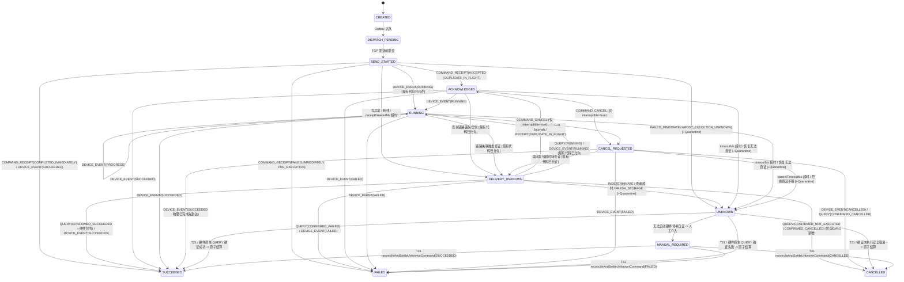

# DEVICE_EXECUTION_CORE_CONTRACT — 设备执行核心与物理安全契约（AI-1 主责 · Draft v1.7）

> **所属总纲**：[PHASE3B_MASTER_CONTRACT.md](./PHASE3B_MASTER_CONTRACT.md)  
> **通信与 Wire 对侧契约**：[DEVICE_GATEWAY_PROTOCOL.md](./DEVICE_GATEWAY_PROTOCOL.md)  
> **目标数据库迁移**：[006_device_execution_contract_v1.draft.sql](./ddl/006_device_execution_contract_v1.draft.sql)

---

## 1. 精简后的 4-ID 纪律与结构化执行证据模型（P0-3）

对照 [001_init.sql:442-443](../db/workflow_runtime/001_init.sql#L442-L443)，既有表 `workflow_runtime.command_ledger` 已经通过 `UNIQUE (tenant_id, attempt_id)` 保证 **1 个 `node_attempt` 最多对应 1 条命令**，并通过 `payload_hash` 检查载荷冲突。在零历史兼容契约下，**`workflow_runtime.command_ledger` 仅承载 Contract v1.x 的物理设备命令**（不存在任何非设备账本记录类型，也不为历史/mock 数据保留 `workstation_id` 可空豁免；旧 `labos-kernel` 隔离保留在 `public.command_ledger`）。

经核对，原草案引入的「Run+AttemptNo 拼接键」与 `UNIQUE(attempt_id)` 重叠、随重试变化且极易与既有 `idempotency_class` 列混用。**本版正式取消冗余键，统一收敛为严格 4-ID 纪律**：

| 标识 | 生成方 | 粒度与持久化位置 | 真实工程角色（不夸大担保边界） |
| :--- | :--- | :--- | :--- |
| **`commandId`** (`UUID`) | Kernel | 一条逻辑物理动作（`command_ledger` 主键；与 `attempt_id` 1:1 绑定） | **全链路唯一且跨重连、重启恒定的逻辑命令与 Sidecar 防重主键**。只要同一个 `attempt_id` 被重入创建，必须返回原 `commandId`；一次重跑新建 `node_attempt` 则获得新 `commandId`（旧尝试必须先安全结束或确认未执行）。 |
| **`dispatchId`** (`UUID`) | Kernel | 单次线协议发送/查询/取消尝试（`command_dispatch_attempt` 主键） | 新增 `dispatch_kind`（`SEND` \| `QUERY` \| `CANCEL`）。区分同一次命令的不同网络动作尝试；**绝对不作防重键**。 |
| **`sourceMessageId`** (`text`) | Sidecar 持久 Outbox | 一条上行设备事件帧（`inbox_receipt` 唯一键 `(tenant_id, source, source_message_id)`） | Sidecar 生成并落盘保持，直到 Kernel PG 提交后回传 `EVENT_ACK` 方可核销。 |
| **`deviceSequence`** (`text`) | Sidecar / 硬件设备 | 设备任务句柄 / 流水关联标识（`command_ledger.device_sequence`） | **仅为关联标识（correlation handle），本身不是"不可伪造的成功证明"**；除非配合经核实的硬件原生证据载荷，否则不能凭一个序号字段单独判定设备已完成物理动作。 |

> **与 `idempotency_class` 的分工**：`idempotency_class`（既有列：`IDEMPOTENT` \| `QUERYABLE` \| `NON_IDEMPOTENT`）仅由设备操作能力元数据 `DeviceCapabilities` 赋值（不再像 [GatewayDeviceTaskBridge.java:187](../workflow-runtime/src/main/java/com/labos/kernel/workflow/runtime/bridge/GatewayDeviceTaskBridge.java#L187) 那样硬编码为 `"QUERYABLE"`），配合 `ReconciliationPolicy` 共同裁决恢复边界；防重完全交由 `commandId` + Sidecar WAL Journal 承担。

### 1.1 结构化执行证据模型（`ExecutionEvidence`，解决 P0-3）
命令终态与对账裁决不再依赖裸 `deviceSequence` 字符串，所有 `COMMAND_QUERY_RESULT` 与终态事件必须映射为四元组 `ExecutionEvidence` 并完整落库 `command_ledger.reconciliation_evidence`（/ `inbox_receipt.message_payload`）供事后审计：
- `deviceSequence`（关联句柄，可空）；
- `evidenceSource`：`HARDWARE_NATIVE_QUERY` \| `PRIOR_HARDWARE_COMPLETION_IN_JOURNAL` \| `PRE_SEND_ABORT_IN_JOURNAL` \| `OPERATOR_PHYSICAL_INSPECTION` \| `AMBIGUOUS`；
- `evidenceStrength`（决定状态迁移合法性）：
  - `STRONG_HARDWARE_FACT`：实时硬件终态/原生接口直读或已落盘完整的硬件原始响应；
  - `STRONG_PRE_SEND_ABORT`：Sidecar 确认在调 `IProtocolAdapter` 物理发包前即被拒绝或安全中止；
  - `STRONG_OPERATOR_ATTESTED`：T21 人工现场核验后提交的非空实体证词与检查记录；
  - `WEAK_UNVERIFIED`：仅有本地 `ACCEPTED_PENDING_SEND`/`DISPATCHED` 记录、或无硬件背书的推断；
- `evidencePayload`（JSON 对象，保存原始硬件应答报文、寄存器快照或操作员核验记录）。

---

## 2. 独立审查后的 12 态 Command 状态机（含现状差异表与 `ReconciliationPolicy`）

### 2.1 状态集合、存在必要性与 `ABANDONED_SAFE` 明确边界（P1-2）
保留 `001_init.sql:431-433` CHECK 约束中的全部 12 个命令状态（不增设第 13 态 `ABANDONED_SAFE`）：

| 状态 | 阶段归属 | 不可合并的独立必要性 |
| :--- | :--- | :--- |
| `CREATED` / `DISPATCH_PENDING` | 派发准备（可安全丢弃） | 事务落库与 Outbox 排队的双态分离；**`ABANDONED_SAFE` 澄清（P1-2）**：若崩溃发生在 `SEND_STARTED` 提交之前，按 [001_init.sql:124-125](../db/workflow_runtime/001_init.sql#L124-L125) 与 [WorkflowRuntimeRepository.java:5361-5386](../workflow-runtime/src/main/java/com/labos/kernel/workflow/runtime/persistence/WorkflowRuntimeRepository.java#L5361-L5386) 既有模型：`command_ledger.command_state` 置为 **`CANCELLED`**、`node_attempt.attempt_state` 置为 **`ABANDONED_SAFE`**、`node_activation.activation_state` 置为 **`ABANDONED_SAFE`**、`execution_token.token_state` 回退为 **`READY`** 以便安全重派，绝不往 `command_ledger` 新增第 13 个状态值。 |
| `SEND_STARTED` | 网络边界跨越态 | **分水岭**：一经提交即视为 TCP 发送已开始，后续崩溃不可盲目假设"绝对没发出去"。 |
| `DELIVERY_UNKNOWN` | **传输层未决态（可有限自动查证）** | 专门表达「TCP 写故障 / 断线 / `receiptTimeout` 超时，连 Sidecar 到底收没收到回执都不知道」。此时允许先按 `ReconciliationPolicy` 发起受控只读查证。 |
| `ACKNOWLEDGED` | Sidecar 已接单队列态 | 明确区分「Sidecar WAL 已接单入队 (`COMMAND_RECEIPT(ACCEPTED)`)」与「物理动作已完成」。**严禁把 `ACKNOWLEDGED` 当作成功**。 |
| `RUNNING` | 设备执行进行中 | 接收设备真实异步进度与启动运行事件后的状态，可响应支持中断操作的 `COMMAND_CANCEL`。 |
| `CANCEL_REQUESTED` | 取消指令竞争态 | 仅针对 `interruptible=true` 动作发起取消后等待设备最终裁决（取消 vs 晚到完成）的过渡态。 |
| `UNKNOWN` | **物理副作用未明态（必须隔离）** | 与 `DELIVERY_UNKNOWN` 的本质区别：已确认超出自动查证边界或硬件无自证证据（运行超时、硬件无查询接口崩溃、`FRESH_STORAGE`、`POST_EXECUTION_UNKNOWN`），**必须自动触发 `quarantine_record` 锁住风险资源**。 |
| `MANUAL_REQUIRED` | 人工裁决冻结态 | 明确停机等待现场操作员核验输入证据并通过 **T21** 裁决的状态；与 `UNKNOWN` 分离以区分「等待自动化最后确认」和「已冻结推给人类」。 |
| `SUCCEEDED` / `FAILED` / `CANCELLED` | 终态 | 不可逆物理结果终点（`SUCCEEDED` 强制要求强硬件/人工事实证据）。 |

### 2.2 既有代码转移矩阵 vs 目标状态机对照表（B1 修复）

对照 [WorkflowRuntimeRepository.java:4428-4435](../workflow-runtime/src/main/java/com/labos/kernel/workflow/runtime/persistence/WorkflowRuntimeRepository.java#L4428-L4435) 现行实现，明确标识本次必须同步升级的转移规则与新增边界：

| 差异点 | 现行代码（`WorkflowRuntimeRepository:4428-4435`） | Draft v1.7 明确约定 | 责任方 |
| :--- | :--- | :--- | :--- |
| `CANCEL_REQUESTED → DELIVERY_UNKNOWN` | 已允许 | **保留**（取消指令断连超时时可先转 `DELIVERY_UNKNOWN` 发起只读查证） | 阶段 0 / AI-1 对齐 |
| `DELIVERY_UNKNOWN → RUNNING` | 已允许 | **保留**（恢复时若设备回报运行中，无缝接续 `RUNNING`） | 阶段 0 / AI-1 对齐 |
| `SEND_STARTED → RUNNING` | 已允许 | **保留**（若设备跳过进度直接上报 `RUNNING` 事件不拒收） | 阶段 0 / AI-1 对齐 |
| `DELIVERY_UNKNOWN → CANCELLED` | **当前缺失** | **明确新增**：仅当 `COMMAND_QUERY_RESULT` 给出 `CONFIRMED_NOT_EXECUTED`（配合 `STRONG_PRE_SEND_ABORT` / `STRONG_HARDWARE_FACT`）或 `CONFIRMED_CANCELLED` 时合法 | AI-1 定点修改（阶段 0 测试覆盖） |

### 2.3 六项强制转移规则、`ReconciliationPolicy`（P0-4）与终态结算矩阵
1. **`FAILED_IMMEDIATELY` 边界区分**：回执必须带 `failureBoundary`：`PRE_EXECUTION` → `SEND_STARTED → FAILED`（仅当确定未触碰硬件时允许免隔离释放租约）；`POST_EXECUTION_UNKNOWN` 或缺失/非法边界 → **拒绝判为普通失败**，强制进入 `UNKNOWN` 并打开隔离。
2. **`DUPLICATE_IN_FLIGHT` 语义**：证明 Sidecar 本地 Journal 存在该 `commandId` 正在执行的原始任务，回执**必须回传原 `deviceSequence` 与 `acceptedAtEpochMs`**；Kernel 保持或迁入 `ACKNOWLEDGED`（若原已在 `RUNNING` 则维持 `RUNNING`），严禁触发二次派发。
3. **`ACKNOWLEDGED != COMPLETED`**：`COMMAND_RECEIPT(ACCEPTED)` 只能更新 `last_receipt_at` 与 `ACKNOWLEDGED`，绝对不能推进 `node_attempt`。
4. **物理完成证据双通道底线与防伪边界（P0-3 / T21 闭环一致）**：`SUCCEEDED` 迁移在代码层面严格按两条互斥通道分别校验 `ExecutionEvidence`：
   - **通道 A（自动线协议入站路径：`DEVICE_EVENT` / `COMMAND_RECEIPT(COMPLETED_IMMEDIATELY)` / `COMMAND_QUERY_RESULT`）**：**必须**同时满足 `evidenceStrength == STRONG_HARDWARE_FACT`、`evidenceSource IN ('HARDWARE_NATIVE_QUERY', 'PRIOR_HARDWARE_COMPLETION_IN_JOURNAL')` 且附非空原始 `evidencePayload`；若线协议入站违规出现 `OPERATOR_PHYSICAL_INSPECTION` 或 `STRONG_OPERATOR_ATTESTED`，Gateway/Core 必须当场永久拒收（**`ERR_WIRE_FORBIDDEN_EVIDENCE_SOURCE`**），杜绝设备端伪造人工证明；任何仅凭本地 WAL 或 `WEAK_UNVERIFIED` 一律结构性拒收并转 `UNKNOWN`。
   - **通道 B（RBAC 授权 T21 人工裁决入口：`reconcileAndSettleUnknownCommand`，`UNKNOWN / MANUAL_REQUIRED → SUCCEEDED`）**：**仅当**通过受鉴权的 T21 人工裁决接口提交时，允许使用 **`evidenceStrength == STRONG_OPERATOR_ATTESTED`** 且仅配对 **`evidenceSource == OPERATOR_PHYSICAL_INSPECTION`**，同时强校验非空操作人 `actor`、核验时间、非空现场实体检查记录 `evidencePayload` 以及显式 `quarantineAction`——绝不把人工门槛退化为设备自动成功门槛。
5. **`DELIVERY_UNKNOWN` 自动对账策略与 5 条硬边界（`ReconciliationPolicy`，解决 P0-4）**：
   每条命令能力声明必须携带显式对账策略 `ReconciliationPolicy(autoQueryAllowed, maxQueryAttempts, queryIntervalMs, maxReconcileWindowMs, requiredSuccessStrength, onExhaustedAction)`：
   - **① 只读禁令**：`COMMAND_QUERY` 在任何适配器下均**严格只读**，绝不向物理设备重发原动作报文，更不允许通过重发非幂等命令来“试探状态”；
   - **② 禁凭发起推完成**：Sidecar Journal 处于 `DISPATCHED_TO_DEVICE` / `ACCEPTED_PENDING_SEND` 时**严禁**返回 `CONFIRMED_SUCCEEDED`（必须返回 `INDETERMINATE` + `AMBIGUOUS`）；
   - **③ 禁凭查不到推未执行**：当 `HELLO_ACK.storageState != 'PERSISTED'`（如 `FRESH_STORAGE`/`CORRUPTED`）时，“本地查不到该 `commandId`”**绝对禁止**解释为 `CONFIRMED_NOT_EXECUTED`，必须直转 `UNKNOWN`；
   - **④ 次数与时间上限**：`autoQueryAllowed=true` 时最多执行 `maxQueryAttempts`（默认 `3` 次）且总窗口不超过 `maxReconcileWindowMs`（默认 `15,000 ms`）；超限或 `onExhaustedAction == ESCALATE_UNKNOWN_AND_QUARANTINE` 触发时**立即升级 `UNKNOWN` 并原子锁定全组隔离资源**；
   - **⑤ 不支持硬件查询的非幂等动作**：若本地 Journal 未捕获预发送中止或硬件终态回包，**零探测重发，直接落 `UNKNOWN` 交 T21**。
6. **终态资源释放 / Run 推进 / 审计统一矩阵**：

| 目标终态 | `node_attempt` 与 Capacity | `resource_lease` / `quarantine_record` | Run 推进条件 | 审计强制要求 |
| :--- | :--- | :--- | :--- | :--- |
| **`SUCCEEDED`** | `SUCCEEDED`；释放 `dispatch_reservation` 并减 `scheduler_capacity` | 若是单次作业：`device:` 租约释放；若是搬运成功：`slot:<src>` 释放、`slot:<dst>`/`carrier:` 过户到位；无隔离产生 | 提交并通知 `GraphCoordinator` 消费令牌推进下游 | 必须落库 `ExecutionEvidence`（含 `evidenceSource`/`evidenceStrength`/`evidencePayload`）；若经 T21 写入 `worker_execution_fact` + `runtime_audit` |
| **`FAILED`** (`PRE_EXECUTION` / 无未知副作用) | `FAILED`；释放 `dispatch_reservation` 并减 `scheduler_capacity` | 释放临时动作租约；原在位板件租约保留不动 | 按流程失败/重试规则处理 | 写标准 `COMMAND_FAILED` 审计及完整错误码 |
| **`FAILED`**（有物理损伤或执行中报错） | `FAILED`；释放容量预留（除非同事务挂隔离） | 若涉及在途搬运失败，由 `PhysicalSafetyGate` 按影响声明决定保持或挂起 `quarantine_record` | 若触发隔离，阻断冲突后续调度；Run 可转故障收口或人工介入 | 记录受损步骤、错误码与受影响的资源集合 |
| **`CANCELLED`** | `CANCELLED`；释放预留 | `CONFIRMED_NOT_EXECUTED` 或安全取消确认 → 释放本次新建租约，保留原位状态 | `STOP` 流程收敛 `STOPPED`；否则依撤销重跑策略处理 | 审计标明 `ExecutionEvidence`（硬件取消 vs `PRE_SEND_ABORT_IN_JOURNAL`） |

---

## 3. T21 解冻原子事务与启动恢复缺陷修复（B2 · N1 · N2）

> **所有权声明（消除 B2 冲突）**：[WorkflowRuntimeRepository.java](../workflow-runtime/src/main/java/com/labos/kernel/workflow/runtime/persistence/WorkflowRuntimeRepository.java) 中仅允许 **AI-1** 对以下 3 处做精准修改，其余新仓储方法抽取到同包独立的 `DeviceExecution*Repository.java`；AI-2 / AI-3 / AI-4 严禁修改 `WorkflowRuntimeRepository.java`。

1. **填补 `resolveUnknownCommand` 缺口（L1700–1748）→ 升级为 `reconcileAndSettleUnknownCommand`**：
   - 现状识别（N2 精确措辞）：当前 [L1700–1748](../workflow-runtime/src/main/java/com/labos/kernel/workflow/runtime/persistence/WorkflowRuntimeRepository.java#L1700-L1748) 仅更新 `command_ledger` + 事实/审计/事件，**缺失**了 `node_attempt` 结算、`dispatch_reservation`/`scheduler_capacity` 释放、`manual_intervention` 关闭、`quarantine_record` 联动处理以及 `workflow_run` 解冻推进。
   - **单一原子事务硬约束**（锁序：`workflow_run → execution_token → node_activation → node_attempt → command_ledger → resource_lease → quarantine_record`）：
     1. 入参强制要求 **`quarantineAction`（`CLEAR_AFTER_VERIFY` \| `KEEP_QUARANTINED`）**、非空 `evidenceJson`、`resolvedState`、`actor`；
     2. 同步结算 `command_ledger`、`command_dispatch_attempt`、`node_attempt`、追加 `worker_execution_fact`；
     3. 释放 `dispatch_reservation`（`HELD → RELEASED`）并原子扣减 `scheduler_capacity.reserved_count`；
     4. **隔离组原子联动**：按 `quarantine_record.command_id = ?` 查找同一次 `UNKNOWN` 产生的所有活跃隔离单——**禁止部分解冻**：
        - 若 `quarantineAction == CLEAR_AFTER_VERIFY`：必须对同 `command_id` 下**全部**隔离记录统一置为 `CLEARED`（写入 `cleared_by`、`cleared_at`），并依核验结果同步更新/释放关联 `resource_lease`（如搬运已确认放到目标位则把载具归属转到目标 `slot:<dst>` 并释放旧 `slot:<src>` 与 `ARM1`）；
        - 若 `quarantineAction == KEEP_QUARANTINED`：仅允许结算命令账本与释放超时占位，所有受影响实体继续保持 `QUARANTINED` 阻止新任务撞机，且相关阻塞节点不可被推进放行；
     5. 关闭关联 `manual_intervention`（`OPEN → DECIDED`）；
     6. 仅当同一 `workflow_run` 内再无其他 `OPEN manual_intervention`、再无其他 `UNKNOWN node_attempt` 且当前待激活节点所需资源无 `ACTIVE/CLEAR_PENDING` 隔离时，将 `workflow_run` 从 `MANUAL_REQUIRED / CLOSED / BLOCKED` 恢复为 `RUNNING / OPEN / RECOVERY_COMPLETED` 并唤醒 `RunCoordinatorRegistry`；否则保持挂起等待剩余人工工单清零。

2. **修复 `recoverInterruptedAttempt` 过度升级根因（L5355–5359，采纳 N1 实证）**：
   - 实证代码定位：[WorkflowRuntimeRepository.java:5355-5359](../workflow-runtime/src/main/java/com/labos/kernel/workflow/runtime/persistence/WorkflowRuntimeRepository.java#L5355-L5359) 的 SQL 条件为 `command_state NOT IN ('CREATED','DISPATCH_PENDING','CANCELLED')`，错误地把**已经在 Step 0 `recoverPendingCommandInbox` 提交成终态的 `SUCCEEDED` / `FAILED`** 也算作 `ambiguousCommands`，从而一路走进 [L5401–5464](../workflow-runtime/src/main/java/com/labos/kernel/workflow/runtime/persistence/WorkflowRuntimeRepository.java#L5401-L5464) 把原本已经成功的 Run 强行打入 `MANUAL_REQUIRED`！
   - **修复规范**：在 `recoverInterruptedAttempt` 中必须先查对应 `command_ledger.command_state`：
     - 若已因 Step 0 提交到达 `SUCCEEDED` / `FAILED` / `CANCELLED` → 直接完成对应 `node_attempt` 终态结算（`SAFE_TO_RETRY` 或终态收口），绝不错误打开 `MANUAL_REQUIRED`；
     - 仅当 `command_state IN ('SEND_STARTED','DELIVERY_UNKNOWN','ACKNOWLEDGED','RUNNING','CANCEL_REQUESTED','UNKNOWN')` 时才进入未决恢复：对于允许自动 `COMMAND_QUERY`（见 [DEVICE_GATEWAY_PROTOCOL.md §4](./DEVICE_GATEWAY_PROTOCOL.md)）的命令，允许在网关完成方向 A 握手后触发有限次自动对账结算；仍无法获得硬件确定证据者，才进入 `UNKNOWN → MANUAL_REQUIRED + Quarantine`。

---

## 4. `PhysicalSafetyGate` 正式模型、全局锁序与安全权威（R1 · R4）

> **单实例声明**：本节依赖 V1 单 Kernel [SingleInstanceHostLock](../workflow-runtime/src/main/java/com/labos/kernel/workflow/runtime/host/EmbeddedWorkflowRuntimeHost.java) 保证同库唯一协调进程下的 PostgreSQL 行锁语义。

1. **Core 安全权威原则（R4）**：
   - 安全模型以 Core 为唯一权威：**Sidecar 上报的操作必须同时在 Core 注册有明确的 `CommandResourceImpactSpec`**；若 Sidecar 在 `HELLO_ACK` 声明了某操作、而 Core 尚未登记对应影响声明，派发前 Fail-Closed 拒绝执行并报错 **`ERR_SAFETY_IMPACT_UNDECLARED`**。
2. **资源命名空间（直接复用 `resource_lease` 与 `quarantine_record`）**：
   - `device:<deviceId>`、`slot:<deviceId>:<slotCode>`、`carrier:<plateBarcode>`、`rail:<zoneId>`、`turntable:<deviceId>` / `stirrer:<deviceId>`。
3. **强声明 `CommandResourceImpactSpec`**（每条设备操作下发前必须静态 + 参数化生成，缺项直接 `ERR_SAFETY_IMPACT_UNDECLARED` / `ERR_SAFETY_PRECONDITION_FAILED`）：
   - `requiredExclusiveLeases[]`：执行该命令须锁定的全部资源集合；
   - `postSuccessMutations[]`：命令成功后引起的板位所有权转移（例如 `ARM.Transfer`：`release(slot:<src>)`, `transferCarrier(carrier:<b>, to=slot:<dst>)`, `release(device:ARM1)`）；
   - `quarantineScopeOnUnknown[]`：命令进入 `UNKNOWN` 时必须**整组连带隔离**的全部资源（例如 `Transfer` 一旦 `UNKNOWN`，连带锁死 **`device:ARM1` + `slot:<src>` + `slot:<dst>` + `carrier:<plateBarcode>`**）。
4. **全局唯一锁序与单一原子事务边界（消除 R1 AB-BA 死锁）**：
   - 派发路径 `PhysicalSafetyGate.acquireAndValidate(...) + INSERT command_ledger` 必须**严格遵守与 §3 T21 解冻完全一致的全局加锁顺序**：
     **`workflow_run`（最先取行锁，同一 Run 内所有派发/解冻/事件严格串行）→ `execution_token` → `node_activation` → `node_attempt` → `command_ledger` → `resource_lease`（按 `resource_id` 严格字典序加锁）→ `quarantine_record`**；
   - 绝不允许“先锁 `resource_lease` 再锁 `command_ledger`”，从根本上消除并发派发与 T21 解冻之间的 AB-BA 死锁；
   - 事务内同步校验三维状态新鲜度（`workstation_sidecar.connection_state == 'ONLINE'` 且心跳未超期 + `device_state_projection` 观察未过期且非 `FAULTED`）以及抓前扫码/门控/`DISP2` 搅拌器条件；任一失败则整体回滚（不留孤儿命令或僵尸租约）。
5. **Sidecar 重启或设备观测状态过期后的重确认流程**：
   - Sidecar 重连返回 `HELLO_ACK` 携带新 `observation` 或观察超时恢复时：若无活跃隔离单且 `storageState == PERSISTED` & `observation == IDLE`，刷新 `device_state_projection` 恢复可调度资格；
   - 若存在 `ACTIVE` 隔离单，或上报 `FAULTED` / `FRESH_STORAGE`，任何心跳或重连**均不得自动清除 `quarantine_record`**，必须由现场核验（或具备原生查询能力者只读 `GetStatus`）后按 T21 整组解锁。
6. **实现节奏切片**：Phase 3B 交付完整 SPI、`resource_lease`/`quarantine_record` 原子实现、`device:`/`slot:`/`carrier:`、`UNKNOWN` 连带隔离组、抓前扫码取证与 `DISP2` 搅拌器门控（满足 `EXT-STD-SINGLE-V1`）；Phase 3E-2 补齐 4 机并行 `rail:`/`turntable:` 抢占优化（满足 `EXT-STD-BATCH4-V1`）。

---

## 5. G5.1 增补契约：设备自发事件 → G5 Wait 统一入站与 `GraphPlan V3`（P0-2 · P1-1 · P1-5）

> **G5 不动原则**：既有的 HTTP Wait Signal 入口（`receiveWaitInbox`，无 ACTIVE Wait 时直接 `409 REJECTED`）以及 `GraphPlan V1/V2` 的既有编译/校验逻辑**原封不动，100% 保护 G5 已验收行为**。

### 5.1 自发设备事件严格确定性路由（取消第 4 级推断 · P1-1）
当 `DEVICE_EVENT(eventScope="SPONTANEOUS")` 到达 `RuntimeDeviceEventBridge` 时，**仅允许以下三级确定性关联**确定唯一 `(tenantId, runId)`——**正式取消"全租户/工位只有唯一活跃 Run 时直接推断归属"的危险规则**：
1. 事件帧显式附带了 `commandId` → 直接反查 `command_ledger(command_id)` 归属 `run_id`；
2. 当前持有 `resource_lease(resource_id = 'device:' || deviceId, lease_state = 'ACTIVE')` 的 `run_id`；
3. 当前仍在该物理设备板位/载具上持有活跃实体租约（`resource_id LIKE 'slot:' || deviceId || ':%' AND lease_state = 'ACTIVE'`）的唯一非终态 `run_id`；
- **Fail-Closed**：若以上三级均无法匹配出唯一非终态 Run（命中 0 条或 ≥ 2 条歧义），**绝不猜测归属**！在 `inbox_receipt` 记录拒收收据（`receipt_state = 'REJECTED'`）+ 审计告警，并返回 **`EVENT_NACK(retryable=false, errorCode="ERR_EVENT_UNROUTABLE")`**。

### 5.2 全局单一权威去重：`inbox_receipt` + 1:1 `wait_early_signal_buffer`（P0-2 · P1-5 · N4）

彻底消除双表并行去重的并发竞态：`workflow_runtime.inbox_receipt` 的 `(tenant_id, source, source_message_id)` 为**全系统唯一的事件去重权威**；`wait_early_signal_buffer` **不再复制 `source`/`source_message_id`/`payload_hash`/`payload` 字段**，只通过 `UNIQUE (tenant_id, inbox_id)` 与**复合外键 `FOREIGN KEY (tenant_id, inbox_id, run_id) REFERENCES inbox_receipt(tenant_id, inbox_id, run_id)`** 建立 1:1 且同 Run 强一致性绑定（从 PG Schema 数学保证 `wait_early_signal_buffer.run_id == inbox_receipt.run_id` 且非空，绝不依赖程序员口头检查）。

且关联键 `correlationKey = "device:" + deviceId + ":" + eventName` 严格受 [003_g5_wait_correlation.sql](../db/workflow_runtime/003_g5_wait_correlation.sql) `wait_active_correlation_uq` 约束（同 Run 同 key 同时最多 1 个 `ACTIVE` Wait）。

#### ① 单一原子入站事务（先夺取唯一 `inbox_receipt` 主键，彻底免疫并发插入竞态）
Gateway 每条入站 `DEVICE_EVENT(SPONTANEOUS)` 按严格锁序 **`workflow_run → execution_token → node_activation → wait_registration → inbox_receipt → wait_early_signal_buffer`** 在单 PG 事务内执行：
1. 若 Run 已终结（`SUCCEEDED`/`FAILED`/`STOPPED`）：用 `INSERT INTO inbox_receipt ... ON CONFLICT DO NOTHING`（若新插入则直接标记 `receipt_state='REJECTED'`，提交后返回 `EVENT_NACK(retryable=false, ERR_EVENT_RUN_TERMINAL)`；若冲突则校验哈希并返回 `DUPLICATE`/`PROTOCOL_VIOLATION`）。
2. 执行原子写入/冲突仲裁：`INSERT INTO workflow_runtime.inbox_receipt (...) VALUES (...) ON CONFLICT (tenant_id, source, source_message_id) DO NOTHING RETURNING inbox_id`：
   - **若无新行返回（命中既有收据）**：行锁查询既有 `inbox_receipt`：
     - 校验 `payload_hash` / `run_id` / `correlationKey` 一致性 → 不一致则独立事务写 `inbox_protocol_violation` 并返 `EVENT_NACK(retryable=false)`；
     - 一致 → 按既有收据状态返 **`EVENT_ACK(status="DUPLICATE")`**（即使上次 `EVENT_ACK` 发送前崩溃/Sidecar 未及删除 Outbox，重发必安全命中此处，零重复消费！）。
   - **若新插入成功**：
     - **情况 A（`RUNNING/OPEN` 且已存在匹配 `ACTIVE wait_registration`）**：写入 `message_type='WORKFLOW_WAIT_SIGNAL'`，当场满足 Wait 并将 `inbox_receipt` 置为 `PROCESSED` → 提交后返 **`EVENT_ACK(status="APPLIED")`**（完全不入 buffer）；
     - **情况 B（`PAUSE_REQUESTED`/`PAUSING`/`PAUSED` 暂停态）**：写入 `message_type='WORKFLOW_WAIT_SIGNAL'`, `receipt_state='RECEIVED'`（交由 G5 恢复时 `replayPendingWaitInbox` 消费）→ 提交后返 **`EVENT_ACK(status="BUFFERED")`**；
     - **情况 C（`CREATED`/`RUNNING` 非终态且尚无匹配 `ACTIVE` Wait，即真早到）**：写入 **`message_type = 'DEVICE_SPONTANEOUS_EARLY'`, `receipt_state = 'RECEIVED'`**（关键隔离：避免被 [WorkflowRuntimeRepository.java:2326](../workflow-runtime/src/main/java/com/labos/kernel/workflow/runtime/persistence/WorkflowRuntimeRepository.java#L2326) 的 `message_type='WORKFLOW_WAIT_SIGNAL'` 有界发现查询（由 `:2212` `replayPendingWaitInbox` 消费）误当过期信号清退成 `REJECTED`！），并校验本 Run `BUFFERED < 64` 后同事务写入 `wait_early_signal_buffer(inbox_id, run_id, correlation_key, buffer_state='BUFFERED', expires_at)` → 提交后返 **`EVENT_ACK(status="BUFFERED")`**。

#### ② 四个生命周期阶段与顺序声明（P1-5）
1. **入站顺序**：Gateway 按**单 `deviceId` 严格 FIFO 顺序**序列化处理 `DEVICE_EVENT` 并落库 `inbox_receipt`；
2. **`EVENT_ACK` 与业务消费解耦**：只有在上述入站事务 PG `COMMIT` 彻底完成后方可发送 `EVENT_ACK`（确认落盘唯一事实），`EVENT_ACK` 不代表 `WAIT` 已被推进；
3. **Wait 激活单事务消费**：`GraphCoordinator` 注册 `WAIT(correlationKey)` 时，在同一锁序事务内 `SELECT ... FROM wait_early_signal_buffer` 最早一条未过期 `BUFFERED` 项，将缓冲项置为 **`CONSUMED`（写 `consumed_wait_id`）**，并将关联 `inbox_receipt` 置为 **`message_type = 'WORKFLOW_WAIT_SIGNAL', receipt_state = 'PROCESSED', processed_at = clock_timestamp()`**，同步满足 Wait；
4. **超时过期 / Run 终结清理（GC）**：一旦缓冲项超 `expires_at` 或 Run 进入终态，同事务将 `wait_early_signal_buffer` 置为 **`EXPIRED`**，同步将关联 `inbox_receipt` 置为 **`REJECTED`**（含 `outcome={"reason":"EARLY_SIGNAL_EXPIRED_OR_RUN_TERMINAL"}`）。

### 5.3 并行区 Wait 超时策略：`GraphPlan SCHEMA_VERSION_V3`
为消除并行区内 `waiting_interaction` 超时的语义冲突（[GraphPlan.java:24-25](../workflow-runtime/src/main/java/com/labos/kernel/workflow/runtime/graph/GraphPlan.java#L24-L25) 中 `V2` 已被 G5 使用）：
- **阶段 0 骨架 PR 中新增 `SCHEMA_VERSION_V3`**（完整保留 `V1`/`V2` 既有一切校验与测试无丝毫变更）；
- 在 V3 `WaitSpec` 中扩展可选 `deadlinePolicy`：`ROUTE_TIMEOUT_EDGE`（默认，仅用于非并行区 `MESSAGE_WITH_TIMEOUT`）| **`ESCALATE_MANUAL`** | **`FAIL_RUN`**；
- 允许并行/包容网关内部 `MESSAGE` Wait 在不引出任何拓扑超时的前提下携带 `durationIso` + `deadlinePolicy = ESCALATE_MANUAL | FAIL_RUN`，超时后分别触发打开 `manual_intervention` / 安全失败收敛，并行 Join 拓扑不变式 100% 保持不变。

---

## 6. 存量 Schema (`001`/`002`) vs `006` 迁移逐项核对表（B3 · P1-3 · R5）

完整目标 DDL 见 [006_device_execution_contract_v1.draft.sql](./ddl/006_device_execution_contract_v1.draft.sql)；阶段 0 需同步在 [apply-workflow-runtime-migrations.sh](../scripts/apply-workflow-runtime-migrations.sh#L120-L251) 注册 `006_device_execution_contract_v1.sql`（`is_allowed_filename`、有序循环 `001 003 004 005 006` 与 `case "$ver"` 的 `006)` 分支）、对齐 [test_pg_migrations.py](../db/workflow_runtime/tests/test_pg_migrations.py#L122-L133)，并将 CI 三处表数量断言（[workflow-runtime-db.yml:86,102,111](../.github/workflows/workflow-runtime-db.yml#L86-L111)）同步由 `32` 调整为 `35`。

| 数据库对象 | 现有状态（`001`–`005`） | `006` 变更内容 | `002_schema_contract.sql` 与一致性约束 |
| :--- | :--- | :--- | :--- |
| **`workstation_sidecar`** | **新增表 #33**（建于修改其他表之前以支撑外键） | 主键 `(tenant_id, workstation_id)`；含 **`connection_generation bigint NOT NULL DEFAULT 0`**、`security_mode` (`DEV_LOOPBACK_PLAINTEXT`\|`TLS13_MTLS`)、`cert_fingerprint_sha256`、`connection_state`、`heartbeat_*`、`last_heartbeat_at` | **显式豁免说明（B3）**：在 `002_schema_contract.sql` 白名单注释中明确 `connection_generation` 是**单实例 Kernel 本地连接重连计数器，非分布式 leader/fencing token** |
| **`command_ledger`** | 已有 `command_id`, `attempt_id (UQ)`, `command_state` (12态), `idempotency_class`, `command_payload`, `device_sequence` | 新增 `workstation_id text NOT NULL`、`operation_name text NOT NULL`、`timeout_ms`、`interruptible`、`last_receipt_at`、`command_result (jsonb)`、`reconciliation_evidence (jsonb)` + 升级前 Fail-Closed 预检（含 `NULL` 或 `!~ '[^[:space:]]'` 即以 `23502` 阻断升级）+ 外键 `(tenant_id, workstation_id) → workstation_sidecar` + `command_ledger_workstation_nonblank_chk`（`workstation_id ~ '[^[:space:]]' AND operation_name ~ '[^[:space:]]'`，拒绝空串/空格/Tab/换行等一切纯空白串，彻底消除豁免口） | `workflow_runtime.command_ledger` 仅承载契约 v1.x 物理设备命令；列级强约束非空非纯空白并外键锁定工位（`workstation_sidecar.workstation_id` 同步施加 `~ '[^[:space:]]'`）；存量库/演练数据迁移与归档边界见 **§6.1**；阶段 0 同步更新 `002_schema_contract.sql`、`test_pg_con_matrix.py` 与 `workflow-runtime` 既有命令夹具，并加入 PG17 负向拒插断言 |
| **`command_dispatch_attempt`** | 已有 `(tenant_id, dispatch_id)` PK、**`UNIQUE(tenant_id, command_id, dispatch_no)`**（R5）、`dispatch_state` | 新增：`dispatch_kind text NOT NULL DEFAULT 'SEND' CHECK (dispatch_kind IN ('SEND','QUERY','CANCEL'))`、`error_code text`；补索引 `(tenant_id, command_id, dispatch_kind, dispatch_no)` | 确保在线态与查证态皆可追溯更新终态 |
| **`quarantine_record`** | 已有 `quarantine_id`, `resource_id`, `run_id`, `lease_id`, `quarantine_one_active_resource_uq` | 新增：`quarantine_origin` (`COMMAND_UNKNOWN`\|`TRANSFER_IN_FLIGHT`\|`HARDWARE_FAULT`\|`MANUAL_OR_LEGACY`) + `command_id uuid`（外键关联 `command_ledger`）+ **`quarantine_command_origin_chk`**（命令类隔离强制 `command_id NOT NULL`）+ 部分索引 | **保证所有命令引起的隔离必带 `command_id` 支撑整组 T21 解锁**，同时清晰建模硬件故障/人工隔离 |
| **`resource_lease`** | 已有全套状态与唯一约束（零调用方） | 零结构修改，直接投入 `PhysicalSafetyGate` 生产复用 | 保持既有严格 `resource_one_live_lease_uq` |
| **`device_state_projection`** | **新增表 #34** | 主键 `(tenant_id, device_id)` + `workstation_id NOT NULL` + **外键 `(tenant_id, workstation_id) → workstation_sidecar`** + **可选外键 `(tenant_id, active_command_id) → command_ledger`**（P1-3） | 数据库级硬锁定单设备唯一工位归属与真实命令关联 |
| **`wait_early_signal_buffer`** | **新增表 #35**（及 `inbox_receipt_tenant_inbox_run_uq`） | 主键 `(tenant_id, buffer_id)` + **`inbox_id uuid NOT NULL UNIQUE(tenant_id, inbox_id)`** + **复合外键 `(tenant_id, inbox_id, run_id) → inbox_receipt(tenant_id, inbox_id, run_id)`** + `run_id`, `correlation_key`, `buffer_state`, `expires_at`, `consumed_wait_id` | **零独立去重键/载荷副本，且 DB 级硬保证两表 `run_id` 必相等且非空** |

### 6.1 存量 `command_ledger` 迁移与只读归档边界（保护 Phase 2B 演练数据，严禁误判在途命令）
`006` 在执行 `SET NOT NULL` 前通过 `$command_ledger_v1_preflight$` 主动以 `23502` 阻断缺失非空白 `workstation_id`/`operation_name` 的存量库升级；阶段 0 与后续升库必须严格遵守以下迁移与归档纪律，不得为绕过预检而破坏审计证据或误结在途命令：
1. **环境边界（空库 CI vs 共享演练库）**：Phase 0–3D 仅在隔离 PostgreSQL 17 CI / 本地沙箱空库运行 `001→006`（并由 `test_pg_migrations.py` 专项测试脏行 preflight 阻断）；**含 Phase 2B 演练记录的共享库（例如 `192.168.124.2:5432/labdb`）在 Phase 3E/3F 独立审批前严禁执行 `006`**，**绝对禁止为跑通 `006` 而直接 `DELETE`/`TRUNCATE` 或覆盖已有 Phase 2B 演练记录**。
2. **旧记录保留位置与审计可追溯性**：
   - **优先隔离方案（推荐用于历史演练库）**：若原库仅承接 Phase 2B 演练与历史调试数据且无需原地升级，**优先对原库整库保留只读归档快照（如 `pg_dump` 只读封存）并在全新独立库初始化 Phase 3B `workflow_runtime`（`001→006`）**，做到历史演练数据物理不改动。
   - **原地升级只读归档方案**：若确需在存量库执行原地升库，须先在独立只读归档 Schema **`workflow_runtime_archive_pre006`**（独立于 `workflow_runtime`，不破坏 `002` 35 表契约断言）中建立同构只读归档表 `command_ledger_pre006`、`command_dispatch_attempt_pre006` 与（若目标库已含 `006+` `quarantine_record.command_id`）历史已解除隔离归档表 `quarantine_record_pre006`（归档须成对保持引用完整并外键指向 `command_ledger_pre006(tenant_id, command_id)`），每条归档行必须附带 `archived_at`、`archive_batch_id`、`archive_reason`、`operator_id`、`original_sha256`（由原关键字段算得）；同时**原样保留** `workflow_run`、`node_attempt`、`worker_execution_fact`（append-only 不可改）、`runtime_event` 与 `runtime_audit`（不删除关联父行），并在 `runtime_audit` 追加本次只读归档批次审计事件与子表映射快照以保持全链路追溯。
3. **允许归档 vs 必须等待人工核验的 12 态硬划分**：
   - **仅以下已闭环终态记录允许迁入只读归档**：`command_state IN ('SUCCEEDED', 'FAILED', 'CANCELLED')` **且** 所属 `workflow_run.status IN ('COMPLETED', 'FAILED', 'CANCELLED')` **且** 不存在关联的 `ACTIVE`/`CLEAR_PENDING` `quarantine_record` 或 `ACTIVE`/`QUARANTINED` `resource_lease` **且** 不存在处于 `device_state = 'BUSY'` 且 `active_command_id` 指向该命令的 `device_state_projection` 行（含经核实已完整闭环的 Phase 2B 演练记录）。
   - **严禁归档、必须阻断升级并等待人工核验的记录**：任何 `command_state IN ('CREATED', 'DISPATCH_PENDING', 'SEND_STARTED', 'ACKNOWLEDGED', 'RUNNING', 'CANCEL_REQUESTED', 'DELIVERY_UNKNOWN', 'UNKNOWN', 'MANUAL_REQUIRED')` 的行，或所属 `workflow_run` 未终结、或仍关联活跃租约/`ACTIVE`/`CLEAR_PENDING` 隔离单、或仍有设备投影处于 `BUSY` 指向该命令的行。
4. **新表启用前严防误判旧在途命令为安全终态**：
   - 严禁以批量 SQL 脚本将 `CREATED`/`SEND_STARTED`/`DELIVERY_UNKNOWN`/`UNKNOWN`/`RUNNING` 等旧在途或未决命令强行改写为 `CANCELLED`/`FAILED`/`SUCCEEDED`；
   - 严禁填写虚构占位符（如 `'LEGACY_DUMMY'`）批量回填 `workstation_id` / `operation_name` 以强行通过 `006` preflight；
   - 必须在 `labos.workflow.runtime.host.enabled=false` 静默前提下，由运维与实验负责人按物理设备现场逐条核对、经正式人工结算路径留痕（写入 `runtime_audit` / `manual_intervention`）确认零残余在途物理动作后，再按第 2–3 条及第 5–6 条只读归档已闭环记录（或仅对经核实具真实可追溯来源的记录按变更单显式回填真实工位与操作名），预检归零后方可应用 `006`。
5. **完整入站外键依赖清单、未登记外键 Fail-Closed 阻断与各子表处理策略（禁止只假设 `command_dispatch_attempt`）**：
   - **动态系统目录枚举（Fail-Closed 门禁）**：执行任何归档移除前，必须查询 PostgreSQL 系统目录枚举**全部**引用 `workflow_runtime.command_ledger` 的外键：
     `SELECT conrelid::regclass::text AS referencing_table, conname FROM pg_constraint WHERE contype = 'f' AND confrelid = 'workflow_runtime.command_ledger'::regclass;`
     **若返回集合中存在任何未在下表显式登记处理策略的子表或外键约束，立即 Fail-Closed 阻断归档流程**，严禁继续删除活表父行。
   - **已登记全部 3 张引用子表的确定性处理策略（覆盖 `001`–`006` 全量外键）**：
     - **`command_dispatch_attempt`**（`(tenant_id, command_id) → command_ledger`，[001_init.sql:465](../db/workflow_runtime/001_init.sql#L465)）：锁定并成对复制至 `workflow_runtime_archive_pre006.command_dispatch_attempt_pre006`（附元数据与 `original_sha256`），完成字段/行数/哈希核验后，在移除活表 `command_ledger` 前先移除已归档子行；
     - **`quarantine_record`**（`(tenant_id, command_id) → command_ledger`，`006` 新增；状态集合见 [001_init.sql:559](../db/workflow_runtime/001_init.sql#L559)）：
       - 存在 `ACTIVE` / `CLEAR_PENDING` 引用该命令 → 直接阻断归档并等待人工解锁；
       - 历史已解除的 **`CLEARED`** 隔离记录 → **严禁为了通过父表删除而将 `command_id` 置空（`SET command_id = NULL` 既破坏历史隔离审计可追溯性，又违反 `quarantine_command_origin_chk`）**；必须锁定并成对复制至只读归档表 `workflow_runtime_archive_pre006.quarantine_record_pre006`（完整保留 `command_id`、`quarantine_origin`、`resource_id`、`run_id`、`lease_id`、`evidence`、`cleared_by`、`cleared_at` 及归档元数据与 `original_sha256`，外键指向 `command_ledger_pre006(tenant_id, command_id)`），在完成核验并将 `quarantine_id ↔ command_id` 映射写入保留的 `runtime_audit` 后，方可在移除活表 `command_ledger` 前移除已归档的 `CLEARED` 子行；
     - **`device_state_projection`**（`(tenant_id, active_command_id) → command_ledger`，`006` 新增）：锁定全部 `active_command_id` 命中目标命令集合的投影行；仅当第 3 条已确证目标命令终结且设备投影不处于 `BUSY` 指向该命令（若仍为 `BUSY`，直接阻断归档并先做观测对账）时，先将清理前的投影快照（`device_id`、`workstation_id`、原 `active_command_id`、`device_state`、`observed_at`）写入保留的 `runtime_audit` 留存历史证据，随后在移除活表 `command_ledger` 前将其 `active_command_id` 置为 `NULL`。
6. **原地升级只读归档操作顺序（单原子事务 / 受控维护窗口，严禁部分清除）**：
   1. **维护窗口、目录枚举与全依赖锁定**：确认 `labos.workflow.runtime.host.enabled=false`、持有独立变更单与全量备份（`pg_dump`），先执行第 5 条 `pg_constraint` 动态外键完备性校验（发现未登记外键立即 Fail-Closed 报错中止），随后在受控维护窗口与单一原子事务内对目标 `workflow_run`、`command_ledger` 及**全部已登记引用子行**（`command_dispatch_attempt`、`quarantine_record`、`device_state_projection`）加行锁（`FOR UPDATE`），防止并发状态变化；
   2. **锁内终态与安全复核**：在锁内逐条核验满足第 3 条全部闭环条件（`command_state IN ('SUCCEEDED','FAILED','CANCELLED')`、`workflow_run.status IN ('COMPLETED','FAILED','CANCELLED')`，无 `ACTIVE`/`CLEAR_PENDING` `quarantine_record`、无 `ACTIVE`/`QUARANTINED` `resource_lease`、且无 `BUSY` `device_state_projection` 指向目标命令）；任一行不满足即整批中止并转人工核验；
   3. **成对只读复制**：将 `command_ledger`、`command_dispatch_attempt` 及历史 `CLEARED` `quarantine_record` 按 `(tenant_id, command_id)` 成对复制到独立归档 Schema `workflow_runtime_archive_pre006`（`command_ledger_pre006`、`command_dispatch_attempt_pre006`、`quarantine_record_pre006`，完整保留 `quarantine_record.command_id` 与 `quarantine_origin`），附加 `archived_at`、`archive_batch_id`、`archive_reason`、`operator_id`、`original_sha256`；
   4. **字段级、行数与哈希核对**：对活动表源集合与全部归档表目标集合执行**字段级比对、精确行数核对与 `original_sha256` 哈希核对**，须 100% 一致；
   5. **审计链留痕**：向保留在 `workflow_runtime` 的 `runtime_audit` 写入归档批次审计记录（含 `archive_batch_id`、各归档表名、记录数、校验摘要、`quarantine_id ↔ command_id` 映射摘要、`device_state_projection` 清理前快照与变更单审批标识），同时**原样保留** `workflow_run`、`node_attempt`、`worker_execution_fact`（append-only）、`runtime_event` 与 `runtime_audit`（零删除零篡改）；
   6. **核验通过且获授权后按全子表先于父表顺序移除活表依赖**：仅当第 1–5 步全部核验通过、全部入站外键依赖处理明确且取得正式授权后，方可在同一原子事务内依次处理所有已登记子表（移除已归档 `command_dispatch_attempt` 行 → 移除已归档 `CLEARED` `quarantine_record` 行 → 将已留痕的终态非执行 `device_state_projection.active_command_id` 置 `NULL`），最后移除活表 `workflow_runtime.command_ledger` 对应父行；
   7. **全失败回滚底线**：上述任一步失败，整个事务立即回滚，该批次**严禁**进入“归档完成”状态，原始活动数据与历史隔离关联不得被部分清除。

> **阶段 0 边界声明**：阶段 0 仅冻结上述 `§6.1` 操作规范，**不**在阶段 0 编写自动删除活表数据的归档脚本，亦**严禁**在 `192.168.124.2:5432/labdb` 试跑任何归档或删除语句；未来实库执行必须另立独立变更单、全量备份与正式人工审批。

---

## 7. 阶段 0 骨架 PR 必附：6 条核心契约不变式测试清单（N7）

阶段 0 合入前必须随骨架 PR 一起落入可执行的测试断言骨架（由 AI-1 / AI-2 / AI-3 在阶段 1–2 跑绿），把文字纪律变成编译器与单测红线：
1. **Invariant-1（`ACKNOWLEDGED != SUCCEEDED`）**：收到 `COMMAND_RECEIPT(ACCEPTED)` 后，`command_ledger` 仅到 `ACKNOWLEDGED`，`node_attempt` 严禁结算，Token 不前移。
2. **Invariant-2（硬件背书防伪造 & 线协议禁人工伪证 · P0-3/P0-4）**：当 `COMMAND_QUERY_RESULT` 以 `WEAK_UNVERIFIED` / 无 `STRONG_HARDWARE_FACT` 载荷提交 `CONFIRMED_SUCCEEDED`，或 `storageState='FRESH_STORAGE'` 下报告 `CONFIRMED_NOT_EXECUTED` 时，Core 强制拒绝并转 `UNKNOWN` + `quarantine_record`；若线协议违规携带 `OPERATOR_PHYSICAL_INSPECTION`/`STRONG_OPERATOR_ATTESTED`，网关当场返 **`ERR_WIRE_FORBIDDEN_EVIDENCE_SOURCE`** 拒收。
3. **Invariant-3（`FAILED_IMMEDIATELY` 双边界隔离）**：`PRE_EXECUTION` 直接 `FAILED` 且不生成隔离单；`POST_EXECUTION_UNKNOWN` 必须进入 `UNKNOWN` + `ACTIVE` 隔离全部影响资源。
4. **Invariant-4（`PhysicalSafetyGate` 全局锁序 & 原子组锁 · R1）**：并发派发与 T21 解冻压测零死锁（统一先锁 `workflow_run`）；`Transfer` 入 `UNKNOWN` 必须整组锁定 `device:ARM1`、`slot:src`、`slot:dst`、`carrier:id`；`reconcileAndSettleUnknownCommand(KEEP_QUARANTINED)` 后不可只解锁单一机械臂；`CLEAR_AFTER_VERIFY` 须整组清零后方能放行下一个 Run。
5. **Invariant-5（`recoverInterruptedAttempt` 终态不误杀 + T21 授权人工核验解冻）**：Step 0 已把 `SUCCEEDED` 落入 `command_ledger` 时，重启恢复必须直接推进成功而非进入 `MANUAL_REQUIRED`；真实 `UNKNOWN` 通过 RBAC 授权 T21 提交 `OPERATOR_PHYSICAL_INSPECTION` + `STRONG_OPERATOR_ATTESTED` + `CLEAR_AFTER_VERIFY` 后合法转为 `SUCCEEDED`、释放 `scheduler_capacity` 并唤醒 `workflow_run`。
6. **Invariant-6（`inbox_receipt` 并发全局唯一去重 + 禁猜 Run + 提交栅栏 · P0-2/P1-1）**：两个并发线程投递同一 `sourceMessageId` 时，全局只在 `inbox_receipt` 留存 1 条权威收据且仅消费 1 次；无租赁归属的独立运行工位即使全租户只有 1 个活跃 Run 也必须拒收并返 `ERR_EVENT_UNROUTABLE`；PG 事务回滚时网关必须回传 `EVENT_NACK(retryable=true)` 且绝不发送 `EVENT_ACK`。

### 7.1 配套 PG17 Schema 负向测试（阶段 0 同步写入 `002_schema_contract.sql`，CI 必跑）
1. 向 `workflow_runtime.command_ledger` 插入 `workstation_id IS NULL` 或 `operation_name IS NULL` 的新契约记录 → PostgreSQL 必须直接拒绝并抛出 **`23502 (not_null_violation)`**；
2. 向 `workflow_runtime.command_ledger` 插入空串或纯空白 `workstation_id` / `operation_name`（必须覆盖 `''`、纯空格 `'   '`、制表符 `E'\t'`、换行符 `E'\n'` 及混合空白字符输入）→ PostgreSQL 必须直接拒绝并抛出 **`23514 (check_violation)`**（`command_ledger_workstation_nonblank_chk`，正则 `~ '[^[:space:]]'`）；
3. 向 `workflow_runtime.command_ledger` 插入未在 `workstation_sidecar` 注册或跨租户的 `workstation_id` → PostgreSQL 必须直接拒绝并抛出 **`23503 (foreign_key_violation)`**（`command_ledger_workstation_fk`）；
4. 向 `workflow_runtime.wait_early_signal_buffer` 插入与 `inbox_receipt.run_id` 不一致（或对应 `inbox_receipt.run_id IS NULL`）的记录 → PostgreSQL 必须直接拒绝并抛出 **`23503 (foreign_key_violation)`**（复合外键）；
5. 通过 PostgreSQL 系统目录 `pg_constraint`（`contype = 'f' AND confrelid = 'workflow_runtime.command_ledger'::regclass`）自动核验引用 `workflow_runtime.command_ledger` 的全部入站外键集合必须精确等于 `CORE §6.1` 已登记的 3 张子表 `{command_dispatch_attempt, quarantine_record, device_state_projection}`；若后续迁移引入任何未登记外键依赖，`002_schema_contract.sql` 与归档前置检查必须立即 Fail-Closed 报错阻断。
