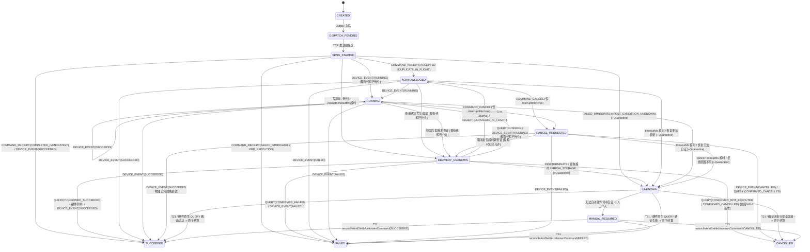

# DEVICE_EXECUTION_CORE_CONTRACT — 设备执行核心与物理安全契约（AI-1 主责 · Draft v1.1）

> **所属总纲**：[PHASE3B_MASTER_CONTRACT.md](./PHASE3B_MASTER_CONTRACT.md)  
> **通信与 Wire 对侧契约**：[DEVICE_GATEWAY_PROTOCOL.md](./DEVICE_GATEWAY_PROTOCOL.md)  
> **目标数据库迁移**：[006_device_execution_contract_v1.draft.sql](./ddl/006_device_execution_contract_v1.draft.sql)

---

## 1. 精简后的 4-ID 纪律（消除冗余与命名冲突）

对照 [001_init.sql:442-443](../db/workflow_runtime/001_init.sql#L442-L443)，既有表 `workflow_runtime.command_ledger` 已经通过 `UNIQUE (tenant_id, attempt_id)` 保证 **1 个 `node_attempt` 最多对应 1 条命令**，并通过 `payload_hash` 检查载荷冲突。

经核对，原草案引入的「Run+AttemptNo 拼接键」与 `UNIQUE(attempt_id)` 重叠、随重试变化且极易与既有 `idempotency_class` 列混用。**本版正式取消冗余键，统一收敛为严格 4-ID 纪律**：

| 标识 | 生成方 | 粒度与持久化位置 | 核心不变式 |
| :--- | :--- | :--- | :--- |
| **`commandId`** (`UUID`) | Kernel | 一条逻辑物理动作（`command_ledger` 主键；与 `attempt_id` 1:1 绑定） | **全链路唯一且跨重连、重启恒定的逻辑命令与 Sidecar 防重主键**。只要同一个 `attempt_id` 被重入创建，必须返回原 `commandId`；一次重跑新建 `node_attempt` 则获得新 `commandId`（旧尝试必须先安全结束或确认未执行）。 |
| **`dispatchId`** (`UUID`) | Kernel | 单次线协议发送/查询/取消尝试（`command_dispatch_attempt` 主键） | 新增 `dispatch_kind`（`SEND` \| `QUERY` \| `CANCEL`）。区分同一次命令的不同网络动作尝试；**绝对不作防重键**。 |
| **`sourceMessageId`** (`text`) | Sidecar 持久 Outbox | 一条上行设备事件帧（`inbox_receipt` / `wait_early_signal_buffer` 唯一键） | Sidecar 生成并落盘保持，直到 Kernel PG 提交后回传 `EVENT_ACK` 方可核销。 |
| **`deviceSequence`** (`text`) | Sidecar / 硬件设备 | 设备/驱动返回的任务序号或句柄（`command_ledger.device_sequence`） | 不可伪造的执行证据字段，随回执与事件落库，用于审计与 T21 对账核验。 |

> **与 `idempotency_class` 的分工**：`idempotency_class`（既有列：`IDEMPOTENT` \| `QUERYABLE` \| `NON_IDEMPOTENT`）仅由设备操作能力元数据 `DeviceCapabilities` 赋值（不再像 [GatewayDeviceTaskBridge.java:187](../workflow-runtime/src/main/java/com/labos/kernel/workflow/runtime/bridge/GatewayDeviceTaskBridge.java#L187) 那样硬编码为 `"QUERYABLE"`），决定异常超时后允许自动恢复还是必须人工裁决；防重完全交由 `commandId` + Sidecar WAL Journal 承担。

---

## 2. 独立审查后的 12 态 Command 状态机（含现状差异表）

### 2.1 状态集合与存在必要性论证
保留 `001_init.sql:431-433` CHECK 约束中的全部 12 个状态（不是盲从 CHECK，而是各自对应正交物理边界）：

| 状态 | 阶段归属 | 不可合并的独立必要性 |
| :--- | :--- | :--- |
| `CREATED` / `DISPATCH_PENDING` | 派发准备（可安全丢弃） | 事务落库与 Outbox 排队的双态分离；崩溃发生在未跨越 `SEND_STARTED` 前均可无副作用直接安全放弃 (`ABANDONED_SAFE`) 重试。 |
| `SEND_STARTED` | 网络边界跨越态 | **分水岭**：一经提交即视为 TCP 发送已开始，后续崩溃不可盲目假设"绝对没发出去"。 |
| `DELIVERY_UNKNOWN` | **传输层未决态（可自动查证）** | 专门表达「TCP 写故障 / 断线 / `receiptTimeout` 超时，连 Sidecar 到底收没收到回执都不知道」。此时允许先走**只读 `COMMAND_QUERY`** 验证回执是否落单，**不一定立刻污染物理隔离**。 |
| `ACKNOWLEDGED` | Sidecar 已接单队列态 | 明确区分「Sidecar WAL 已接单入队 (`COMMAND_RECEIPT(ACCEPTED)`)」与「物理动作已完成」。**严禁把 `ACKNOWLEDGED` 当作成功**。 |
| `RUNNING` | 设备执行进行中 | 接收设备真实异步进度与启动运行事件后的状态，可响应支持中断操作的 `COMMAND_CANCEL`。 |
| `CANCEL_REQUESTED` | 取消指令竞争态 | 仅针对 `interruptible=true` 动作发起取消后等待设备最终裁决（取消 vs 晚到完成）的过渡态。 |
| `UNKNOWN` | **物理副作用未明态（必须隔离）** | 与 `DELIVERY_UNKNOWN` 的本质区别：已经确认无法通过自动安全查询自证（如运行超时、硬件无查询接口崩溃、存储损坏、`POST_EXECUTION_UNKNOWN`），**必须自动触发 `quarantine_record` 锁住风险资源**。 |
| `MANUAL_REQUIRED` | 人工裁决冻结态 | 明确停机等待现场操作员核验输入证据并通过 **T21** 裁决的状态；与 `UNKNOWN` 分离以区分「等待自动化最后确认」和「已冻结推给人类」。 |
| `SUCCEEDED` / `FAILED` / `CANCELLED` | 终态 | 不可逆物理结果终点（`COMPLETED` 仅由硬件事实触发；`CANCELLED` 仅由确认未执行或确认已取消触发）。 |

### 2.2 既有代码转移矩阵 vs 目标状态机对照表（B1 修复）

对照 [WorkflowRuntimeRepository.java:4428-4435](../workflow-runtime/src/main/java/com/labos/kernel/workflow/runtime/persistence/WorkflowRuntimeRepository.java#L4428-L4435) 现行实现，明确标识本次必须同步升级的转移规则与新增边界：

| 差异点 | 现行代码（`WorkflowRuntimeRepository:4428-4435`） | Draft v1.1 明确约定 | 责任方 |
| :--- | :--- | :--- | :--- |
| `CANCEL_REQUESTED → DELIVERY_UNKNOWN` | 已允许 | **保留**（取消指令断连超时时可先转 `DELIVERY_UNKNOWN` 发起只读查证） | 阶段 0 / AI-1 对齐 |
| `DELIVERY_UNKNOWN → RUNNING` | 已允许 | **保留**（恢复时若设备回报运行中，无缝接续 `RUNNING`） | 阶段 0 / AI-1 对齐 |
| `SEND_STARTED → RUNNING` | 已允许 | **保留**（若设备跳过进度直接上报 `RUNNING` 事件不拒收） | 阶段 0 / AI-1 对齐 |
| `DELIVERY_UNKNOWN → CANCELLED` | **当前缺失** | **明确新增**：仅当 `COMMAND_QUERY_RESULT` 给出 `CONFIRMED_NOT_EXECUTED`（配合 `PRE_SEND_ABORT_IN_JOURNAL` / `HARDWARE_NATIVE_QUERY` 铁证）或 `CONFIRMED_CANCELLED` 时合法 | AI-1 定点修改（阶段 0 测试覆盖） |

### 2.3 六项强制转移规则与终态结算矩（解决所有边界歧义）
1. **`FAILED_IMMEDIATELY` 边界区分**：回执必须带 `failureBoundary`：`PRE_EXECUTION` → `SEND_STARTED → FAILED`（仅当确定未触碰硬件时允许免隔离释放租约）；`POST_EXECUTION_UNKNOWN` 或缺失/非法边界 → **拒绝判为普通失败**，强制进入 `UNKNOWN` 并打开隔离。
2. **`DUPLICATE_IN_FLIGHT` 语义**：证明 Sidecar 本地 Journal 存在该 `commandId` 正在执行的原始任务，回执**必须回传原 `deviceSequence` 与 `acceptedAtEpochMs`**；Kernel 保持或迁入 `ACKNOWLEDGED`（若原已在 `RUNNING` 则维持 `RUNNING`），严禁触发二次派发。
3. **`ACKNOWLEDGED != COMPLETED`**：`COMMAND_RECEIPT(ACCEPTED)` 只能更新 `last_receipt_at` 与 `ACKNOWLEDGED`，绝对不能推进 `node_attempt`。
4. **物理完成证据底线（堵死 Journal 自证漏洞）**：只有来自 ① `DEVICE_EVENT(SUCCEEDED)`；② `COMMAND_RECEIPT(COMPLETED_IMMEDIATELY)`；或 ③ `COMMAND_QUERY_RESULT(CONFIRMED_SUCCEEDED)` 且 **`evidenceSource IN ('HARDWARE_NATIVE_QUERY', 'PRIOR_HARDWARE_COMPLETION_IN_JOURNAL')`** 时，方可将命令判为 `SUCCEEDED`！仅凭「Sidecar Journal 显示发过命令（未写回硬件终态）」**绝对禁止判 `CONFIRMED_SUCCEEDED` 或 `CONFIRMED_NOT_EXECUTED`**。
5. **终态资源释放 / Run 推进 / 审计统一矩阵**：

| 目标终态 | `node_attempt` 与 Capacity | `resource_lease` / `quarantine_record` | Run 推进条件 | 审计强制要求 |
| :--- | :--- | :--- | :--- | :--- |
| **`SUCCEEDED`** | `SUCCEEDED`；释放 `dispatch_reservation` 并减 `scheduler_capacity` | 若是单次作业：`device:` 租约释放；若是搬运成功：`slot:<src>` 释放、`slot:<dst>`/`carrier:` 过户到位；无隔离产生 | 提交并通知 `GraphCoordinator` 消费令牌推进下游 | 若通过 T21 解冻，必须写入 `worker_execution_fact` + `runtime_audit`（含操作人与实证） |
| **`FAILED`** (`PRE_EXECUTION` / 无未知副作用) | `FAILED`；释放 `dispatch_reservation` 并减 `scheduler_capacity` | 释放临时动作租约；原在位板件租约保留不动 | 按流程失败/重试规则处理 | 写标准 `COMMAND_FAILED` 审计及完整错误码 |
| **`FAILED`**（有物理损伤或执行中报错） | `FAILED`；释放容量预留（除非同事务挂隔离） | 若涉及在途搬运失败，由 `PhysicalSafetyGate` 按影响声明决定保持或挂起 `quarantine_record` | 若触发隔离，阻断冲突后续调度；Run 可转故障收口或人工介入 | 记录受损步骤、错误码与受影响的资源集合 |
| **`CANCELLED`** | `CANCELLED`；释放预留 | `CONFIRMED_NOT_EXECUTED` 或安全取消确认 → 释放本次新建租约，保留原位状态 | `STOP` 流程收敛 `STOPPED`；否则依撤销重跑策略处理 | 审计标明证据来源（设备取消回包 vs 尚未派发） |

---

## 3. T21 解冻原子事务与启动恢复缺陷修复（B2 · N1 · N2）

> **所有权声明（消除 B2 冲突）**：[WorkflowRuntimeRepository.java](../workflow-runtime/src/main/java/com/labos/kernel/workflow/runtime/persistence/WorkflowRuntimeRepository.java) 中仅允许 **AI-1** 对以下 3 处做精准修改，其余新仓储方法抽取到同包独立的 `DeviceExecution*Repository.java`；AI-2 / AI-3 / AI-4 严禁修改 `WorkflowRuntimeRepository.java`。

1. **填补 `resolveUnknownCommand` 缺口（L1700–1748）→ 升级为 `reconcileAndSettleUnknownCommand`**：
   - 现状识别（N2 精确措辞）：当前 [L1700–1748](../workflow-runtime/src/main/java/com/labos/kernel/workflow/runtime/persistence/WorkflowRuntimeRepository.java#L1700-L1748) 仅更新 `command_ledger` + 事实/审计/事件，**缺失**了 `node_attempt` 结算、`dispatch_reservation`/`scheduler_capacity` 释放、`manual_intervention` 关闭、`quarantine_record` 联动处理以及 `workflow_run` 解冻推进。
   - **单一原子事务硬约束**（锁序：`workflow_run → execution_token → node_activation → node_attempt → command_ledger → resource_lease → quarantine_record`）：
     1. 入参强制要求 **`quarantineAction`（`CLEAR_AFTER_VERIFY` \| `KEEP_QUARANTINED`）**、非空 `evidenceJson`、`resolvedState`、`actor`；
     2. 同步结算 `command_ledger`、`command_dispatch_attempt`、`node_attempt`、追加 `worker_execution_fact`；
     3. 释放 `dispatch_reservation`（`HELD → RELEASED`）并原子扣减 `scheduler_capacity.reserved_count`；
     4. **隔离组原子联动**：按 `quarantine_record.command_id = ?` 查找同一次 `UNKNOWN` 产生的所有活跃隔离单——**禁止部分解冻**：
        - 若 `quarantineAction == CLEAR_AFTER_VERIFY`：必须对同 `command_id` 下**全部**隔离记录统一置为 `CLEARED`（写入 `cleared_by`、`cleared_at`），并依核验结果同步更新/释放关联 `resource_lease`（如搬运已确认放到目标位则把载具归属转到目标 `slot:<dst>` 并释放旧 `slot:<src>` 与 `ARM1`）；
        - 若 `quarantineAction == KEEP_QUARANTINED`：仅允许结算命令账本与释放超时占位，所有受影响实体继续保持 `QUARANTINED` 阻止新任务撞机，且相关阻塞节点不可被推进放行；
     5. 关闭关联 `manual_intervention`（`OPEN → DECIDED`）；
     6. 仅当同一 `workflow_run` 内再无其他 `OPEN manual_intervention`、再无其他 `UNKNOWN node_attempt` 且当前待激活节点所需资源无 `ACTIVE/CLEAR_PENDING` 隔离时，将 `workflow_run` 从 `MANUAL_REQUIRED / CLOSED / BLOCKED` 恢复为 `RUNNING / OPEN / RECOVERY_COMPLETED` 并唤醒 `RunCoordinatorRegistry`；否则保持挂起等待剩余人工工单清零。

2. **修复 `recoverInterruptedAttempt` 过度升级根因（L5355–5359，采纳 N1 实证）**：
   - 实证代码定位：[WorkflowRuntimeRepository.java:5355-5359](../workflow-runtime/src/main/java/com/labos/kernel/workflow/runtime/persistence/WorkflowRuntimeRepository.java#L5355-L5359) 的 SQL 条件为 `command_state NOT IN ('CREATED','DISPATCH_PENDING','CANCELLED')`，错误地把**已经在 Step 0 `recoverPendingCommandInbox` 提交成终态的 `SUCCEEDED` / `FAILED`** 也算作 `ambiguousCommands`，从而一路走进 [L5401–5464](../workflow-runtime/src/main/java/com/labos/kernel/workflow/runtime/persistence/WorkflowRuntimeRepository.java#L5401-L5464) 把原本已经成功的 Run 强行打入 `MANUAL_REQUIRED`！
   - **修复规范**：在 `recoverInterruptedAttempt` 中必须先查对应 `command_ledger.command_state`：
     - 若已因 Step 0 提交到达 `SUCCEEDED` / `FAILED` / `CANCELLED` → 直接完成对应 `node_attempt` 终态结算（`SAFE_TO_RETRY` 或终态收口），绝不错误打开 `MANUAL_REQUIRED`；
     - 仅当 `command_state IN ('SEND_STARTED','DELIVERY_UNKNOWN','ACKNOWLEDGED','RUNNING','CANCEL_REQUESTED','UNKNOWN')` 时才进入未决恢复：对于允许自动 `COMMAND_QUERY`（见 [DEVICE_GATEWAY_PROTOCOL.md §4](./DEVICE_GATEWAY_PROTOCOL.md)）的命令，允许在网关完成方向 A 握手后触发有限次自动对账结算；仍无法获得硬件确定证据者，才进入 `UNKNOWN → MANUAL_REQUIRED + Quarantine`。

---

## 4. `PhysicalSafetyGate` 正式模型、事务原子性与重确认规范

> **单实例声明**：本节依赖 V1 单 Kernel [SingleInstanceHostLock](../workflow-runtime/src/main/java/com/labos/kernel/workflow/runtime/host/EmbeddedWorkflowRuntimeHost.java) 保证同库唯一协调进程下的 PostgreSQL 行锁语义。

1. **资源命名空间（直接复用 `resource_lease` 与 `quarantine_record`）**：
   - `device:<deviceId>`、`slot:<deviceId>:<slotCode>`、`carrier:<plateBarcode>`、`rail:<zoneId>`、`turntable:<deviceId>` / `stirrer:<deviceId>`。
2. **强声明 `CommandResourceImpactSpec`**（每条设备操作下发前必须静态 + 参数化生成，缺项直接 `ERR_SAFETY_PRECONDITION_FAILED`）：
   - `requiredExclusiveLeases[]`：执行该命令须锁定的全部资源集合（多资源**必须按字典序加锁**防死锁）；
   - `postSuccessMutations[]`：命令成功后引起的板位所有权转移（例如 `ARM.Transfer`：`release(slot:<src>)`, `transferCarrier(carrier:<b>, to=slot:<dst>)`, `release(device:ARM1)`）；
   - `quarantineScopeOnUnknown[]`：命令进入 `UNKNOWN` 时必须**整组连带隔离**的全部资源（例如 `Transfer` 一旦 `UNKNOWN`，连带锁死 **`device:ARM1` + `slot:<src>` + `slot:<dst>` + `carrier:<plateBarcode>`**）。
3. **资源获取与命令落库的单一原子事务边界**：
   - `PhysicalSafetyGate.acquireAndValidate(...)` 必须与 `INSERT workflow_runtime.command_ledger` 落在**同一个数据库事务**内！
   - 若任一目标资源已被其他租约持有 → 事务回滚，返 `ERR_SAFETY_LEASE_BUSY`（不创建孤儿 `command_ledger`，也不丢下僵尸锁）；
   - 若任一目标资源存在 `ACTIVE`/`CLEAR_PENDING` `quarantine_record` → 事务回滚，返 `ERR_SAFETY_QUARANTINED`；
   - 必须同步验证该工位与目标设备的**三维状态新鲜度**（`workstation_sidecar.connection_state == 'ONLINE'` 且心跳未超期 + `device_state_projection` 观察未过期且非 `FAULTED`）以及前置扫码/门控条件（如 `GrabScanGate` 抓前扫码证据、S100 托盘回原点、`DISP2` 搅拌器就绪）。
4. **Sidecar 重启或设备观测状态过期后的重确认流程**：
   - 当 Sidecar 重连返回 `HELLO_ACK` 携带新的 `observation`，或 `observation` 超时失效后再恢复时：
   - 若设备无活跃在途命令且观察上报为 `IDLE`（且 `storageState == PERSISTED`），直接刷新 `device_state_projection` 恢复可调度资格；
   - 若设备存在关联 `ACTIVE` 隔离单，或 Sidecar 上报 `FAULTED` / `FRESH_STORAGE`，任何纯心跳或重启**均不得自动清除 `quarantine_record`**，必须显式进入人工现场确认或先发只读 `GetStatus`（具备硬件原生查询能力者）再经隔离组核验解锁。
5. **实现节奏切片**：Phase 3B 交付完整 SPI、`resource_lease`/`quarantine_record` 原子实现、`device:`/`slot:`/`carrier:`、`UNKNOWN` 连带隔离组、抓前扫码取证与 `DISP2` 搅拌器门控（满足 `EXT-STD-SINGLE-V1`）；Phase 3E-2 补齐 4 机并行 `rail:`/`turntable:` 抢占优化（满足 `EXT-STD-BATCH4-V1`）。

---

## 5. G5.1 增补契约：设备自发事件 → G5 Wait 桥接与 `GraphPlan V3`（解决 B4 · N3 · N4）

> **G5 不动原则**：既有的 HTTP Wait Signal 入口（`receiveWaitInbox`，无 ACTIVE Wait 时直接 `409 REJECTED`）以及 `GraphPlan V1/V2` 的既有编译/校验逻辑**原封不动，100% 保护 G5 已验收行为**。

### 5.1 自发设备事件路由优先级（解决 N3 租约已释放空窗）
当 `DEVICE_EVENT(eventScope="SPONTANEOUS")`（如 `P_AUTO-1` 上报 `waiting_interaction`，常出现在 `Bind`/`Wash` 命令刚刚终态释放了 `device:` 租约后的几十毫秒）到达 `RuntimeDeviceEventBridge` 时，按以下**严格四级优先级**确定唯一 `(tenantId, runId)`：
1. 事件帧显式附带了 `commandId` → 直接反查 `command_ledger(command_id)` 归属 `run_id`；
2. 当前持有 `resource_lease(resource_id = 'device:' || deviceId, lease_state = 'ACTIVE')` 的 `run_id`；
3. 当前仍在该物理设备板位上持有活跃实体租约（`resource_id LIKE 'slot:' || deviceId || ':%' AND lease_state = 'ACTIVE'`）的唯一非终态 `run_id`；
4. 若某工位上全部关联活跃设备在全租户范围内**仅存在唯一一条**处于活跃非终态的 `workflow_run` → 路由至该 Run。
- 若命中的非终态 Run 数为 0 条或 ≥ 2 条（多 Run 归属歧义）→ 拒绝路由并写协议/路由告警，返回 `EVENT_NACK(retryable=false)`。

### 5.2 `wait_early_signal_buffer` 与 `inbox_receipt(WORKFLOW_WAIT_SIGNAL)` 单一真相规范（解决 B4）
为避免两张表长出平行消费真相，定死以下跨表协议（两表共用唯一幂等键 `(tenant_id, source, source_message_id)`，关联键标准格式 `correlationKey = "device:" + deviceId + ":" + eventName`；并显式遵守 [003_g5_wait_correlation.sql](../db/workflow_runtime/003_g5_wait_correlation.sql) 一条 Run + 同一 `correlationKey` 同时最多只能有一个 `ACTIVE` Wait 的约束，即 N4）：

1. **写入前强检查跨表唯一身份**（单 PG 事务，先锁 `workflow_run`）：
   - 先查 `workflow_runtime.inbox_receipt(tenant_id, source, source_message_id)`：若已存在且同 `payload_hash` / `run_id` / `correlation_key` → 立即返 **`EVENT_ACK(status="DUPLICATE")`**；若载荷哈希冲突 → 独立事务写 `inbox_protocol_violation` 并返 **`EVENT_NACK(retryable=false)`**；
   - 若该 `run_id` 下已存在匹配 `ACTIVE wait_registration`（且非 PAUSE/DRAIN 态）→ 直接走既有 G5 `receiveWaitInbox` 写入 **`inbox_receipt(PROCESSED)`** 并唤醒 Wait，返回 **`EVENT_ACK(status="APPLIED")`**（完全不经 buffer 表）；
   - **仅当该 Run 处于非终态（`CREATED`/`RUNNING`/`PAUSING`/`PAUSED`）且尚无匹配 `ACTIVE` Wait 时**：再检查 `wait_early_signal_buffer(tenant_id, source, source_message_id)`：
     - 已存在同哈希 → **`EVENT_ACK(status="DUPLICATE")`**；已存在冲突哈希 → 写 `inbox_protocol_violation` + `NACK`；
     - 不存在且该 Run 当前 `buffer_state='BUFFERED'` 计数 `< 64`（防洪容量上限）→ 插入 **`wait_early_signal_buffer(buffer_state='BUFFERED', expires_at=now + ttl)`**，事务 COMMIT 后返回 **`EVENT_ACK(status="BUFFERED")`**；超上限直接 `NACK_PERMANENT`。
2. **Wait 激活时的单事务原子消费**：
   - 当 `GraphCoordinator` 注册 `WAIT(correlationKey)` 时，在同一锁序事务内 `SELECT ... FOR UPDATE SKIP LOCKED` 检查最早一条 `buffer_state='BUFFERED' AND expires_at > clock_timestamp()` 记录：
   - 存在则同一事务内将其更新为 `buffer_state='CONSUMED', consumed_wait_id=?`，**同时搬入 `inbox_receipt(PROCESSED)`** 保持完整 G5 信号审计视图，并直接置该 Wait 为 `SATISFIED`。
3. **过期与 Run 终结清理（GC）**：
   - 伴随 Run 进入终态（`SUCCEEDED`/`FAILED`/`STOPPED`）同事务把该 Run 剩余 `BUFFERED` 条目置为 `EXPIRED`；并由调度周期清理过期行。
4. **`EVENT_ACK` 提交铁律**：网关只有在上述 PG `COMMIT` 彻底成功后方可回写 TCP `EVENT_ACK`。

### 5.3 并行区 Wait 超时策略：`GraphPlan SCHEMA_VERSION_V3`
为消除并行区内 `waiting_interaction` 超时的语义冲突（[GraphPlan.java:24-25](../workflow-runtime/src/main/java/com/labos/kernel/workflow/runtime/graph/GraphPlan.java#L24-L25) 中 `V2` 已被 G5 使用）：
- **阶段 0 骨架 PR 中新增 `SCHEMA_VERSION_V3`**（完整保留 `V1`/`V2` 既有一切校验与测试无丝毫变更）；
- 在 V3 `WaitSpec` 中扩展可选 `deadlinePolicy`：`ROUTE_TIMEOUT_EDGE`（默认，仅用于非并行区 `MESSAGE_WITH_TIMEOUT`）| **`ESCALATE_MANUAL`** | **`FAIL_RUN`**；
- 允许并行/包容网关内部 `MESSAGE` Wait 在不引出任何拓扑超时的前提下携带 `durationIso` + `deadlinePolicy = ESCALATE_MANUAL | FAIL_RUN`，超时后分别触发打开 `manual_intervention` / 安全失败收敛，并行 Join 拓扑不变式 100% 保持不变。

---

## 6. 存量 Schema (`001`/`002`) vs `006` 迁移逐项核对表（解决 B3）

完整目标 DDL 见 [006_device_execution_contract_v1.draft.sql](./ddl/006_device_execution_contract_v1.draft.sql)；CI 三处表数量断言（[workflow-runtime-db.yml:86,102,111](../.github/workflows/workflow-runtime-db.yml#L86-L111)）同步由 `32` 调整为 `35`。

| 数据库对象 | 现有状态（`001`–`005`） | `006` 变更内容 | `002_schema_contract.sql` 与安全核对 |
| :--- | :--- | :--- | :--- |
| **`command_ledger`** | 已有 `command_id`, `attempt_id (UQ)`, `command_state` (12态), `idempotency_class`, `command_payload`, `device_sequence` | 新增：`workstation_id`, `operation_name`, `timeout_ms`, `interruptible`, `last_receipt_at`, `command_result (jsonb)`, `reconciliation_evidence (jsonb)`。**不再新增任何冗余键列**。 | 100% 兼容 `001` 与现有索引 |
| **`command_dispatch_attempt`** | 已有 `(tenant_id, dispatch_id)` PK、`UNIQUE(command_id, dispatch_no)`、`dispatch_state` | 新增：`dispatch_kind text NOT NULL DEFAULT 'SEND' CHECK (dispatch_kind IN ('SEND','QUERY','CANCEL'))`、`error_code text`；补索引 `(tenant_id, command_id, dispatch_kind)` | 确保在线态与查证态皆可追溯更新终态 |
| **`quarantine_record`** | 已有 `quarantine_id`, `resource_id`, `run_id`, `lease_id`, `quarantine_one_active_resource_uq` | 新增：`command_id uuid`（外键关联 `command_ledger`）+ 部分索引 `(tenant_id, command_id) WHERE quarantine_state IN ('ACTIVE','CLEAR_PENDING')` | **用于实现整组 `UNKNOWN` 原子隔离与整组解锁**，彻底防止解锁漏放 |
| **`resource_lease`** | 已有全套状态与唯一约束（零调用方） | 零结构修改，直接投入 `PhysicalSafetyGate` 生产复用 | 保持既有严格 `resource_one_live_lease_uq` |
| **`workstation_sidecar`** | **新增表 #33** | 主键 `(tenant_id, workstation_id)`；含 **`connection_generation bigint NOT NULL DEFAULT 0`**、`endpoint_uri`、`sidecar_instance_id`、`storage_state`、`security_mode`、`connection_state`、`heartbeat_*`、`last_heartbeat_at` | **显式豁免说明（B3）**：在 `002_schema_contract.sql` 白名单注释中明确 `connection_generation` 是**单实例 Kernel 用于拒绝本机重连前陈旧 TCP 会话帧的本地代次号**，严禁充当跨进程 leader/lease fencing token。 |
| **`device_state_projection`** | **新增表 #34** | 主键 `(tenant_id, device_id)`；存 `workstation_id`、三维观察态 `device_state`（`IDLE/BUSY/FAULTED/WAITING_INTERACTION/UNKNOWN_OBS`）、`capabilities (jsonb)`、`observation_ttl_ms`、`observed_at` | 隔离本体观察态与命令账本 |
| **`wait_early_signal_buffer`** | **新增表 #35** | 主键 `(tenant_id, buffer_id)`；含 `UNIQUE(tenant_id, source, source_message_id)`、`payload_hash (32B)`、`buffer_state`、`expires_at`、`consumed_wait_id` 及待消费索引 | 与 `inbox_receipt` 同遵 32 字节哈希防冲突 |

---

## 7. 阶段 0 骨架 PR 必附：6 条核心契约不变式测试清单（N7）

阶段 0 合入前必须随骨架 PR 一起落入可执行的测试断言骨架（由 AI-1 / AI-2 / AI-3 在阶段 1–2 跑绿），把文字纪律变成编译器与单测红线：
1. **Invariant-1（`ACKNOWLEDGED != SUCCEEDED`）**：收到 `COMMAND_RECEIPT(ACCEPTED)` 后，`command_ledger` 仅到 `ACKNOWLEDGED`，`node_attempt` 严禁结算，Token 不前移。
2. **Invariant-2（硬件背书防伪造）**：`supportsNativeHardwareQuery=false` 设备收到无 `PRIOR_HARDWARE_COMPLETION_IN_JOURNAL` 仅凭 Journal 发出的 `CONFIRMED_SUCCEEDED` 时，Core 强制拒绝并转入 `UNKNOWN` + `quarantine_record`。
3. **Invariant-3（`FAILED_IMMEDIATELY` 双边界隔离）**：`PRE_EXECUTION` 直接 `FAILED` 且不生成隔离单；`POST_EXECUTION_UNKNOWN` 必须进入 `UNKNOWN` + `ACTIVE` 隔离全部影响资源。
4. **Invariant-4（`PhysicalSafetyGate` 事务原子性 & 组锁）**：`Transfer` 入 `UNKNOWN` 必须整组锁定 `device:ARM1`、`slot:src`、`slot:dst`、`carrier:id`；`reconcileAndSettleUnknownCommand(KEEP_QUARANTINED)` 后不可只解锁单一机械臂；`CLEAR_AFTER_VERIFY` 须整组清零后方能放行下一个 Run。
5. **Invariant-5（`recoverInterruptedAttempt` 终态不误杀 + T21 解冻恢复）**：Step 0 已把 `SUCCEEDED` 落入 `command_ledger` 时，重启恢复必须直接推进成功而非进入 `MANUAL_REQUIRED`；真实 `UNKNOWN` 经 T21 后必须闭环释放 `scheduler_capacity` 并唤醒 `workflow_run`。
6. **Invariant-6（自发事件早到缓冲 + 事务提交后 `EVENT_ACK`）**：自发 `waiting_interaction` 早于 `WAIT` 注册到达且当时 `commandId` 刚结束释放了 `device:` 租约时，仍能按 `slot:`/`workstation` 确定性命中唯一 Run 进入 `wait_early_signal_buffer` 并返回 `BUFFERED`；PG 事务回滚时网关必须回传 `EVENT_NACK(retryable=true)` 且绝不发送 `EVENT_ACK`。
