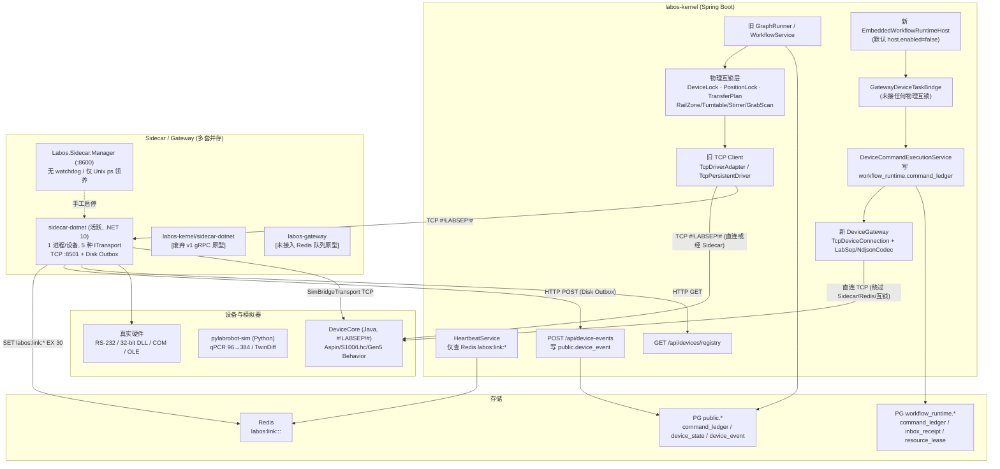

# DEVICE_INFRASTRUCTURE_AUDIT — LabOS 设备执行基础设施现状只读审计

> **审计范围**：`origin/main` @ `c650e271`（只读源码基线），覆盖 `labos-kernel/driver`、`workflow-runtime/gateway & bridge & command`、`sidecar-dotnet/`、`labos-kernel/sidecar-dotnet/`、`labos-gateway/`、`labos-kernel/sim/` 与 `pylabrobot-sim/`。

---

## 1. 当前系统真实依赖与四通道分裂全景

---

## 2. 十个核心架构审计问题逐项实证回答

### Q1. 现在 TCP Client 有几套？分别在哪里？
**共 5 套活跃/历史实现**（含 3 套活跃 + 1 套未接入 + 1 套死代码），同时存在 **6 处独立的 `#!LABSEP!#` 编解码器**：
1. **`TcpDriverAdapter`**（[TcpDriverAdapter.java](../labos-kernel/src/main/java/com/labos/kernel/driver/tcp/TcpDriverAdapter.java#L44-L294)）：旧 Kernel 默认实现，`synchronized` 全链路串行阻塞，逐字符无缓冲读，正则提取 `message_id`，所有参数被强转为字符串，无心跳、无取消、无查询。
2. **`TcpPersistentDriver`**（[TcpPersistentDriver.java](../labos-kernel/src/main/java/com/labos/kernel/driver/tcp/TcpPersistentDriver.java#L60-L437)）：旧 Kernel `LABOS_DRIVER_MODE=persistent` 多路复用长连接，`ConcurrentHashMap<String, CompletableFuture>` 关联应答；单 daemon 读线程，仅 TCP `SO_KEEPALIVE`，丢弃无 `message_id` 帧；`reconnectCount` 从未递增，异常路径存在 `pendingDevice` 泄漏。
3. **`TcpDeviceConnection`**（[TcpDeviceConnection.java](../workflow-runtime/src/main/java/com/labos/kernel/workflow/runtime/gateway/TcpDeviceConnection.java#L56-L867)）：新 `workflow-runtime` 网关实现，每设备 3 线程（IO / Event / Heartbeat），支持 `NdjsonWireCodec` 与 `LabSepWireCodec`、连接 epoch 防陈旧帧、有界事件队列与 `EVENT_ACK`/`EVENT_NACK`、`authenticatedDeviceId` 归因防伪造；但缺少协议版本、TLS、`COMMAND_CANCEL`/`COMMAND_QUERY`、`LabSep` 无心跳与 ACK。
4. **`SimBridgeTransport`**（[SimBridgeTransport.cs](../sidecar-dotnet/Labos.Sidecar/SimBridgeTransport.cs#L31-L313)）：.NET Sidecar 连下游模拟器的独立 TCP Client，后台读线程按 `HasMessageId` 分流应答与自发事件；**实证缺陷**：`TakeReply()`（L137-154）不校验应答 `message_id == req.MessageId`；`CloseQuietly()`（L309）在落盘前清空 `_spontaneous` 内存队列。
5. **未接入/废弃代码**：[DriverConnection.java](../labos-gateway/src/main/java/com/labos/gateway/driver/DriverConnection.java#L35-L344)（未接入 Kernel 的 Redis 队列网关原型）与 [TcpDriverConnection.cs](../labos-kernel/sidecar-dotnet/Drivers/TcpDriverConnection.cs#L20-L208)（已废弃的 v1 gRPC 原型）。

### Q2. Driver 是按设备厂商划分，还是按设备型号划分？
**两层存在结构性错位**：
- **Java Kernel 侧**：不按厂商或型号建子类，统一由 DB `driver` 表端点 + `DriverDescriptor` 能力声明驱动（[WorkflowService.java](../labos-kernel/src/main/java/com/labos/kernel/workflow/WorkflowService.java#L1725-L1792)）；厂商错误码与方法超时以元数据表存在 `DeviceModels` / `DeviceErrorMapper` / `public.device_method`。
- **.NET Sidecar 侧**：按**具体硬件协议/型号**硬编码为 5 个 `ITransport`（[Program.cs](../sidecar-dotnet/Labos.Sidecar/Program.cs#L332-L357)）：`S100SerialTransport`（12 字节 RS-232）、`AspinClusterTransport`（32-bit `Cluster.dll` P/Invoke XML）、`LhcRunnerTransport`（BioTek COM）、`Gen5OleTransport`（Gen5 OLE）、`SimBridgeTransport`（TCP `#!LABSEP!#`）。仅由 `models.json` 提供方法/错误码元数据。

### Q3. `DeviceCore`、Gateway、Sidecar 之间的真实调用关系是什么？
- **旧 Kernel 链路**分 4 个独立通道：命令走 TCP `#!LABSEP!#`（实物走 Sidecar `:8501`，模拟环境多直连 `DeviceCore` `:1950x`）；在线状态走 `Labos.Sidecar` → Redis → `HeartbeatService`；注册发现走无鉴权 `GET /api/devices/registry`；自发事件走 `DeviceCore` → `SimBridgeTransport` → 磁盘 Outbox → `POST /api/device-events`。
- **新 Workflow Runtime 链路**（[EmbeddedWorkflowRuntimeHost.java](../workflow-runtime/src/main/java/com/labos/kernel/workflow/runtime/host/EmbeddedWorkflowRuntimeHost.java#L186-L228)）：`GatewayDeviceTaskBridge` → `DeviceCommandExecutionService` → `DeviceGateway` → `TcpDeviceConnection` 直连设备/模拟器 TCP，**完全绕过 `sidecar-dotnet`、Redis 心跳、`/api/device-events` 和旧物理互锁**。
- **`labos-gateway/`** 完全未接入 Kernel（`LABOS_DRIVER_MODE=redis` 未实现，[RedisClient.java](../labos-kernel/src/main/java/com/labos/kernel/redis/RedisClient.java#L24)）。

### Q4. 设备命令到底由谁持久化？
**存在两套互不知晓的持久化账本**：
- 旧 Kernel：`public.command_ledger` + `public.command_outbox` + `public.run_command`（[CommandLedger.java](../labos-kernel/src/main/java/com/labos/kernel/driver/CommandLedger.java#L48-L75)、[WorkflowService.java](../labos-kernel/src/main/java/com/labos/kernel/workflow/WorkflowService.java#L3318-L3335)）。
- 新 Runtime：`workflow_runtime.command_ledger` + `command_dispatch_attempt` + `runtime_outbox` + `inbox_receipt`（[001_init.sql](../db/workflow_runtime/001_init.sql#L423-L466)）。注意：`command_dispatch_attempt` 在正常在线执行时只插入 `SEND_STARTED` 从不更新终态；`command_ledger` 缺少命令输出载荷字段（`GatewayDeviceTaskBridge` 返回伪造 stub JSON）。
- `Labos.Sidecar` **不持久化命令**，仅以文件 Outbox 持久化自发事件（[DeviceEventOutbox.cs](../sidecar-dotnet/Labos.Sidecar/DeviceEventOutbox.cs#L28-L59)）。

### Q5. 断线后是谁负责重连？
**三处独立管理且策略碎片化**：
- 旧 Kernel TCP 驱动：仅在下次 `execute()` 时懒重连；且 `WorkflowService.buildDriverRegistry()` 每 60s 过期重建 `DriverRegistry` 时**未调用旧 adapter 的 `close()`**（[WorkflowService.java](../labos-kernel/src/main/java/com/labos/kernel/workflow/WorkflowService.java#L1674-L1715)）。
- `sidecar-dotnet`：`SimBridgeTransport` 由 10s `link-keeper` 探测重连，且 `Send()` 超时/断线时自动重试 1 次；`S100SerialTransport`、`LhcRunnerTransport`、`Gen5OleTransport` **无断线重建能力**。
- 新 Runtime `TcpDeviceConnection`：后台独立线程指数退避重连（无 jitter），绝不自动重发命令；但在 `LabSep` 模式下因 `supportsAppHeartbeat=false`，半开 TCP 僵死只能等操作系统 `SO_KEEPALIVE`（默认约 2 小时）。

### Q6. Sidecar / Kernel 崩溃后，命令状态如何恢复？
审计暴露 **4 项高优先恢复缺口**：
1. **Sidecar 侧**：无命令幂等缓存；`Labos.Sidecar.Manager` **无自动重启 watchdog**（[DeviceSupervisor.cs](../sidecar-dotnet/Labos.Sidecar.Manager/DeviceSupervisor.cs#L117-L131)）；`AdoptExisting()` 依赖 Unix `ps` 命令，**Windows 真实硬件工位无法领养**（L278-322）；`Program.cs:251` 死代码（`var stop = 0` 永不变更）导致崩溃后 Redis 在线键滞留 30s。
2. **新 Runtime T21 闭环缺失（P0）**：[WorkflowRuntimeRepository.resolveUnknownCommand](../workflow-runtime/src/main/java/com/labos/kernel/workflow/runtime/persistence/WorkflowRuntimeRepository.java#L1700-L1748) 仅更新 `command_ledger` + fact/audit/event，**不更新 `node_attempt`、不关闭 `manual_intervention`、不释放 `dispatch_reservation` / `scheduler_capacity`（导致 `device:<id>` 容量为 1 的设备永久锁死！）、也不提供将 `workflow_run` 从 `MANUAL_REQUIRED` 解冻续跑的 API**。
3. **新 Runtime 启动恢复过度升级（P1）**：[recoverInterruptedAttempt](../workflow-runtime/src/main/java/com/labos/kernel/workflow/runtime/persistence/WorkflowRuntimeRepository.java#L5350-L5359) 在 Step 0 已把持久 Inbox 中的 `SUCCEEDED`/`FAILED` 写入 `command_ledger` 后，仍因 `sideEffects > 0` / `ambiguousCommands > 0` 强行把 Run 推入 `MANUAL_REQUIRED`。
4. **无自动化设备查询对账**：`command_ledger.idempotency_class`（`IDEMPOTENT`/`QUERYABLE`/`NON_IDEMPOTENT`）在代码里**从未被读取分支**；TCP 驱动（旧/新）均未实现 `queryStatus(commandId)`，崩溃后所有在途命令只能人工处置。

### Q7. Simulator 是不是复用了真实 Driver？
**否。** [DeviceCore.java](../labos-kernel/src/main/java/com/labos/kernel/sim/DeviceCore.java)（1,771 行）完全独立实现 TCP 服务与 `#!LABSEP!#` 协议，不依赖 `DeviceDriver` 或 `TcpDeviceConnection`，仅共享 `DeviceModel`/`DeviceModels` 元数据。
- **已有能力**：离线、周期/定向故障注入与故障锁存（`latchedFault`）、延迟/随机延迟、`--spontaneous` 事件、通用门/运行/持板态、设备级动作互斥、`doneCache` 幂等缓存、4 个真实机型状态机（`AspinBehavior`/`S100Behavior`/`LhcBehavior`/`Gen5Behavior`）。
- **缺失能力**：无 TCP 断连/RST/黑洞（执行成功但丢应答）、无重复应答、无乱序事件、无设备崩溃重启模拟；且 **`--long` 模式先 sleep 完再将 `method_status=1` 与 `2` 拼接一次写回**（L687, 1394-1399），并非真异步进度流；`DeviceCore.java:1587` 设置 `running=true` 后永不清除；`--spontaneous` 载荷硬编码 `"{}"`。
- **`pylabrobot-sim/`**：独立 Python 服务，用于 Kernel `POST /api/qpcr-layout/simulate` 96→384 液体处理仿真与 TwinDiff 校验（`qpcr_sim.py` / `run_simulator.py`）。

### Q8. 设备协议是否有统一版本管理？
**无。** `#!LABSEP!#` 与 NDJSON 均无 `protocolVersion` / `contractVersion` 字段，无连接握手与能力协商。且新 `LabSepWireCodec`（[LabSepWireCodec.java](../workflow-runtime/src/main/java/com/labos/kernel/workflow/runtime/gateway/LabSepWireCodec.java#L103-L164)）对历史 `message_type=0/2/4` 及 `method_status=0` 会直接抛异常记入 `malformedFrames`，并静默丢弃 `message_type=6` 自发事件。

### Q9. 设备状态是否有统一模型？
**无。** 设备状态分散在 5 处且无单一权威：
1. `public.device_state`（Redis 派生在线态 + `current_run_id`）
2. `public.device_fact`（转盘/搅拌/等待交互事实，含 TTL 新鲜度）
3. `public.device_access`（门禁开关态，动作推导而非实测）
4. `TcpDeviceConnection.ConnectionStatus`（仅 JVM 内存态）
5. `DeviceCore` / `Gen5OleTransport` 本地内存态

### Q10. 是否存在多处重复管理连接或命令状态的问题？
**明确存在，且文档与代码已出现严重漂移**：
- **重复连接/编解码**：5 套 TCP Client + 6 处 `#!LABSEP!#` 编解码器。
- **重复命令账本与并发锁**：`public.command_ledger` vs `workflow_runtime.command_ledger`；旧 `DeviceLock`/`PositionLock`/`Interlock*` vs 新 `workflow_runtime.scheduler_capacity`（且 `workflow_runtime.resource_lease` / `quarantine_record` 目前零生产调用方！）。
- **物理安全层完全缺席新引擎**：`GatewayDeviceTaskBridge` 未调用任何旧互锁（`PositionLock`、`TransferPlan`、`RailZoneGuard`、`TurntableGuard`、`StirrerDispenserGuard`、`GrabScanGate`、`DeviceAccessManager`、`LiquidLedgerGate`——其中 `LiquidLedgerGate` 连旧 Kernel 也未接入生产调用）。
- **文档漂移**：`NET_SIDECAR_DESIGN.md` 描述的是已废弃的 gRPC v1 原型；`设备状态与心跳-设计.md` 仍写 Kernel 直连 TCP 探活；`设备网关与Redis状态中心-设计.md` 对应的 `labos-gateway` 实际未接入。
