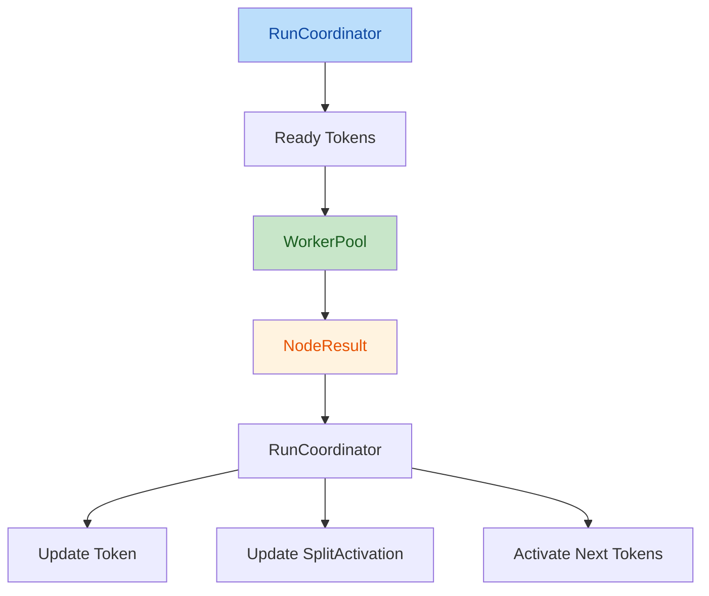
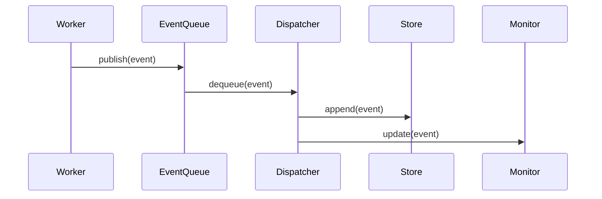

# LabOS Workflow Runtime 主设计

- 日期：2026-11-19
- 作者：Trae AI（GPT-5.4）
- 性质：新系统主设计草案，供评审
- 前提：**按新系统设计，无现场、无历史包袱、无旧接口兼容约束，不围绕 `GraphRunner` 渐进改造**
- 目标：直接定义一套可并发、可恢复、可审计、可逐步扩展的 Workflow Runtime

---

## 0. 设计立场

这份设计基于一个明确前提：

> LabOS 的并行执行能力，不再通过给 `GraphRunner` 继续打补丁获得，而是通过定义一套新的 Workflow Runtime 获得。

因此，本文不再把问题表述为：

- 如何把 `GraphRunner` 改成多线程
- 如何在现有主循环上叠加并行组
- 如何最小侵入迁移现有代码

而是直接回答：

1. 新系统里的工作流执行引擎应该有哪些职责边界。
2. 并行、暂停、停止、恢复、事件归属、物理状态如何在同一套运行时里成立。
3. 第一版应该支持哪些图形、拒绝哪些图形、采用什么持久化和执行语义。

---

## 1. 目标与非目标

## 1.1 目标

本 Runtime 必须同时满足以下 6 项目标：

1. **真并发**
   - `split_parallel` 的多个分支可真正重叠执行
   - 互不冲突的节点可同时派发

2. **单一正确性来源**
   - 图推进、JOIN、循环、暂停、恢复必须由唯一运行时模型解释
   - 不允许再出现“图语义在 A 处、设备语义在 B 处、恢复语义在 C 处”的分裂实现

3. **可恢复**
   - 进程重启后能够恢复 run、token、等待中的事件、暂停中的执行、隔离中的租约

4. **可审计**
   - 执行事件、命令派发、节点结果、等待原因、恢复动作必须可追溯

5. **可扩展**
   - 第一版先支持结构化并行，但模型本身要允许以后扩展到嵌套并行、复杂等待、更多节点类型

6. **物理安全**
   - 程序态、设备态、物理态分离
   - 不把逻辑回滚误当成物理回滚

## 1.2 非目标

本设计当前不覆盖：

1. 多实例部署与 fencing
2. 跨实验室调度
3. 设备协议本身重写
4. 面向外部的接口兼容迁移
5. 完整 BPMN 语义支持

---

## 2. 总体架构

## 2.1 五层模型

新的 LabOS Workflow Runtime 分为五层：

| 层 | 模块 | 职责 |
|---|---|---|
| L1 | Workflow Definition | 流程定义、节点、边、变量声明、网关、循环 |
| L2 | Workflow Compiler | 图校验、编译、结构化并行分析、生成不可变 `GraphPlan` |
| L3 | Workflow Runtime | `RunCoordinator`、`ExecutionToken`、`SplitActivation`、生命周期控制 |
| L4 | Node Execution | `NodeExecutor`、`NodeHandlerRegistry`、设备节点/等待节点/脚本节点等 |
| L5 | Persistence & Observability | run 快照、事件日志、台账、监控、恢复元数据 |

## 2.2 核心原则

### 原则 A：图推进权唯一

任何时刻，**只有 `RunCoordinator` 拥有图推进权**。

它独占维护：

- token 流转
- 节点就绪判定
- join 到达与放行
- pause / stop / resume / quarantine
- 恢复后的继续执行点

worker 线程只执行一个节点，不允许自行推进图。

### 原则 B：节点执行与图调度分离

节点执行器负责“把一个节点跑完或挂起”，不负责“决定下一个节点是谁”。

### 原则 C：等待必须可挂起

任何长时间等待都不能长期占用 worker：

- 等设备完成
- 等设备事件
- 等人工确认
- 等暂停协调

它们都必须转成 `SUSPENDED`，由 Runtime 和 EventDispatcher 恢复。

### 原则 D：状态机可恢复

恢复不是把 `run.status` 改回 `running`。

恢复必须能重建：

- token
- split activation
- join 到达状态
- 等待中的节点
- 事件游标
- commandId
- 设备租约

---

## 3. 核心组件

## 3.1 WorkflowCompiler

负责把流程定义编译成不可变的 `GraphPlan`。

职责：

1. 解析节点与边
2. 检查节点类型是否合法
3. 计算 entry nodes
4. 识别结构化 `split_parallel -> join_parallel`
5. 检查图形是否合法
6. 检查变量读写冲突
7. 产出 `GraphPlan`

## 3.2 GraphPlan

`GraphPlan` 是不可变运行计划，供多个 run 共享。

建议结构：

```java
public record GraphPlan(
        String workflowId,
        Map<String, NodeDefinition> nodes,
        Map<String, List<GraphEdge>> outgoing,
        Map<String, List<GraphEdge>> incoming,
        Map<String, ParallelGroupPlan> parallelGroups,
        Set<String> entryNodes,
        GraphCapabilities capabilities
) {}
```

其中 `parallelGroups` 是编译期已经识别好的结构化并行组。

## 3.3 RunCoordinator

单个 run 的唯一协调者。

职责：

1. 维护 run 生命周期
2. 维护 token 集合
3. 决定哪些 token 可进入执行
4. 接收节点完成结果
5. 接收设备事件和外部控制命令
6. 推进图
7. 生成恢复快照

## 3.4 ExecutionToken

`ExecutionToken` 表示“流程执行到某个位置的一次具体激活”。

建议结构：

```java
public record ExecutionToken(
        String tokenId,
        long runId,
        String currentNodeKey,
        String branchId,
        String splitActivationId,
        int loopIndex,
        TokenStatus status
) {}
```

说明：

- `tokenId`：唯一身份
- `branchId`：该 token 属于哪条分支
- `splitActivationId`：该 token 属于哪一次 split 激活
- `loopIndex`：当前循环圈次
- `currentNodeKey`：当前停留节点

## 3.5 SplitActivation

用于建模 JOIN。

建议结构：

```java
public record SplitActivation(
        String activationId,
        long runId,
        String splitNodeKey,
        String joinNodeKey,
        Set<String> expectedBranches,
        Set<String> arrivedBranches,
        SplitActivationStatus status
) {}
```

语义：

- `expectedBranches`：本次 split 实际激活出的分支
- `arrivedBranches`：已经到达 join 的分支
- 当 `arrived == expected` 时，JOIN 才放行

### 为什么必须引入 SplitActivation

因为 JOIN 不应只看“这个节点的静态入边有几条”。

必须区分：

- 当前是哪一次 split 激活
- 哪些分支本次真的被激活
- 哪些分支被条件排除
- 哪些分支已经到达

否则嵌套并行、循环中的并行、条件分支中的并行都无法可靠恢复。

## 3.6 NodeExecutor

统一的节点执行入口。

建议接口：

```java
public interface NodeExecutor {
    NodeResult execute(NodeExecutionRequest request);
}
```

它从 `NodeHandlerRegistry` 找到具体 handler。

## 3.7 NodeHandlerRegistry

注册不同节点类型的处理器。

建议接口：

```java
public interface NodeHandler {
    NodeType supports();
    NodeResult execute(NodeExecutionRequest request);
}
```

典型 handler：

- `DeviceNodeHandler`
- `WaitEventNodeHandler`
- `ScriptNodeHandler`
- `BuiltinNodeHandler`
- `GatewayNodeHandler`
- `ManualNodeHandler`

## 3.8 EventDispatcher

Run 级串行事件分发器。

职责：

1. 为每个 run 分配单调递增事件序号
2. 串行投递执行事件
3. 写入事件日志
4. 更新实时监控
5. 唤醒等待中的节点

这是整个 Runtime 中非常关键的一层，因为它统一了：

- 事件顺序
- 监控更新
- 落库顺序
- 恢复时的游标语义

## 3.9 RunLifecycleManager

负责 run 生命周期控制。

它不是“改 run.status 的工具类”，而是协调：

- pause
- stop
- resume
- quarantine
- recovery_checking

---

## 4. 执行语义

## 4.1 节点结果必须三分，不允许只有 completed/failed

节点执行结果至少分成三类：

| 结果 | 含义 | 是否继续推进 |
|---|---|---|
| `COMPLETED` | 节点已完成 | 是 |
| `SUSPENDED` | 等待外部条件，当前不完成 | 否，等待恢复 |
| `FAILED` | 节点失败 | 否，由协调器统一处理 |

必要时可细化为：

- `COMPLETED`
- `SUSPENDED_EVENT`
- `SUSPENDED_MANUAL`
- `FAILED_RECOVERABLE`
- `FAILED_FATAL`

## 4.2 Worker 只执行单节点

worker 只处理一个 `NodeExecutionRequest`：

```java
public record NodeExecutionRequest(
        long runId,
        ExecutionToken token,
        NodeDefinition node,
        RunExecutionContext runContext,
        NodeExecutionContext nodeContext
) {}
```

worker 执行结束后，把结果投递回 `RunCoordinator`。

它不允许：

- 修改 ready 队列
- 激活下游节点
- 直接释放 join
- 修改 split activation

## 4.3 真并发的实现方式

真正的并发不是“给 GraphRunner 开线程池”，而是：

1. `RunCoordinator` 判断哪些 token 当前可执行
2. 把这些 token 对应的节点提交到全局有界 worker pool
3. worker 执行节点
4. 完成结果回到 coordinator
5. coordinator 继续推进图

执行关系如下：



---

## 5. 并行模型

## 5.1 V1 只支持结构化并行

V1 支持：

```text
SPLIT_PARALLEL
  ├─ branch A
  ├─ branch B
  └─ branch C
JOIN_PARALLEL
```

编译期要求：

1. 每个 split 必须有唯一对应 join
2. 分支之间除 join 外不得共享业务节点
3. 分支内部不得再出现并行组、条件汇合、回边

## 5.2 V1 明确拒绝的图形

以下图形在编译期直接报错：

1. 非结构化交叉并行
2. 分支内部再出现 `split_parallel`
3. 分支内部出现 `JOIN_CONDITIONAL`
4. 分支内部出现回边循环
5. 两条分支共享同一个业务节点

拒绝原因不是“永远不支持”，而是：

> 第一版必须先把结构化并行做成闭环，不能一上来支持所有图形。

## 5.3 为什么不让分支各自推进图

不采用“每分支一个独立图推进器”的原因：

1. 会把 JOIN 语义分散到多个执行器中
2. 会把 token merge 复杂化
3. 恢复时需要恢复多个推进器局部状态
4. 条件分支、循环、暂停的协调难度明显增加

所以我们坚持：

> 分支可以并发执行节点，但图推进权不能分散。

---

## 6. 变量模型

## 6.1 Run 级共享变量

变量仍然只有一份 Run 级 `FlowVariableStore`。

建议接口：

```java
public interface FlowVariableStore {
    String get(String key);
    void put(String key, String value);
    void putAll(Map<String, String> values);
    Map<String, String> snapshot();
}
```

## 6.2 分支局部输出

为了支持并行汇总，分支可以有局部输出：

```text
Branch A -> output.a = 3
Branch B -> output.b = 5
JOIN 后 -> total = output.a + output.b
```

这些局部输出不是 Run 级共享变量本体，而是 branch-local result。

## 6.3 编译期变量冲突规则

V1 编译期规则：

1. 同一并行组内，两分支写同一 key：**禁止**
2. 一分支写 key，另一分支读同一 key：**禁止**
3. 两分支只读同一 key：**允许**
4. 两分支写不同 key：**允许**

### 为什么不提供原子自增

因为“两分支同时给同一变量做累加”会引入：

- 时序不确定
- 重试重复累加
- 恢复重复提交
- 审计难以解释

因此 V1 明确不提供共享变量原子累加能力。

---

## 7. 生命周期语义

## 7.1 Pause

暂停不是命令，是协调请求。

状态机：

```text
RUNNING
  -> PAUSE_REQUESTED
  -> PAUSE_DRAINING
  -> PAUSED
```

语义：

1. 收到 pause 请求后，不再启动新节点
2. 已经执行中的节点继续到安全边界
3. 等事件中的节点保持等待态
4. 全部 token 都进入可暂停边界后，run 才进入 `PAUSED`

## 7.2 Stop

停止同样是协调过程：

```text
RUNNING
  -> STOP_REQUESTED
  -> STOP_DRAINING
  -> FAILED / MANUAL / QUARANTINED
```

语义：

1. 任一分支失败后，全局停止派发新节点
2. 已派发节点继续收尾
3. 收尾完成后再决定最终状态
4. 若超出控制等待预算且设备状态不明，进入 `QUARANTINED`

## 7.3 Resume

恢复不是把 `run.status` 改回 running。

恢复必须通过：

1. 恢复前物理安全检查
2. 重建 token
3. 重建 split activation
4. 重建等待中的事件游标
5. 重建节点执行上下文

---

## 8. 等待与超时

## 8.1 业务超时与控制超时分离

必须分清三种时间：

| 时间 | 含义 | 是否决定业务失败 |
|---|---|---|
| 节点执行时间 | 一个节点自然要跑多久 | 否，业务定义 |
| 分支运行时间 | 一个分支整体可能跑多久 | 否，V1 不设硬超时 |
| 控制等待预算 | pause/stop/recovery 最多协调多久 | 是，超出后转异常控制态 |

## 8.2 控制等待预算按方法为主、设备可覆盖

建议：

1. 默认按方法配置控制预算
2. 设备可覆盖
3. 超限不等于自动失败，而是进入：
   - `PAUSE_BLOCKED`
   - `STOP_DRAINING_TIMEOUT`
   - `QUARANTINED`

---

## 9. 设备节点与事件归属

## 9.1 commandId 仍是唯一归属锚点

设备事件归属继续沿用已经确定的原则：

> 事件归属只认 `commandId`

新 Runtime 不重新设计这条规则，只重定义它与运行时的关系。

## 9.2 设备节点执行流程

设备节点的执行分成两段：

1. 派发设备命令
2. 等待正确关联的完成事件

因此设备节点第一次执行后的结果通常不是 `COMPLETED`，而是：

- `SUSPENDED_EVENT`

只有当对应 `commandId` 的结果事件到达时，才真正完成。

## 9.3 设备租约

物理租约继续独立于事件表。

运行时只负责：

1. 在派发前申请租约
2. 记录 `owner_command_id`
3. 在恢复/隔离时保留租约语义

不允许用事件表代替物理租约事实。

---

## 10. 持久化模型

## 10.1 必须持久化的运行态对象

至少需要持久化：

1. `run`
2. `token`
3. `split_activation`
4. `node_progress`
5. `execution_event`
6. `waiting_registration`
7. `device_physical_hold`
8. `run_control_state`

## 10.2 快照与事件分离

建议同时保留：

- **状态快照**：便于恢复
- **事件日志**：便于审计与回放

两者不互相替代。

## 10.3 建议新增的核心表

### workflow_run_token

```text
token_id
run_id
current_node_key
branch_id
split_activation_id
loop_index
status
updated_at
```

### workflow_split_activation

```text
activation_id
run_id
split_node_key
join_node_key
expected_branches_json
arrived_branches_json
status
updated_at
```

### workflow_execution_event

```text
run_id
seq
event_type
token_id
node_key
detail_json
created_at
```

### workflow_waiting_registration

```text
wait_id
run_id
token_id
node_key
wait_type
expected_command_id
cursor
status
created_at
updated_at
```

---

## 11. 监控模型

## 11.1 不能再用“当前节点只有一个”的视角

并行后，`RunMonitor` 不能再只存：

- `nodeKey`
- `nodeStatus`

因为 run 同时可能有多个活跃节点。

## 11.2 新监控模型

建议：

### run 级

- 总节点数
- 已完成节点数
- 活跃 token 数
- 暂停/停止/隔离状态

### token/branch 级

- branchId
- 当前节点
- 当前状态
- resourceId
- startedAt
- waiting reason

---

## 12. 线程模型

## 12.1 全局有界 Worker Pool

使用 JVM 级统一 worker pool，不为每个 run 新建线程池。

理由：

1. 每 run 一个池会导致线程数失控
2. 全局池更易统一限流
3. 可与 run 级 in-flight 限额叠加

## 12.2 Run 级并发额度

每个 run 额外维护 `maxInFlightNodes`，避免单个 run 占满全局 worker。

## 12.3 EventDispatcher 单消费者

每个 run 的事件分发采用单消费者串行模型：



这样可以保住：

- 事件顺序
- 监控顺序
- 恢复游标语义

---

## 13. V1 范围

## 13.1 V1 支持

1. 结构化 `split_parallel -> branches -> join_parallel`
2. 真并发节点执行
3. commandId 唯一归属
4. 设备节点挂起与事件恢复
5. pause / stop / quarantine
6. token / split activation 持久化

## 13.2 V1 不支持

1. 非结构化并行
2. 分支内部嵌套并行
3. 并行与循环自由组合
4. 同组共享变量写入
5. 多实例执行

---

## 14. 实施顺序

虽然本设计是“新系统主设计”，但实施仍然建议分阶段：

## Phase 1：定义与编译

产物：

- `NodeDefinition`
- `GraphPlan`
- `WorkflowCompiler`
- `ParallelGroupPlan`
- 编译期校验器

验收：

- 非法图在编译期被拒绝

## Phase 2：串行 Runtime

产物：

- `RunCoordinator`
- `ExecutionToken`
- `NodeExecutor`
- `NodeHandlerRegistry`
- `RunExecutionContext`

验收：

- 在不启用并行时，可正确跑通流程

## Phase 3：真并发执行

产物：

- worker pool
- token 并发调度
- split activation / join barrier

验收：

- 并行分支真正重叠

## Phase 4：等待、暂停、恢复

产物：

- `EventDispatcher`
- `RunLifecycleManager`
- waiting registration
- recovery snapshot

验收：

- pause / stop / resume / quarantine 闭环成立

## Phase 5：真实设备与物理安全

产物：

- device hold
- event attribution integration
- observability 完整落地

验收：

- 设备事件、租约、恢复、监控一致

---

## 15. 评审者重点检查问题

这份主设计希望评审者重点看下面 8 个问题：

1. `RunCoordinator` 独占图推进权，这个边界是否足够清晰？
2. `ExecutionToken + SplitActivation` 是否足以表达结构化并行与恢复？
3. V1 拒绝的图形范围是否合理？
4. `NodeResult` 的 `SUSPENDED` 语义是否足以承载设备等待、人工等待、暂停协调？
5. `EventDispatcher` 采用 run 级串行，是否能同时满足性能与恢复语义？
6. `FlowVariableStore + branch-local output` 是否足以覆盖现有业务变量需求？
7. `pause / stop / quarantine` 的状态机是否闭环？
8. 第一版是否需要在模型中纳入循环与并行的组合，还是应明确延期？

---

## 16. 最终结论

LabOS 的新执行引擎不应再围绕 `GraphRunner` 做功能叠加，而应直接定义新的 Workflow Runtime。

这套 Runtime 的核心不是“线程池”，而是以下 5 个基础对象：

1. `GraphPlan`
2. `RunCoordinator`
3. `ExecutionToken`
4. `SplitActivation`
5. `EventDispatcher`

如果把这 5 个对象定义清楚，那么：

- 真并发有明确落点
- JOIN 有明确语义
- 暂停恢复有明确模型
- 审计与恢复有明确载体

如果这 5 个对象没有定义清楚，那么即使把 `GraphRunner` 改成多线程，也仍然只是在旧模型上叠加复杂度。

因此，本设计建议：

> 以“新的 Workflow Runtime”作为主线推进，不再把 `GraphRunner` 视为未来的核心执行模型。

