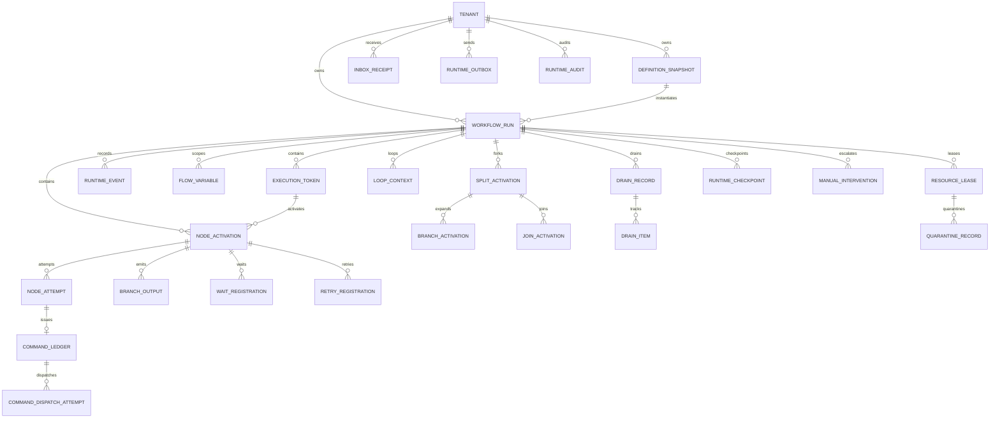

# Workflow Runtime 数据库物理设计 v1.0

- 日期：2026-11-19
- 目标：全新 Workflow Runtime 的 PostgreSQL 17 持久化模型
- 架构基线：`docs/LabOS-Workflow-Runtime-架构设计-v2.0-20261119.md`
- 事务基线：`docs/LabOS-Workflow-Runtime-T01-T23-数据库事务与测试设计-v1.0-20261119.md`
- DDL：`db/workflow_runtime/001_init.sql`
- 性质：物理设计与初始化 DDL；不是代码实现或运行验证报告

## 1. 裁决

这是空数据库初始化设计。没有旧表迁移、兼容视图、双写、历史数据转换或旧 GraphRunner 语义。现有 LabOS schema 仅用于确认 PostgreSQL 17 技术基线，不作为 Runtime 表结构模板。

- 主键统一 UUID；应用优先生成 UUIDv7，DDL 默认 UUIDv4 仅作安全兜底。PG17 不把 UUIDv7 生成为内建默认值。
- 所有业务表携带 tenant_id，跨表引用采用 (tenant_id, id)，防止跨租户引用。
- 时间统一 timestamptz；数据库写入时间使用 clock_timestamp()。
- Run 的 commit_version 与 event_seq 是独立单调游标；所有控制流写事务锁定 workflow_run 行，更新游标并在同一事务写 runtime_event。
- 设备型 Attempt V1 通过 command_ledger 的 UNIQUE(tenant_id, attempt_id) 限制一个 Attempt 仅一个逻辑 command_id。
- command_id 与 dispatch_id 分离：同一逻辑命令可有多次受控派发尝试，但不得用新 command_id 掩盖未知结果。
- Inbox Receipt 先独立落库；之后按 T14 业务事务消费，收件与业务投影不跨网络事务。
- Outbox 只保证可恢复投递，不保证外部物理动作 exactly-once。
- Lease 的 QUARANTINED / EXPIRED_UNVERIFIED 仍占据资源唯一有效 owner 位置，不允许新 owner 接管。
- 共享变量与 BranchOutput 分离；设备动作成功事实不可被后续共享变量 CAS 冲突回滚。设备节点先持久化不可变输出，后续纯计算节点再聚合共享变量。

## 2. ERD（逻辑关系）



## 3. 表职责与约束分区

| 子域 | 表 | 关键职责/约束 |
|---|---|---|
| Tenant/Definition | tenant, definition_snapshot | 租户隔离；不可变定义快照及编译产物 |
| Run/Control flow | workflow_run, execution_token, node_activation, node_attempt | Run 线性化游标；Token、Activation、Attempt 生命周期；dispatch_id 唯一 |
| Parallel/Loop | split_activation, branch_activation, join_activation, loop_context | 显式分叉、分支到达、Join release、循环迭代 |
| Async | wait_registration, retry_registration, dispatch_reservation, scheduler_capacity | 不占 Worker 的 Wait/Retry；容量 reservation |
| Data | flow_variable, branch_output | Run 共享变量版本与分支局部不可变输出分离 |
| Event delivery | runtime_event, inbox_receipt, inbox_protocol_violation, runtime_outbox | 每 Run event_seq；消息去重、payload hash、防丢投递 |
| Device | command_ledger, command_dispatch_attempt, resource_fence_counter, resource_lease | commandId 幂等身份、派发尝试、资源 fencing/隔离 |
| Drain/Safety | drain_record, drain_item, manual_intervention, quarantine_record | Pause/Stop 收敛、人工介入、资源隔离 |
| Recovery/Audit | runtime_checkpoint, runtime_audit | 一致快照、不可抵赖审计轨迹 |

## 4. 关键事务协议

### 4.1 Run 写事务模板

1. `BEGIN`。
2. `SELECT ... FROM workflow_run WHERE tenant_id=:tenant AND run_id=:run FOR UPDATE`。
3. 校验 coordinator_id/epoch、control_gate、状态和对象版本。
4. 锁定次级对象，严格遵循事务规格的全局锁顺序。
5. 执行状态 CAS；每个预期单行更新必须检查 affected_rows = 1。
6. `UPDATE workflow_run SET commit_version=commit_version+1, event_seq=event_seq+1 ...`，使用返回的新游标。
7. 同一事务插入 runtime_event，必要时插入 runtime_outbox/runtime_audit。
8. `COMMIT`。提交后才唤醒 Dispatcher/Worker。

不得在数据库事务内调用设备 Adapter、Worker、消息系统、文件系统或人工操作。

### 4.2 EventSeq 分配

Run 行锁保证同一 Run 的 event_seq 分配串行化。事务中先更新 Run 游标并 RETURNING 新 event_seq，再用该值写 Event。Run 投影与 Event 同事务提交；事务回滚则两者一起回滚。禁止使用全局 sequence 作为 Run event_seq。

### 4.3 Inbox

接收入口先以 `(tenant_id, source, source_message_id)` 插入 RECEIVED。唯一冲突时读取原记录并比较 payload_hash：
- 相同 hash：重复投递，返回原 receipt/outcome；
- 不同 hash：保留原 payload 身份，登记 PROTOCOL_VIOLATION，不覆盖原 receipt。
随后 T14 消费事务锁 Run → 业务对象 → Inbox，按当前 Coordinator epoch 核验事件归属；事件只按 command_id 归属设备命令。ACK 不等于物理完成。

### 4.4 Outbox

业务状态、Event 和 Outbox 在一个事务提交。Dispatcher 通过 `FOR UPDATE SKIP LOCKED` claim，写入 owner/epoch/claim_until；外部发送在事务外完成。发送成功但回写丢失时按相同 dedup_key 重投，消费者必须幂等。

### 4.5 Checkpoint 一致快照

Checkpoint 不能通过多次 READ COMMITTED 查询拼接。实现选择：
- 在单个 REPEATABLE READ 只读事务内读取 Run 游标及所有快照表；或
- 先锁 Run 行并在同一事务完成快照物化，保证所有 Run 写事务遵循相同 Run 行锁协议。

建议 V1 使用 REPEATABLE READ READ ONLY + 单事务多表读取，并记录 run_commit_version/event_seq；若快照期间包含非 Run 锁保护数据，必须纳入版本/快照协议。不得把跨事务分页结果宣称为一致快照。

## 5. 全局锁顺序

统一为：
1. workflow_run（单 Run 线性化锁）
2. Split/Join/Token/Activation/Attempt/Wait/Retry/Command 等 Run 内业务对象（按稳定表序与主键序）
3. ResourceLease（按 resource_id 排序）
4. scheduler_capacity / dispatch_reservation（按 capacity_key 排序）
5. inbox_receipt（T14 最后锁 Inbox；Inbox 首次 Receipt insert 不持有 Run 锁）

若一个事务同时涉及多个 Run，V1 禁止；需要时按 run_id 排序并单独设计。

## 6. T01–T23 映射

| 事务 | 核心表读写 | 关键线性化/约束 |
|---|---|---|
| T01 Create Run | definition_snapshot R; workflow_run, request_dedup, execution_token, runtime_event, runtime_outbox W | (tenant_id, request_id) 幂等；Run 初始化与首 Event 同事务 |
| T02 Start Run | workflow_run, execution_token, node_activation, runtime_event | Run 行锁；状态 CAS；初始 Activation/Token 同事务 |
| T03-R Reservation | workflow_run, execution_token, scheduler_capacity, dispatch_reservation | READY→RESERVED CAS；容量不超卖 |
| T03-D Dispatch Commit | workflow_run, node_attempt, node_activation, runtime_outbox, runtime_event | dispatch_id 唯一；Outbox 同事务 |
| T04-A Accepted | workflow_run, node_attempt, runtime_event | CREATED/DISPATCHED→ACCEPTED；dispatch/epoch 匹配 |
| T04-S Started | workflow_run, node_attempt, runtime_event | 仅 ACCEPTED→STARTED |
| T05 Pure Success | workflow_run, node_attempt, branch_output, execution_token, node_activation, runtime_event | Attempt 单次完成；Token consume 单次 |
| T06 Failure/Retry | workflow_run, node_attempt, retry_registration, execution_token, runtime_event | 失败与 Retry 注册原子提交 |
| T07 Suspend | workflow_run, wait_registration, node_activation, execution_token, runtime_event | Wait 与 WAITING 状态同事务 |
| T08 Wait Satisfied/Expired | workflow_run, wait_registration, node_attempt, execution_token, node_activation, runtime_event | Wait CAS；旧 Attempt ABANDONED_SAFE |
| T09 Split Expand | workflow_run, split_activation, branch_activation, execution_token, runtime_event | Branch 集合原子创建 |
| T10 Branch Arrival/Join | workflow_run, branch_activation, join_activation, execution_token, runtime_event | Arrival 幂等；最后到达者单次 Release |
| T11 Loop Advance | workflow_run, loop_context, execution_token, runtime_event | iteration CAS 与新 Token 同事务 |
| T12 Command Create | workflow_run, command_ledger, runtime_outbox, runtime_event | Attempt→Command 一对零或一 |
| T13 Command Dispatch | command_ledger, command_dispatch_attempt, runtime_outbox, runtime_event | SEND_STARTED 前置提交；未知结果不得换 commandId 重发 |
| T14 Device Event | inbox_receipt, inbox_protocol_violation, workflow_run, command_ledger, resource_lease, runtime_event, runtime_outbox | commandId 归属；Inbox 消费与业务投影同事务 |
| T15 Pause/Stop Request | workflow_run, drain_record, runtime_event, runtime_outbox | Gate 关闭与 Drain 建立原子 |
| T16 Drain Start | workflow_run, drain_record, drain_item, runtime_event | 稳定扫描游标 |
| T17 Reservation Reconcile | workflow_run, dispatch_reservation, execution_token, drain_item, runtime_event | 重复扫描；Stop INVALIDATED，Pause 保留 READY |
| T18 Safe Point | workflow_run, command_ledger, resource_lease, wait/retry/split/branch/join/loop, drain_item, runtime_event | 先物理安全核验，再关闭控制流结构 |
| T19 Drain Complete | workflow_run, drain_record, runtime_event | StopSafePredicate 全真才终结 |
| T20 Checkpoint | workflow_run, runtime_checkpoint | 单一 MVCC 快照游标 |
| T21 Unknown Reconcile | workflow_run, command_ledger, resource_fence_counter, resource_lease, manual_intervention, runtime_event | 保存证据；无证据不释放 |
| T22 Manual Resolution | workflow_run, manual_intervention, command_ledger/resource_lease, runtime_audit, runtime_event | 人工决策与状态更改同事务 |
| T23 Quarantine Clear | workflow_run（如有关联）, quarantine_record, resource_lease, runtime_audit, runtime_event | 证据版本 CAS 后清除隔离 |

## 7. 已落实到 DDL 的不变量与尚未落实项

### 已由 DDL 结构约束

- 租户复合外键阻止跨租户引用。
- 同一 Attempt 最多一个逻辑 Command。
- 同一 Token 最多一个 live Activation；同一 Activation 最多一个 live Attempt（部分唯一索引）。
- Scheduler capacity 计数不得超过 limit；并发扣减必须锁定 capacity 行并检查余量。
- Resource fencing token 由 resource_fence_counter 行锁定递增；Lease 唯一约束本身不证明 token 单调性。
- Inbox 冲突 payload hash 另存 inbox_protocol_violation，不覆盖首次 receipt。
- dispatch_id 在 Attempt 唯一；command dispatch attempt 有独立 dispatch_id。
- 同一 Run event_seq 唯一。
- Inbox source/message_id 唯一，payload hash 长度固定。
- 同一资源同时最多一个 ACTIVE/RELEASING/QUARANTINED/EXPIRED_UNVERIFIED Lease。
- 同一 Run 最多一个未完成 Drain。
- 同一资源最多一个 ACTIVE/CLEAR_PENDING Quarantine。

### 需要事务代码或更强约束实现

- “每 Token 同时最多一个有效 Activation”“每 Activation 最多一个活动 Attempt”需部分唯一索引或事务 CAS；本版 DDL 用唯一 activation_no/attempt_no，不足以独立证明此不变量，实施时须补部分唯一索引（推荐引入显式 current/active 布尔列或用状态谓词索引）。
- Run 终态谓词、StopSafePredicate、Join 完整性、Split 关闭前所有 Branch 终态需由事务服务和巡检 SQL 验证。
- Inbox hash 冲突必须产生独立 ProtocolViolation 审计；唯一约束只阻止覆盖，不自动产生违规记录。
- command ledger 的 UNKNOWN 状态不可普通自动重发，需 Dispatcher 状态机硬门禁。
- fencing_token 是否能被设备/网关强制执行，不能由 PostgreSQL DDL 证明。
- JSONB 快照哈希需规范化序列化格式后计算，不能直接依赖不同语言的 JSON 文本序列化。
- T01–T23 SQL 尚未接入 Runtime Repository；当前是设计规格与初始化 DDL。

## 8. 实施与验证状态

| 项目 | 状态 | 证据 |
|---|---|---|
| ERD / 物理表职责 | 设计已提交（待独立评审） | 本文 §2–§3 |
| PostgreSQL 17 初始化 DDL | 已编写（尚未在 PG17 执行） | `db/workflow_runtime/001_init.sql` |
| T01–T23 事务映射 | 设计已映射 | 本文 §6 |
| 真实 DB 约束/SQL 验证 | UNKNOWN | 需要 PG17 空库初始化、catalog 检查、并发测试 |
| Runtime Repository 实现 | NOT IMPLEMENTED | 当前没有代码实现证据 |
| Adapter/Worker/HIL 安全能力 | UNKNOWN | 需要按设备协议做 HIL 验证 |

### 验收命令

```bash
createdb labos_runtime_test
psql -v ON_ERROR_STOP=1 -d labos_runtime_test -f db/workflow_runtime/001_init.sql
psql -d labos_runtime_test -c "SELECT schemaname, tablename FROM pg_tables WHERE schemaname='workflow_runtime' ORDER BY tablename;"
```

本文件不把“DDL 文件存在”写成“数据库设计全部 PASS”。数据库结构只有在目标 PG17 执行、catalog/约束核对、T01–T23 双连接竞态与故障测试完成后，才可从 UNKNOWN 升级。


## 9. SQL 实现与 CI 验证工件（2026-11-19 补充）

- PostgreSQL 17 Schema 合同检查：`db/workflow_runtime/002_schema_contract.sql`。检查 31 张核心表、关键部分唯一索引，并在事务回滚的夹具中验证一个 Attempt 不能创建两个 Command、一个 Token 不能有两个活动 Activation、一个 Activation 不能有两个活动 Attempt、隔离 Lease 不能被新 Lease 抢占、Run event_seq 不能重复。
- 双连接并发测试：`db/workflow_runtime/tests/test_pg_concurrency.py`。真实独立连接并发竞争同 Token 的 live Activation，以及容量为 1 的 SchedulerCapacity；期望分别为单一胜者和不超卖。
- GitHub Actions：`.github/workflows/workflow-runtime-db.yml`。在 PostgreSQL 17 服务容器中执行空库 DDL、Schema 合同和并发测试。
- T01–T23 SQL 实现合同：`docs/LabOS-Workflow-Runtime-T01-T23-SQL实现契约-v1.0-20261119.md`。

**验证结果：** PostgreSQL 17.12 GitHub Actions 实测通过（Run #7，commit `054adb263242bc516f58e6d36f1255f1fb38b49a`）：空库 DDL 初始化、31 张表与关键索引目录检查、Schema 行为约束测试、两个独立连接的 live Activation 竞争、SchedulerCapacity 不超卖竞争、最终表数检查均 PASS。此前两次失败分别是测试 SQL 列引用错误和并发夹具预先创建了 live Activation；均已修复，最终 Run 全绿。

**验证边界：** 本次 PASS 只覆盖初始化 DDL、schema 合同和两类并发竞态。T01–T23 Repository 事务尚未实现；CON-01 至 CON-14 全集、完整故障注入矩阵、Checkpoint MVCC 并发证明、Adapter/Worker/硬件 HIL 仍未验证，不能据此宣称 Runtime 数据库实现全部完成。
