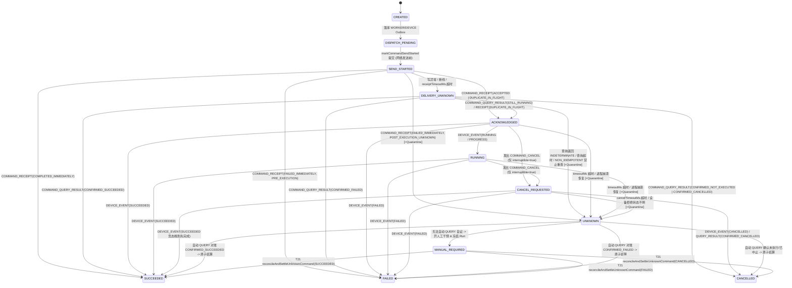

# PHASE3B_MASTER_CONTRACT — LabOS 设备执行体系核心契约与 4-AI 协作总纲（Draft v1.0 · 待冻结评审）

> **状态**：`Draft v1.0（For Freeze Review）` — 需经人工与主审确认后合并「契约冻结骨架 PR」，随后再拉出 4 条实现分支并行施工。  
> **统一基线**：`origin/main` @ `2e2e0eaffbb21ceadbbbe71bd201e8e22ddae692`（统一并取代此前审阅过程中出现过的 `c650e271` 与 `4b8e9d76` 文档快照基准）。  
> **关联基准文档**：[DEVICE_INFRASTRUCTURE_AUDIT.md](./DEVICE_INFRASTRUCTURE_AUDIT.md) · [REAL_WORKFLOW_INVENTORY.md](./REAL_WORKFLOW_INVENTORY.md) · [DEVICE_EXECUTION_CONTRACT_V1.md](./DEVICE_EXECUTION_CONTRACT_V1.md)

---

## 0. 全局工程纪律、零兼容决策与安全红线

### 0.1 已拍板的架构大前提
1. **零历史兼容路径**：新设备执行链路完全脱离旧内核兼容负担，严禁把任何旧协议或旧表带入 `workflow-runtime` 新路径：
   - 废除 `#!LABSEP!#` 文本分隔协议（彻底从新链路移除 `LabSepWireCodec`）；
   - 废除 Redis `labos:link:*` 在线权威（`RedisLinkState` 不再作为新引擎事实源）；
   - 废除 Sidecar 直连旧接口 `POST /api/device-events` 写 `public.device_event`；
   - 废除旧 TCP 客户端 `TcpDriverAdapter`、`TcpPersistentDriver`、旧原型 `labos-kernel/sidecar-dotnet/` 与 `labos-gateway/`；
   - 不迁移历史 `__awaitEvent` 流程（`1001017` / `1001041` 原样封存），全新构建标准工艺 `EXT-STD-SINGLE-V1` 与 `EXT-STD-BATCH4-V1`。
2. **工位 Sidecar 架构（Option C）**：一台工控机运行一个 `.NET 10` Sidecar Host（统一管理多台硬件的串口/Vendor DLL/COM/OLE/本地模拟适配器）；无本地硬件总线依赖的虚拟设备亦可作为一个独立或集群 Sidecar 接入同一契约。
3. **连接方向选型（已收敛为方向 A）**：**Kernel 作为 TCP Client 主动连接已启动的 Workstation Sidecar Server**（详见 §1.2）。

### 0.2 四条安全与隔离红线（违反即阻断）
1. **禁止触碰脏主工作区**：主仓目录保留不动，所有契约与开发均基于干净 `origin/main` worktree 进行。
2. **禁止在共享生产/演示库执行未审批迁移**：Phase 3B–3D 全部测试使用隔离的本地 PostgreSQL 17 临时/CI 库；未获明确许可前不得对 `192.168.124.2:5432/labdb` 执行 `006` 迁移或压测写入。
3. **保持 `RuntimeHost` 默认关闭**：[WorkflowRuntimeHostProperties.java](../labos-kernel/src/boot/java/com/labos/boot/WorkflowRuntimeHostProperties.java) 中的 `labos.workflow.runtime.host.enabled` 必须维持 `false`，直到 Phase 3F 单独审批开启。
4. **严禁未经授权向真实实验室设备下发命令**。

---

## 1. 整体架构边界与 TCP 连接方向

### 1.1 五层架构与双层测试替身边界

```mermaid
flowchart TB
  subgraph L1["Workflow Runtime (已冻结 G1–G5 · 不可私改语义)"]
    GC["GraphCoordinator / BpmnGraphCompiler / WorkflowRunFactory<br/>(BPMN · Token · Activation · Wait · Timer)"]
  end

  subgraph L2["Device Execution Core (AI-1 主责 · workflow-runtime)"]
    DBR["DeviceExecutionBridge (${var} 解析 · Capability 校验)"]
    PSG["PhysicalSafetyGate (基于 resource_lease + quarantine_record)"]
    CMD["DeviceCommandExecutionService & T21 Reconciler (command_ledger)"]
    EVR["DeviceEventRouter & EarlySignalBuffer (G5 Wait 桥接)"]
  end

  subgraph L3["Device Gateway (AI-2 主责 · workflow-runtime/gateway)"]
    GW["WorkstationConnectionManager (TCP Client 拨号 · Heartbeat)"]
    CODEC["ContractV1NdjsonCodec (NDJSON v1.1 · 严格版本校验)"]
  end

  subgraph L4["Workstation Sidecar (AI-2 主责 · .NET 10 Server)"]
    SVR["TcpWorkstationServer (:port 监听 · HELLO/HELLO_ACK 握手)"]
    JRN["Local WAL/SQLite Journal (commandId 防重) + Persistent Event Outbox"]
    ADP["IProtocolAdapter SPI (S100 / ASpin DLL / LHC COM / Gen5 OLE / Virtual)"]
  end

  subgraph L5["真实设备与双层模拟器 (AI-3 辅助验证)"]
    HW["真实硬件设备 (RS-232 / CAN-DLL / COM / OLE / LAN TCP)"]
    VD["B. 设备级虚拟模拟器 (Device-Level Simulator · 挂载在 IProtocolAdapter 下)"]
    WCH["A. 线协议混沌桩 (Wire-Level Chaos Harness · 替代 Sidecar 直连 Gateway 下方)"]
  end

  GC --> DBR
  DBR --> PSG --> CMD
  CMD --> GW
  EVR <-- "Inbox / wait_early_signal_buffer" --- GC
  GW <-- "EVENT / RECEIPT / QUERY_RESULT" --> CMD
  GW --> EVR
  GW <-->|"Direction A: Kernel dials Sidecar Server<br/>NDJSON v1.1 over Persistent TCP"| SVR
  GW <-.->|"3D 协议混沌注入<br/>(DROP_ACK / RST / 重包 / 伪造ID)"| WCH
  SVR --> JRN --> ADP
  ADP --> HW
  ADP --> VD
```

### 1.2 TCP 连接方向正式拍板：方向 A（Kernel TCP Client 主动连接 Sidecar Server）

| 对比维度 | **方向 A：Kernel TCP Client 主动连接 Sidecar Server（本契约采用）** | 方向 B：Sidecar 主动连接 Kernel TCP Server |
| :--- | :--- | :--- |
| **与现场启动顺序契合度** | **完全契合**：先启动工控机设备驱动程序（Sidecar），中控 Kernel 后起并通过已配置的设备/工位 `IP:Port + 唯一 ID` 主动拨号建连 | 中控须先暴露公网/内网监听端口，且需允许任意工控机随时入站拨入 |
| **多环境防误连/串台安全** | **天然隔离**：本地开发/测试环境 Kernel 只连配置的测试 Sidecar 端口；绝对不会把生产工控机误接入开发者笔记本上的测试进程 | 若两套 Kernel 同时监听，配置漂移的 Sidecar 可能连错环境并被下发误操作命令 |
| **重连与拓扑感知** | Kernel 清晰掌握每个已登记 `workstationId`/`endpoint` 的连接状态与重连退避；与现有 `TcpDeviceConnection` 拨号模型一脉相承 | 需额外处理未注册入站连接的识别、多连接抢占与僵死接入驱逐 |
| **多设备工位支持** | 支持“一工控机 Sidecar 端口代理多台设备（1:N 复用）”及“单模拟/网络设备独立端口（1:1 退化）”，配置上均表达为 `workstationId + tcp://ip:port` | 同支持，但连接数暴增时服务端端口与认证管理复杂度更高 |

**方向 A 握手与身份绑定强约束**：
1. **地址与配置权威**：Kernel 数据库/配置中登记每个工位的 `(workstationId, host, port, allowedDeviceIds[])`。
2. **先拨号、再应用握手**：TCP 三次握手成功后，Sidecar 在未收到并应答合法 `HELLO` 前**静默等待（超时断开），绝不直接吐出历史业务帧**。
3. **Kernel 主动发送 `HELLO`**：携带目标 `workstationId`、Kernel 从 PG `workflow_runtime.workstation_sidecar` 原子递增分配的单调 `sessionEpoch`、`heartbeatIntervalMs`、`heartbeatTimeoutMs`、`supportedProtocolVersions: ["1.1"]`。
4. **Sidecar 回复 `HELLO_ACK`**：声明自己实际管理的 `workstationId`（必须与 `HELLO.workstationId` 精确相等）、`sidecarInstanceId`、`storageState`（`PERSISTED` / `FRESH_STORAGE` / `CORRUPTED`）、以及 `devices[]`（每台设备的 `DeviceDescriptor`、`DeviceCapabilities` 与实时 `DeviceObservationState`）。
5. **Fail-Closed 准入校验**：
   - `HELLO_ACK.workstationId` 不匹配配置的期望工位 ID → 立即断开并记为 `OFFLINE` + `ERR_SESSION_IDENTITY_MISMATCH`；
   - `HELLO_ACK.devices[]` 中若包含不在 Kernel allowlist 内的设备、或某个 `deviceId` 已被另一个活跃在线会话持有 → 拒绝整条会话注册（`ERR_SESSION_DEVICE_CONFLICT`），绝不允许两台工位同时声称拥有同一个 `deviceId`。

---

## 2. 严格 5-ID 纪律与统一错误码目录

### 2.1 五个核心标识的唯一语义（不可混用）

| 标识 | 生成方 | 粒度与作用域 | 不可变与持久化要求 |
| :--- | :--- | :--- | :--- |
| `commandId` (UUID) | Kernel (`command_ledger`) | 一条逻辑物理命令（1:1 对应一个 `node_attempt`） | **跨断线、重连、重启恒定**；Sidecar 本地防重 Journal 主键 |
| `idempotencyKey` (String) | Kernel 确定性拼接：`${runId}:${activationId}:${attemptNo}:${operation}` | 逻辑副作用唯一语义键 | `UNIQUE (tenant_id, idempotency_key)`；供 Sidecar 与支持原生的设备识别重放 |
| `dispatchId` (UUID) | Kernel (`command_dispatch_attempt`) | 单次网络动作尝试（每次 `COMMAND_SEND` / `COMMAND_QUERY` / `COMMAND_CANCEL` 独立生成） | 追踪单次网络往返与超时归因，绝不充当命令防重键 |
| `sourceMessageId` (String) | Sidecar 持久 Outbox | 一条上行事件帧（命令结果/进度/自发事件） | Sidecar 生成并在本地 Outbox 保持不变直至收到 `EVENT_ACK`；Kernel `inbox_receipt(tenant_id, source, source_message_id)` 唯一去重 |
| `deviceSequence` (String) | Sidecar / 设备驱动 | 设备/驱动赋予该次执行的单调流水号或句柄 | 非空字符串；作为设备已真实接单执行的审计证据落库 `command_ledger.device_sequence` |

### 2.2 统一错误码目录（`ContractV1ErrorCodes`）

| 错误码 | 产生层级 | 可重试 (`retryable`) | 触发隔离 (`quarantine`) | 标准语义与处置动作 |
| :--- | :--- | :---: | :---: | :--- |
| `ERR_WIRE_UNSUPPORTED_VERSION` | Gateway / Sidecar | 否 | 否 | 帧缺少 `"protocolVersion": "1.1"` 或版本不兼容 → `EVENT_NACK` 后断连重建 |
| `ERR_WIRE_MALFORMED_FRAME` | Gateway / Sidecar | 否 | 否 | 非法 JSON、缺少必填 ID、或混入非 NDJSON / `#!LABSEP!#` 帧 → 记协议违规并断连 |
| `ERR_WIRE_SPOOFED_DEVICE` | Gateway | 否 | 否 | `DEVICE_EVENT`/`RECEIPT` 内声明的 `deviceId` 不属于该 `workstationId` 会话 → `EVENT_NACK(retryable=false)` |
| `ERR_SESSION_IDENTITY_MISMATCH` | Gateway | 否 | 否 | `HELLO_ACK.workstationId` 与目标配置不符 → 拒绝会话上线 |
| `ERR_SESSION_DEVICE_CONFLICT` | Gateway | 否 | 否 | 同一 `deviceId` 同时在两个工位注册 → 拒绝后到会话上线 |
| `ERR_SESSION_STALE` | Core / Gateway | 是（等待恢复） | 否 | 工位心跳超期或连接态非 `ONLINE` → 调度闸门 Fail-Closed 拦截新派发 |
| `ERR_CAPABILITY_MISSING_OP` | Core | 否 | 否 | 节点请求的 `operation` 未在该设备 `DeviceCapabilities.operations` 声明 → 拒绝生成命令 |
| `ERR_CAPABILITY_CANCEL_UNSUPPORTED` | Core / Sidecar | 否 | 否 | 对 `interruptible=false` 或 `supportsCancel=false` 操作下发 `COMMAND_CANCEL` → 拒绝取消，继续等待物理结果 |
| `ERR_SAFETY_LEASE_BUSY` | PhysicalSafetyGate | 是（排队等待） | 否 | 目标 `device:` / `slot:` / `rail:` / `turntable:` / `carrier:` 已被其他租约持有 → 推迟调度或返回资源冲突 |
| `ERR_SAFETY_QUARANTINED` | PhysicalSafetyGate | 否（需人工解除） | 已处于隔离态 | 资源存在 `ACTIVE`/`CLEAR_PENDING` `quarantine_record` → 禁止调度一切涉及该资源的动作 |
| `ERR_SAFETY_PRECONDITION_FAILED` | PhysicalSafetyGate | 否 | 视在途态决定 | 门禁未关闭、抓前无合法扫码证据、或 `DISP2` 搅拌器互斥未满足 → 阻断物理动作执行 |
| `ERR_DEVICE_REJECTED_PRE_EXECUTION` | Sidecar / Adapter | 按业务策略 | **否** | 参数错、设备拒绝接单，且确定未产生任何物理副作用（`failureBoundary=PRE_EXECUTION`） → 直接 `FAILED` |
| `ERR_DEVICE_EXECUTION_FAILED` | Sidecar / Adapter | 按业务策略 | 视操作安全级 | 设备已执行过程中报错终止 → 写入 `FAILED`；若涉及在途搬运可由 SafetyGate 决定是否隔离板位 |
| `ERR_RECONCILE_DB_TRANSIENT` | Gateway / Inbox | **是** | 否 | PG 暂时超时/锁冲突 → 返回 `EVENT_NACK(retryable=true)`，Sidecar 保留 Outbox 退避重发 |
| `ERR_RECONCILE_INDETERMINATE` | Core / Sidecar | 否 | **是** | 跨边界后无法确认设备侧结果（如 `FRESH_STORAGE` 重装或无原生查询硬件掉电） → 转 `UNKNOWN` + `MANUAL_REQUIRED` + 隔离资源 |

---

## 3. 设备状态三维正交模型与新鲜度规则

严禁把连接态、设备本体状态和命令执行状态混成单一字段，三者拥有各自独立的权威表与写入方：

| 维度 | 权威表 / 字段 | 权威来源 | 允许值域 | 新鲜度与调度裁决规则 |
| :--- | :--- | :--- | :--- | :--- |
| **1. 连接状态 (Connection State)** | `workflow_runtime.workstation_sidecar.connection_state` | `DeviceGateway` 会话与心跳控制器 | `ONLINE` \| `DEGRADED` \| `OFFLINE` | 仅当完成 `HELLO`/`HELLO_ACK` 且 `clock_timestamp() - last_heartbeat_at <= heartbeat_timeout_ms` 时为 `ONLINE`；连续丢失心跳转 `DEGRADED` 后直接切 `OFFLINE`。**非 `ONLINE` 禁止派发任何新命令**。 |
| **2. 设备本体观察状态 (Device Observation State)** | `workflow_runtime.device_state_projection.device_state` | Sidecar 上报（`HELLO_ACK` + `DEVICE_STATE`），Kernel 投影落库 | `IDLE` \| `BUSY` \| `FAULTED` \| `WAITING_INTERACTION` \| `UNKNOWN_OBS` | 每条观察记录携带 `observed_at` 与 `observation_ttl_ms`（由握手声明，默认 `heartbeat_interval_ms * 3`）。**若观察已过期、或为 `FAULTED`/`UNKNOWN_OBS`，禁止通过预检**；`WAITING_INTERACTION` 允许等待 `Wait` 恢复或触发允许的换板动作，不可重发同一提取指令。 |
| **3. 命令执行状态 (Command Execution State)** | `workflow_runtime.command_ledger.command_state` | `DeviceCommandExecutionService` 唯一持有 | §4 定义的 12 个标准状态 | 命令生命周期唯一事实源；任何设备级容量互斥以 `scheduler_capacity` + `dispatch_reservation` + `resource_lease` 为准，不由 Sidecar 内存态代管。 |

---

## 4. 完整 12 态 Command 状态机与严格转移规则

保留并与现有 [001_init.sql](../db/workflow_runtime/001_init.sql#L431-L433) 的 12 个 CHECK 状态完全一致：  
`CREATED`、`DISPATCH_PENDING`、`SEND_STARTED`、`ACKNOWLEDGED`、`RUNNING`、`CANCEL_REQUESTED`、`DELIVERY_UNKNOWN`、`UNKNOWN`、`MANUAL_REQUIRED`、`SUCCEEDED`、`FAILED`、`CANCELLED`。



### 4.1 关键边界转移硬规定（补齐原版缺口）

1. **`ACKNOWLEDGED` 绝不等于物理完成**：收到 `COMMAND_RECEIPT(ACCEPTED)` 仅证明 Sidecar 已落盘防重并提交给适配器（状态转为 `ACKNOWLEDGED`），**严禁把 `ACCEPTED` 当作 `SUCCEEDED` 放行下游流程**。只有 `COMPLETED_IMMEDIATELY` 回执或 `DEVICE_EVENT(SUCCEEDED)`（经 `inbox_receipt` 落库后）才能转为 `SUCCEEDED`。
2. **`FAILED_IMMEDIATELY` 必须区分边界**：
   - `failureBoundary = "PRE_EXECUTION"`（例如参数格式校验失败、未达到串口/DLL/COM 发送点、设备门没关前即拒绝）：允许从 `SEND_STARTED -> FAILED`，写入完整错误码，`command_ledger` 结束，由 `PhysicalSafetyGate` 按规范释放未实际占用的动作租约，**不进入隔离**。
   - `failureBoundary = "POST_EXECUTION_UNKNOWN"`（或未提供可信 `PRE_EXECUTION` 证明的异常断开）：**禁止直接判 `FAILED`**，必须从 `SEND_STARTED -> UNKNOWN` 并自动打开 `quarantine_record`。
3. **`DUPLICATE_IN_FLIGHT` 语义**：仅当 Sidecar 在本地 `sidecar_command_journal` 中精确查到同 `commandId` 且正在执行中（未终态）时方可返回；响应**必须携带原已落盘的 `deviceSequence` 与 `acceptedAtEpochMs`**，证明未重复触发设备动作。Kernel 将其视为与 `ACCEPTED` 等价的活跃态确认（`SEND_STARTED / DELIVERY_UNKNOWN -> ACKNOWLEDGED`），绝不能用来掩盖已经丢单的情况。
4. **`DELIVERY_UNKNOWN` 进入与自动查询规则**：
   - **进入条件**：`SEND_STARTED` 后发生 TCP 写错误、未收到回执前断连、或超过 `receiptTimeoutMs`（默认 `5,000 ms`）未收到 `COMMAND_RECEIPT`。
   - **允许自动发 `COMMAND_QUERY` 的充分条件**（缺一不可）：① 会话重新进入 `ONLINE`；② `HELLO_ACK.storageState == 'PERSISTED'`；③ 目标设备能力 `supportsQuery == true` 且操作为 `QUERYABLE` 或 `IDEMPOTENT`（或存在本地 Journal 精确 `commandId` 证据的 `NON_IDEMPOTENT` 只读查证）。注意：**`COMMAND_QUERY` 本身只读查询 Sidecar Journal / 设备只读寄存器，严禁重发原动作**。
   - **升级条件**：查询超时、返回 `INDETERMINATE`、或 `storageState != 'PERSISTED'` → 立即 `DELIVERY_UNKNOWN -> UNKNOWN`，打开 `manual_intervention` 与 `quarantine_record`。
5. **`CANCEL_REQUESTED` 竞争处理**：
   - 若操作元数据 `interruptible == false` 或设备 `supportsCancel == false`，Core 直接返回 `ERR_CAPABILITY_CANCEL_UNSUPPORTED`，**不允许进入 `CANCEL_REQUESTED`**，保持等待原物理动作结束。
   - 若在 `CANCEL_REQUESTED` 等待期间收到 `DEVICE_EVENT(SUCCEEDED)`，按事实不可逆原则**直接进入 `SUCCEEDED`**（取消未赶上物理完成）；收到 `DEVICE_EVENT(CANCELLED)` 进入 `CANCELLED`；收到 `DEVICE_EVENT(FAILED)` 进入 `FAILED`。
   - 若超过 `cancelTimeoutMs` 仍无确定终态或连接中断，升级至 `UNKNOWN` + `quarantine_record`，不可擅自当作已取消释放机械臂/板位。
6. **`UNKNOWN` 三分流处置策略**：
   - **可自动查询并结算**（`supportsQuery=true` 且 Sidecar Journal `PERSISTED`）：自动下发 `COMMAND_QUERY`，若得到 `CONFIRMED_SUCCEEDED` / `CONFIRMED_FAILED` / `CONFIRMED_CANCELLED` / `CONFIRMED_NOT_EXECUTED`，直接驱动统一结算事务。
   - **可安全中止**（仅限同时满足：① 确认 `CONFIRMED_NOT_EXECUTED` 或仅在 Sidecar Journal 写前崩溃尚未调 `IProtocolAdapter`；② 该操作无在途物理搬运风险）：转为 `CANCELLED`，由上层 `GraphCoordinator` 决定重调新 `attemptNo` 或终止。
   - **必须人工裁决**（所有 `NON_IDEMPOTENT` 跨边界失联、或 `INDETERMINATE`、或 `FRESH_STORAGE`、或搬运在途未知）：转为 `UNKNOWN -> MANUAL_REQUIRED`，保持资源隔离直至 T21 人工核验解锁。

### 4.2 `MANUAL_REQUIRED` 解冻与恢复闭环事务（T21 + 启动恢复修复）

针对现有 [WorkflowRuntimeRepository.java](../workflow-runtime/src/main/java/com/labos/kernel/workflow/runtime/persistence/WorkflowRuntimeRepository.java#L1700-L1748) `resolveUnknownCommand` 与 [recoverInterruptedAttempt](../workflow-runtime/src/main/java/com/labos/kernel/workflow/runtime/persistence/WorkflowRuntimeRepository.java#L5324-L5466) 的缺陷，Phase 3B 强制改为以下两条契约规则：

1. **原子事务 `reconcileAndSettleUnknownCommand(...)`**（严格单 Run 锁序：`Run -> Token -> Activation -> Attempt -> Command -> ResourceLease -> Quarantine`）：
   - 必填参数：`tenantId`, `commandId`, `resolvedState` (`SUCCEEDED | FAILED | CANCELLED | MANUAL_REQUIRED`), `quarantineAction` (`CLEAR_AFTER_VERIFY | KEEP_QUARANTINED`), `deviceSequence`, `evidenceJson`, `actor`；
   - **禁止**在解决 `UNKNOWN` 命令时隐式清空 `quarantine_record`；仅当 `quarantineAction == CLEAR_AFTER_VERIFY` 且提交非空人工/查询核验 `evidenceJson` 时，才把关联隔离记录推进至 `CLEARED` 并按规则释放或转移 `resource_lease`；若 `quarantineAction == KEEP_QUARANTINED`，允许先记录命令终态但保持资源继续锁死，阻断后续竞争；
   - 同步完成 7 步状态闭环：① 更新 `command_ledger` + `command_dispatch_attempt`；② 结算 `node_attempt` 与写入 `worker_execution_fact`；③ 释放 `dispatch_reservation` 并原子扣减 `scheduler_capacity.reserved_count`；④ 若为 `SUCCEEDED`，推送 `node_activation=SUCCEEDED`、`execution_token=READY`；若为 `FAILED`/`CANCELLED`，交给失败/重试转移逻辑；⑤ 关闭关联 `manual_intervention(OPEN -> DECIDED)`；⑥ 仅当同 Run 不存在其他 `OPEN` 人工干预或未结算 `UNKNOWN` Attempt（且 Run 未因隔离阻断后续节点）时，将 `workflow_run` 从 `MANUAL_REQUIRED/CLOSED/BLOCKED` 恢复为 `RUNNING/OPEN/RECOVERY_COMPLETED`；⑦ 写 `runtime_audit` + `runtime_event` 后提交，并提交后唤醒 `RunCoordinatorRegistry` 推进流程。
2. **修复 `WorkerExecutionRecoveryService.recoverAtStartup` 过度升级**：
   - 在 Step 0 `recoverPendingCommandInbox` 已把持久化 `Inbox` 中的终态回执提交入 `command_ledger` 后，`recoverInterruptedAttempt` 若查得对应 `command_ledger.command_state` 已处于 `SUCCEEDED` / `FAILED` / `CANCELLED`，**必须顺承结算该 `node_attempt`（推进到终态或 `SAFE_TO_RETRY`），严禁仅因 `sideEffects > 0` 强行推入 `MANUAL_REQUIRED`**；
   - 若崩溃时命令尚在 `SEND_STARTED` / `ACKNOWLEDGED` / `RUNNING`，且满足 §4.1(4) 自动查询条件，标为待网关握手后立即执行一次自动 `COMMAND_QUERY` 对账，而非永久卡死。

---

## 5. Sidecar 持久化边界与防重日志规范

1. **职责划界**：
   - `workflow_runtime.command_ledger`（Kernel PG）是**唯一的命令生命周期账本**；
   - Sidecar 本地存储（SQLite WAL 或等价崩溃安全本地库，表 `sidecar_command_journal` + `sidecar_event_outbox`）**仅用于：① 接收侧按 `commandId` 防重；② 未收到 `EVENT_ACK` 前持久暂存设备事件；③ 向 `COMMAND_QUERY` 提供崩溃前本工位执行证据**。严禁任何人把 Sidecar Journal 当作独立调度的第二个账本。
2. **强制先落盘再触发物理硬件（Write-Ahead Log 顺序）**：
   - 收到 `COMMAND_SEND(commandId, idempotencyKey, ...)` 后，Sidecar **必须先在事务内持久化写入 `sidecar_command_journal` (`journal_state='ACCEPTED_PENDING_SEND'`) 并完成磁盘 `fsync` 落盘，随后才能调用 `IProtocolAdapter.SendAsync(...)`**。
   - **重复到达处置**：同 `commandId` 再次到达时（或重连再发相同 `commandId`），Sidecar 只查本地 Journal 并返回既有状态（`DUPLICATE_IN_FLIGHT` / 重放既有 `COMPLETED_IMMEDIATELY` / 重放未 ACK 的终态结果），**绝不再次调用物理适配器**。
3. **崩溃窗口与丢盘容错诚实边界（Fail-Closed）**：

| 崩溃 / 故障场景 | 本地/硬件可证明能力 | 契约强制处理结果（严禁脑补成功） |
| :--- | :--- | :--- |
| 写入 `ACCEPTED_PENDING_SEND` 并 `fsync` 之前 Sidecar 进程崩溃 | `IProtocolAdapter` 尚未被调用 | 重启后 Journal 无此记录；若设备无副作用，经 Kernel 超时/查询判定安全边界；或直接重收原命令 |
| **硬件已收到动作指令，但 `IProtocolAdapter` 返回结果尚未写回 Journal 时断电/崩溃** | ① 若硬件原生支持按 `commandId`/`jobId` 查询 → 可由 `IProtocolAdapter.QueryAsync` 查明<br/>② 若硬件（如老式串口 S100 / 无任务表仪器）**不支持**按 ID 查询 → **无法物理自证** | **诚实声明 Fail-Closed**：`COMMAND_QUERY_RESULT` 必须返回 `INDETERMINATE`（若日志只剩 `ACCEPTED_PENDING_SEND` 且无法从硬件自证是否已执行）；Kernel 强制转 `UNKNOWN -> MANUAL_REQUIRED + Quarantine`，绝不承诺“本地 Journal 能万能自动恢复” |
| 动作已完成，但 `EVENT_ACK` 未收到时断网或 Kernel/Sidecar 崩溃 | Sidecar `sidecar_event_outbox` 已持久化带不变 `sourceMessageId` 的终态事件 | 重建 TCP 连接并完成握手后，Sidecar 从 Outbox 自动重传原 `DEVICE_EVENT(sourceMessageId)`，直到收到 Kernel 在 PG 提交后发出的 `EVENT_ACK` |
| **Sidecar 磁盘损坏、工控机重装、数据目录清空** | `HELLO_ACK` 上报新的 `sidecarInstanceId` 与 `storageState = FRESH_STORAGE` 或 `CORRUPTED` | Kernel 对所有登记在该工位且仍处于 `ACKNOWLEDGED`/`RUNNING`/`DELIVERY_UNKNOWN` 的命令，**立即升级为 `UNKNOWN` + 打开 `quarantine_record`**，禁止依赖空目录推算 `CONFIRMED_NOT_EXECUTED` |

---

## 6. `PhysicalSafetyGate` 正式核心模块（直接复用现有 PG 表，不造并行锁表）

### 6.1 表底座复用裁决
现有 [001_init.sql](../db/workflow_runtime/001_init.sql#L468-L485) 与 [001_init.sql](../db/workflow_runtime/001_init.sql#L553-L572) 已建好以下两张带严格部分唯一约束的表（目前零生产调用方）：
- **`workflow_runtime.resource_lease`**：支持 `'ACTIVE' | 'RELEASING' | 'RELEASED' | 'QUARANTINED' | 'EXPIRED_UNVERIFIED'`，通过 `resource_one_live_lease_uq` 强制全局单资源同一时刻仅允许一个活租约。
- **`workflow_runtime.quarantine_record`**：支持 `'ACTIVE' | 'CLEAR_PENDING' | 'CLEARED'`，通过 `quarantine_one_active_resource_uq` 强制单资源唯一活跃隔离单。

**硬性规定**：`PhysicalSafetyGate` **直接运行在这两张已有 PG 表 + 行锁事务上**，绝不在 Redis、JVM 堆内存或 `public.*` 中另外发明一套并行安全锁表。

### 6.2 资源命名空间与安全模型

| 资源维度 | `resource_id` 命名规范 | 独占与安全语义 |
| :--- | :--- | :--- |
| 设备动作互斥 | `device:<deviceId>` | 与 `scheduler_capacity` 对齐，确保单设备同一时刻仅执行一个独占操作 |
| 甲板/料栈/提取仪板位 | `slot:<deviceId>:<slotCode>`（如 `slot:STACK1:S09`、`slot:P_AUTO-1:EXT`） | 放板必须目标空位无活租约；取板前源位必须确认在位且未隔离；**搬运失败/位置未知时转移为在途隔离** |
| 移动载具与条码板件 | `carrier:<plateBarcode>` | 防止同一样品板/磁套板被并行分支同时引用抓取 |
| 共享轨道分区（批量并行必需） | `rail:<zoneId>` | 机械臂跨区搬运前在单一 PG 事务按固定字典序加锁获取所有途径分区租约，防止死锁与物理碰撞 |
| 分液–搅拌器 / 转盘门控 | `turntable:<deviceId>` / `stirrer:<deviceId>` | 对应提取仪换板前转盘归位停稳校验、`DISP2` 分液前磁珠搅拌停转/预混状态确认、`ARM` 进入前门禁确认 |

### 6.3 七大核心安全行为
1. **事务性租约获取与释放**：在物理命令发出前的协调/执行事务内按**字典序统一加锁**获取所需 `resource_lease`，避免多线程多资源互锁死锁。
2. **动作前物理前置条件检查**：校验门状态、工位观测态新鲜度、源/目的板位占用关系以及前驱关键状态（如 S100 封膜前 `MoveTray(0)`、ASpin 执行前 `Init`）。
3. **搬运扫码取证强制链路（Grab-Scan-Place-Scan）**：`ARM.Transfer` 前必须存在同一载具的最近一次有效抓前扫码记录（记录写入 `resource_lease.evidence`），到位后触发确认扫码更新位置所有权，无合法证据直接报 `ERR_SAFETY_PRECONDITION_FAILED`。
4. **在途板材不确定性与连带隔离**：只要一次 `Transfer` / `Pick` / `Place` 类命令进入 `UNKNOWN`，**必须同时将 `device:ARM1`、`slot:<src>`、`slot:<dst>`、`carrier:<barcode>` 全部置入 `quarantine_record(ACTIVE)` 并将租约标为 `QUARANTINED`**——绝不可只释放机械臂让下一个流程去撞不知是否已放下的孔板！
5. **通用 `UNKNOWN` 自动隔离**：任何非幂等动作或具有物理状态副作用的命令落入 `UNKNOWN`，同事务写入 `quarantine_record`。
6. **人工核验后审计解锁**：仅当现场操作员完成实体盘点并在 `T21/T22` 传入实证（板件确在目标位/已安全移除/恢复空闲），方可执行 `CLEAR_PENDING -> CLEARED` 与 `resource_lease` 释放或过户。
7. **分阶段范围切片**：
   - **Phase 3B（首发支持 `EXT-STD-SINGLE-V1`）**：`PhysicalSafetyGate` SPI、基于 `resource_lease`/`quarantine_record` 的事务实现、`device:`/`slot:`/`carrier:` 独占与转移、扫码取证门控、`DISP2` 搅拌器前置门控、`UNKNOWN` 全域连带隔离与 T21 解锁接口。
   - **Phase 3E-2（支持 `EXT-STD-BATCH4-V1`）**：补齐 4 台 `P_AUTO` 并行下的 `rail:` 轨道分段互斥与 `turntable:` 共享转盘高频争抢策略。

---

## 7. Device Event 与 G5 Wait 桥接（P0 底座能力）

打通完整事件链：  
`Sidecar(Outbox) -> DEVICE_EVENT(SPONTANEOUS) -> DeviceGateway -> RuntimeDeviceEventBridge -> wait_early_signal_buffer / G5 Wait Inbox -> EVENT_ACK`

### 7.1 端到端行为规范
1. **设备认证归属**：Gateway 忽略/拒绝任何伪造的设备来源字段，**强制使用当前已完成握手会话验证的 `(workstationId, acceptedDeviceIds)` 作为 `authenticatedDeviceId`**。
2. **所属 Run 关联路由**：当 `eventScope = "SPONTANEOUS"`（如 `P_AUTO-1` 上报 `waiting_interaction`，无 `commandId`）到达时，Kernel 在只读/行锁事务内查询当前 `tenant_id` 下持有该设备活跃租约（`resource_lease` 中 `resource_id = 'device:' || deviceId` 且 `lease_state = 'ACTIVE'`）或唯一未终态工位会话关联的 `workflow_run`（`status NOT IN ('SUCCEEDED','FAILED','STOPPED')`）。若完全无关联活跃 Run 或发现多条冲突归属，记录审计告警并返回确定拒收（绝不效仿旧内核“跨 Run 全局池 FIFO 盲抢”）。
3. **关联键统一格式**：`correlationKey = "device:" + deviceId + ":" + eventName`（例如 `"device:P_AUTO-1:waiting_interaction"`）。
4. **早到信号缓冲与原子消费（解决 409 挂死）**：
   - 若到达时 Run 处于 `RUNNING` / `PAUSING` / `PAUSED` 等非终态且尚无匹配 `ACTIVE Wait`：不抛 `409 REJECTED`，而是同一事务内写入 `workflow_runtime.wait_early_signal_buffer`（`buffer_state='BUFFERED'`，设置 `expires_at`），并提交事务返回 `EVENT_ACK(status="BUFFERED")`。
   - 当 `GraphCoordinator` 激活并注册 `WAIT(correlationKey)` 时，在同一数据库事务按锁序先检查并消费最早一条尚未过期的 `BUFFERED` 记录（`UPDATE ... SET buffer_state='CONSUMED', consumed_wait_id=?`），同时写入 `inbox_receipt(PROCESSED)` 直接完成该 Wait，不发生任何空窗期竞态丢失。
5. **重复与冲突识别**：`wait_early_signal_buffer` 强制 `UNIQUE (tenant_id, source, source_message_id)` + `payload_hash`（SHA-256）：完全相同重放返回 `EVENT_ACK(status="DUPLICATE")`；同 `sourceMessageId` 但不同 `payload_hash` 或不同 `runId` 则独立事务记录 `inbox_protocol_violation` 并返回 `EVENT_NACK(retryable=false)`。
6. **`PAUSE` / `RESUME` / `STOP` 交互**：
   - Run 处于 `PAUSE_REQUESTED` / `PAUSING` / `PAUSED`：与现有 G5 `receiveWaitInbox` 语义完全一致，事件持久保留在 `inbox_receipt(RECEIVED)` 或 `wait_early_signal_buffer(BUFFERED)`，待 `RESUME` 后在唤醒循环内重放消费。
   - Run 已进入 `STOPPED` / `FAILED` / `SUCCEEDED`：停止等待或拒绝新缓冲信号，未消费缓冲条目随 Run 终结标记为 `EXPIRED`。
7. **`EVENT_ACK` 提交栅栏**：**严禁在 PG 数据库 `COMMIT` 完成前提前发出 `EVENT_ACK`**。任何数据库连接闪断、死锁或暂时性异常必须明确返回 `EVENT_NACK(retryable=true)`，使 Sidecar 保留本地 Outbox 并按原 `sourceMessageId` 退避重试。
8. **并行网关内 `Wait` 超时扩展（`WaitSpec.deadlinePolicy`）**：在 [GraphPlan.java](../workflow-runtime/src/main/java/com/labos/kernel/workflow/runtime/graph/GraphPlan.java) 新增 `deadlinePolicy`（`ROUTE_TIMEOUT_EDGE` | `ESCALATE_MANUAL` | `FAIL_RUN`）：当处于 `SPLIT_PARALLEL` / `SPLIT_INCLUSIVE` 并行域内的 `MESSAGE` Wait 配置为 `ESCALATE_MANUAL` 时，不要求也不允许画出破坏 Join 封闭性的超时出边；一旦超出 `deadline_at`，直接标记 Wait 超时、开启 `OPEN manual_intervention` 并触发安全暂停/告警。

---

## 8. 版本化 NDJSON 线协议（Wire Protocol v1.1）

固定编码：UTF-8 单行 JSON（`\n` 分隔，严禁跨行，严禁在同一套接字出现 `#!LABSEP!#`）。所有帧顶层强制包含 `"protocolVersion": "1.1"`、`"frameType"`、`"sentAtEpochMs"`。

### 8.1 完整帧目录（方向 A：Kernel TCP Client → Sidecar TCP Server）

| `frameType` | 发送方 | 关键字段 | 语义与确认纪律 |
| :--- | :--- | :--- | :--- |
| `HELLO` | Kernel → Sidecar | `workstationId`, `sessionEpoch`, `heartbeatIntervalMs`, `heartbeatTimeoutMs`, `supportedProtocolVersions` | Kernel 拨号成功后发送首帧，传递 PG 分配的单调 `sessionEpoch` |
| `HELLO_ACK` | Sidecar → Kernel | `workstationId`, `acceptedProtocolVersion`, `sidecarInstanceId`, `storageState`, `devices[]` (含 `DeviceDescriptor`, `DeviceCapabilities`, 实时 `DeviceObservationState`) | Sidecar 声明所辖设备清单、能力字典、存储真实性与即时状态投影 |
| `HEARTBEAT_PING` | Kernel → Sidecar | `workstationId`, `sessionEpoch`, `pingId` | 传输层保活探测，绝不推进业务状态 |
| `HEARTBEAT_PONG` | Sidecar → Kernel | `workstationId`, `sessionEpoch`, `pingId`, `sidecarEpochMs` | 须精准回传当前活跃 `pingId` 与 `sessionEpoch` |
| `COMMAND_SEND` | Kernel → Sidecar | `commandId`, `idempotencyKey`, `dispatchId`, `runId`, `attemptId`, `deviceId`, `operation`, `idempotencyClass`, `timeoutMs`, `interruptible`, `params` | 单 Attempt 派发（`params` 已完成 `${var}` 替换）；重连绝不自动重发 |
| `COMMAND_RECEIPT` | Sidecar → Kernel | `commandId`, `dispatchId`, `deviceId`, `receiptStatus` (`ACCEPTED`\|`DUPLICATE_IN_FLIGHT`\|`COMPLETED_IMMEDIATELY`\|`FAILED_IMMEDIATELY`), `failureBoundary?`, `deviceSequence?`, `acceptedAtEpochMs`, `errorCode?`, `outcome?` | Sidecar Journal 持久化后的即时同步边界回执 |
| `COMMAND_QUERY` | Kernel → Sidecar | `commandId`, `idempotencyKey`, `dispatchId`, `deviceId`, `deviceSequence?` | 只读对账查询，**无任何物理执行副作用** |
| `COMMAND_QUERY_RESULT` | Sidecar → Kernel | `commandId`, `dispatchId`, `deviceId`, `reconciliationStatus` (`CONFIRMED_SUCCEEDED`\|`CONFIRMED_FAILED`\|`CONFIRMED_CANCELLED`\|`CONFIRMED_NOT_EXECUTED`\|`STILL_RUNNING`\|`INDETERMINATE`), `deviceSequence?`, `errorCode?`, `outcome?` | 根据 Sidecar Journal 与硬件只读查询返回确定或不可证明状态 |
| `COMMAND_CANCEL` | Kernel → Sidecar | `commandId`, `dispatchId`, `deviceId`, `reason` | 仅限 `interruptible=true`；具体终态仍以随后的 `DEVICE_EVENT` 为准 |
| `DEVICE_EVENT` | Sidecar → Kernel | `sourceMessageId`, `eventScope` (`COMMAND`\|`SPONTANEOUS`), `deviceId`, `eventName`, `commandId?`, `targetState?`, `deviceSequence?`, `errorCode?`, `payload` | 来自 Sidecar 持久 Outbox；Kernel 结合握手会话验证 `deviceId` 权限 |
| `EVENT_ACK` | Kernel → Sidecar | `sourceMessageId`, `status` (`APPLIED`\|`DUPLICATE`\|`BUFFERED`) | **必须在 PG 提交后回传**，Sidecar 收到才可核销本地 Outbox |
| `EVENT_NACK` | Kernel → Sidecar | `sourceMessageId`, `retryable`, `errorCode`, `reason` | `retryable=true` 时 Sidecar 保持 Outbox 退避重发；`false` 转死信与告警 |
| `DEVICE_STATE` | Sidecar → Kernel | `deviceId`, `deviceState`, `activeCommandId?`, `deviceSequence?`, `faultCode?`, `observedAtEpochMs`, `detail` | 更新 Kernel 三维状态中的设备本体观察态投影 |

### 8.2 黄金报文样例（Golden Wire Vector 示例）

**① `HELLO` (Kernel → Sidecar) 与 `HELLO_ACK` (Sidecar → Kernel)**
```json
{"protocolVersion":"1.1","frameType":"HELLO","sentAtEpochMs":1763724000000,"workstationId":"ws-extract-01","sessionEpoch":12,"heartbeatIntervalMs":3000,"heartbeatTimeoutMs":10000,"supportedProtocolVersions":["1.1"]}
{"protocolVersion":"1.1","frameType":"HELLO_ACK","sentAtEpochMs":1763724000015,"workstationId":"ws-extract-01","acceptedProtocolVersion":"1.1","sidecarInstanceId":"sc-01JABC99","storageState":"PERSISTED","devices":[{"descriptor":{"deviceId":"P_AUTO-1","deviceModel":"P_AUTO","vendor":"TianLong","transportKind":"SIM_VIRTUAL","adapterVersion":"1.1.0"},"capabilities":{"maxConcurrentCommands":1,"supportsQuery":true,"supportsCancel":true,"supportsSpontaneousEvents":true,"heartbeatIntervalMs":3000,"observationTtlMs":12000,"operations":{"Bind":{"idempotencyClass":"NON_IDEMPOTENT","defaultTimeoutMs":600000,"interruptible":false,"emitsWaitingEvents":["waiting_interaction"]},"GetStatus":{"idempotencyClass":"QUERYABLE","defaultTimeoutMs":5000,"interruptible":true,"emitsWaitingEvents":[]}}},"observation":{"deviceState":"IDLE","observedAtEpochMs":1763724000010}}]}
```

**② `COMMAND_SEND` / `COMMAND_RECEIPT (DUPLICATE_IN_FLIGHT)`**
```json
{"protocolVersion":"1.1","frameType":"COMMAND_SEND","sentAtEpochMs":1763724001000,"commandId":"11111111-1111-1111-1111-111111111111","idempotencyKey":"run9:act2:1:Bind","dispatchId":"22222222-2222-2222-2222-222222222222","runId":"99999999-9999-9999-9999-999999999999","attemptId":"aaaaaaaa-aaaa-aaaa-aaaa-aaaaaaaaaaaa","deviceId":"P_AUTO-1","operation":"Bind","idempotencyClass":"NON_IDEMPOTENT","timeoutMs":600000,"interruptible":false,"params":{"plateBarcode":"PL-S001","program":"EXT-v1"}}
{"protocolVersion":"1.1","frameType":"COMMAND_RECEIPT","sentAtEpochMs":1763724001022,"commandId":"11111111-1111-1111-1111-111111111111","dispatchId":"22222222-2222-2222-2222-222222222222","deviceId":"P_AUTO-1","receiptStatus":"DUPLICATE_IN_FLIGHT","deviceSequence":"pauto1-seq-402","acceptedAtEpochMs":1763724000500}
```

**③ 自发交互事件与早到缓冲确认**
```json
{"protocolVersion":"1.1","frameType":"DEVICE_EVENT","sentAtEpochMs":1763724100000,"sourceMessageId":"ev-ws01-000881","eventScope":"SPONTANEOUS","deviceId":"P_AUTO-1","eventName":"waiting_interaction","deviceSequence":"pauto1-seq-402","payload":{"stage":"bind_done","slot":"EXT"}}
{"protocolVersion":"1.1","frameType":"EVENT_ACK","sentAtEpochMs":1763724100018,"sourceMessageId":"ev-ws01-000881","status":"BUFFERED"}
```

---

## 9. 数据库迁移 `006` 规范与契约骨架冻结 PR

### 9.1 `db/workflow_runtime/006_device_execution_contract_v1.sql` DDL 规格
严格遵守单实例架构校验规则（[002_schema_contract.sql](../db/workflow_runtime/002_schema_contract.sql#L75-L87) 严禁任何分布式 epoch/fencing 列；需同步更新 `002_schema_contract.sql` 期望表清单与 [.github/workflows/workflow-runtime-db.yml](../.github/workflows/workflow-runtime-db.yml) 表数量断言 `32 -> 35`）：

1. **扩展 `workflow_runtime.command_ledger`**：
   - 新增列：`workstation_id text`、`idempotency_key text`、`operation_name text`、`timeout_ms integer NOT NULL DEFAULT 300000 CHECK (timeout_ms > 0)`、`interruptible boolean NOT NULL DEFAULT false`、`last_receipt_at timestamptz`、`command_result jsonb NOT NULL DEFAULT '{}'::jsonb`、`reconciliation_evidence jsonb NOT NULL DEFAULT '{}'::jsonb`。
   - 部分唯一索引：`CREATE UNIQUE INDEX command_idempotency_key_uq ON workflow_runtime.command_ledger (tenant_id, idempotency_key) WHERE idempotency_key IS NOT NULL;`。
2. **新增 `workflow_runtime.workstation_sidecar`**（主键 `(tenant_id, workstation_id)`）：
   - 字段：`tenant_id uuid`, `workstation_id text`, `endpoint_uri text NOT NULL`, `session_epoch bigint NOT NULL DEFAULT 0`, `sidecar_instance_id text`, `storage_state text`, `connection_state text NOT NULL DEFAULT 'OFFLINE' CHECK (connection_state IN ('ONLINE','DEGRADED','OFFLINE'))`, `heartbeat_interval_ms integer NOT NULL DEFAULT 3000`, `heartbeat_timeout_ms integer NOT NULL DEFAULT 10000`, `last_heartbeat_at timestamptz`, `updated_at timestamptz NOT NULL DEFAULT clock_timestamp()`。
3. **新增 `workflow_runtime.device_state_projection`**（主键 `(tenant_id, device_id)`）：
   - 字段：`tenant_id uuid`, `device_id text`, `workstation_id text NOT NULL`, `device_model text`, `device_state text NOT NULL DEFAULT 'UNKNOWN_OBS' CHECK (device_state IN ('IDLE','BUSY','FAULTED','WAITING_INTERACTION','UNKNOWN_OBS'))`, `active_command_id uuid`, `device_sequence text`, `fault_code text`, `capabilities jsonb NOT NULL DEFAULT '{}'::jsonb`, `observation_ttl_ms integer NOT NULL DEFAULT 12000`, `observed_at timestamptz`, `updated_at timestamptz NOT NULL DEFAULT clock_timestamp()`。
4. **新增 `workflow_runtime.wait_early_signal_buffer`**（主键 `(tenant_id, buffer_id)`）：
   - 字段：`tenant_id uuid`, `buffer_id uuid NOT NULL DEFAULT gen_random_uuid()`, `run_id uuid NOT NULL`, `correlation_key text NOT NULL`, `source text NOT NULL`, `source_message_id text NOT NULL`, `payload_hash bytea NOT NULL CHECK (octet_length(payload_hash) = 32)`, `payload jsonb NOT NULL DEFAULT '{}'::jsonb`, `buffer_state text NOT NULL DEFAULT 'BUFFERED' CHECK (buffer_state IN ('BUFFERED','CONSUMED','EXPIRED'))`, `expires_at timestamptz NOT NULL`, `consumed_wait_id uuid`, `created_at timestamptz NOT NULL DEFAULT clock_timestamp()`。
   - 索引：唯一索引 `(tenant_id, source, source_message_id)` + 待消费索引 `(tenant_id, run_id, correlation_key, created_at) WHERE buffer_state = 'BUFFERED'`。

### 9.2 契约冻结同步交付物：「薄代码契约骨架 PR」
仅靠 Markdown 无法阻止 Java 同包开发文件撞车。因此，第一阶段冻结必须包含一次先合入 `main` 的**薄代码契约骨架 PR**（零业务逻辑实现，只放接口/模型/DDL/黄金测试用例）：
1. `docs/PHASE3B_MASTER_CONTRACT.md`（本总纲定稿）；
2. `db/workflow_runtime/006_device_execution_contract_v1.sql` + `002_schema_contract.sql` & `workflow-runtime-db.yml` 对齐更新；
3. `workflow-runtime/src/main/java/com/labos/kernel/workflow/runtime/device/contract/` 冻结接口与不可变 DTO：
   - 12 态枚举与转移合法性辅助、`DeviceCapabilities`、`DeviceCommandEnvelope`、`CommandReceipt`、`ReconciliationResult`、`DeviceStateSnapshot`、`PhysicalSafetyGate` SPI、`ContractV1ErrorCodes`；
4. `workflow-runtime/src/test/resources/contract-v1_1-fixtures/*.json`（供 Java 与 .NET 共同校对的线协议黄金样例集）。

---

## 10. 双层模拟器界定、4-AI 文件所有权与协作节奏

### 10.1 AI-3 的两层测试替身严格拆分（严禁混为一谈）

| 层级 | 名称与挂载位置 | 职责与不可替代价值 | 负责方 & 建议技术栈 |
| :--- | :--- | :--- | :--- |
| **A. 线协议混沌桩** | `Wire-Level Chaos Harness`<br/>（替代 Sidecar，位于 `DeviceGateway` 之下） | 直接讲 NDJSON v1.1 Server，按场景精确注入：`DROP_ACK`、发送中 TCP RST、黑洞超时、重复 `sourceMessageId`、伪造 `deviceId`、`FRESH_STORAGE` 重启、乱序进场、`COMMAND_QUERY` 竞争 | **AI-3**（Java JUnit 集成测试桩 + 可独立运行的协议混沌服务） |
| **B. 设备级虚拟模拟器** | `Device-Level Virtual Simulator`<br/>（挂在 Sidecar `IProtocolAdapter` 下方） | 真实模拟 `P_AUTO` / `DISP1..6` / `ARM1` / `STACK1` / `S100` / `ASpin` 状态机、真实异步分段执行耗时、以及自发上报 `waiting_interaction`，驱动全链路 `Kernel → Gateway → Sidecar → VirtualDevice` 跑通标准工艺 | **AI-3**（独立 TCP/本地虚拟设备服务端 + 与 AI-2 对齐的 `VirtualProtocolAdapter` 测试挂载） |

### 10.2 四 AI 职责、分支与排他文件所有权矩阵

> 所有分支必须从合入「契约冻结骨架 PR」后的**同一个最新 `origin/main` SHA** 拉出；辅助 AI（AI-3 / AI-4）发现契约瑕疵仅提交问题单与复现用例，**不得私自改动契约类或迁移 DDL**。

| 角色 | Git 分支 | 核心职责 | 排他允许修改的代码目录 / 文件 | 禁止触碰 |
| :--- | :--- | :--- | :--- | :--- |
| **AI-1**（主力 · Core） | `feat/phase3b-device-execution-core` | Command 12 态状态机与 Ledger、T21 原子解冻与恢复修正、`PhysicalSafetyGate`（基于 `resource_lease` / `quarantine_record`）、`${var}` 解析、`DeviceEventRouter` + `wait_early_signal_buffer`、`WaitSpec.deadlinePolicy` | `workflow-runtime/.../command/**`<br/>`workflow-runtime/.../bridge/**`<br/>`workflow-runtime/.../safety/**`<br/>`workflow-runtime/.../recovery/**`<br/>`workflow-runtime/.../persistence/DeviceExecution*Repository.java`（拆分新仓，避免与 `WorkflowRuntimeRepository.java` 全文抢锁）<br/>`workflow-runtime/.../graph/` & `coordinator/`（仅限 `deadlinePolicy` 与 Wait 早到消费最小改动） | `gateway/**`、`sidecar-dotnet/**`、业务工作流 XML、`labos-kernel/driver/**` |
| **AI-2**（主力 · Gateway & Sidecar） | `feat/phase3b-device-gateway-sidecar` | **3C-1（关键路径）**：方向 A `DeviceGateway` + `HELLO`/`HELLO_ACK` + `ContractV1NdjsonCodec` + 心跳新鲜度 + `.NET 10` Sidecar Host + WAL/SQLite `commandId` 防重 Journal + 持久 Event Outbox + `IProtocolAdapter` SPI + 虚拟模拟器适配器<br/>**3C-2（并行不阻塞）**：下沉重构 `S100`/`Aspin`/`Lhc`/`Gen5` 硬件适配器 | `workflow-runtime/.../gateway/**`<br/>`sidecar-dotnet/**`<br/>`docs/Sidecar*` | `command/**`、`safety/**`、G1–G5 核心图调度、业务工艺 |
| **AI-3**（辅助 · Simulator & Chaos） | `feat/phase3b-device-simulator` | A. Wire-Level Chaos Harness（断连/RST/黑洞/重包/伪造帧/协议一致性套件）<br/>B. Device-Level Virtual Simulator（`P_AUTO`/`DISP`/`ARM`/`STACK`/`S100`/`ASpin` 虚拟工位机与故障注入） | `workflow-runtime/src/test/java/.../chaos/**`<br/>`simulators/device-virtual-sim/**` 或 `pylabrobot-sim/**` 扩展<br/>`scripts/test-phase3d-*` | `device/contract/**`、生产 Kernel Java、`.NET` Sidecar 核心代码 |
| **AI-4**（辅助 · Workflow & Acceptance） | `feat/phase3b-standard-workflows` | 全新建模 **`EXT-STD-SINGLE-V1`** 与 **`EXT-STD-BATCH4-V1`**、12 步能力映射、T21 人工操作台/Runbook、Phase 3E/3F 端到端独立验收脚本与报告 | 新工艺定义清单/Seeder、`scripts/test-phase3e-*`、`scripts/test-phase3f-*`、验收 Runbook 与验收报告 | G1–G5 语义、`device/contract/**`、Gateway/Sidecar 传输层 |

### 10.3 分阶段实施与门禁顺序

1. **阶段 1（当前待批）：契约冻结** — AI-1 & AI-2 共同完成并合入「`PHASE3B_MASTER_CONTRACT` + 薄代码契约骨架 PR」，拿到统一基准 SHA。
2. **阶段 2（核心并行 + 3D 起步）**：
   - AI-1 实施 Core + SafetyGate + Event/Early Buffer + T21 闭环（PG17 单元测试全绿）；
   - AI-2 优先交付 **`3C-1`（Gateway + .NET Sidecar Core + 虚拟适配器）**，同步并行推进 `3C-2` 硬件适配器迁移；
   - AI-3 同步基于冻结契约构建 Wire Chaos Harness 与 Virtual Device Simulator。
3. **阶段 3（3D 混沌集成压测）**：AI-3 用混沌用例联合压测 AI-1 + `3C-1` AI-2 联调分支，问题回流 AI-1 / AI-2 修复至全绿。
4. **阶段 4（3E 单板 → 3E-2 四机并行）**：AI-4 先交付并独立验收 **`EXT-STD-SINGLE-V1`**（Normal + Early Event + Wait + Disconnect + `SIGKILL` + T21 Unblock）；随后交付 **`EXT-STD-BATCH4-V1`**（4 路并行 + `rail:`/`turntable:` 竞争 + `deadlinePolicy=ESCALATE_MANUAL`）。
5. **阶段 5（3F 独立验收与旧链路退役）**：收集各 AI 实测命令、日志、测试结果与提交 SHA，严格区分 **`PASS` / `FAIL` / `BLOCKED` / `UNKNOWN`** 四态出据独立验收报告；全部 `PASS` 且经单独审批后，才计划生产灰度与老链路下线。
