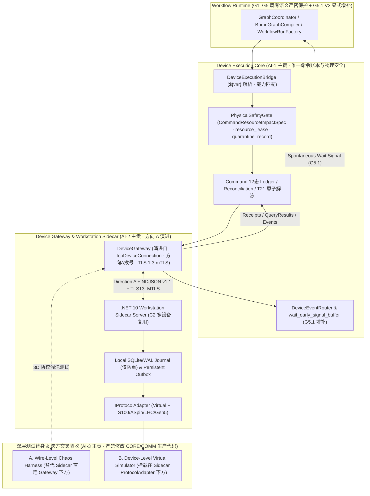

# PHASE3B_MASTER_CONTRACT — LabOS 设备执行体系核心契约与 4-AI 协作总纲（Draft v1.4 · 最终微调版）

> **状态**：`Draft v1.4（For Final Freeze Sign-Off）` — 基于三方对 v1.3 的复核仅作收敛微调（彻底封堵 `command_ledger.workstation_id` / `operation_name` 列级 `NOT NULL` 与非空白校验、补齐阶段 0 PG17 负向拒插断言、以及阶段 3《网络可达与 Lab-CA 运维核验单》退出门禁，不扩大范围）；**需先合入「阶段 0 契约冻结骨架 PR」后，再拉出 4 条实现分支并行开发**。  
> **统一基线**：`origin/main` @ `2e2e0eaffbb21ceadbbbe71bd201e8e22ddae692`（统一并取代此前审阅过程中出现过的 `c650e271` 与 `4b8e9d76` 历史快照引用；PR #18 `72febbf3` 仅追加文档提交免跑 CI 规则，代码与表结构零变更）。  
> **配套核心契约文件**：
> - 核心执行与物理安全：[DEVICE_EXECUTION_CORE_CONTRACT.md](./DEVICE_EXECUTION_CORE_CONTRACT.md)（AI-1 主责）
> - 网关通信与 Sidecar 协议：[DEVICE_GATEWAY_PROTOCOL.md](./DEVICE_GATEWAY_PROTOCOL.md)（AI-2 主责）
> - 数据库 `006` DDL 草案：[006_device_execution_contract_v1.draft.sql](./ddl/006_device_execution_contract_v1.draft.sql)（注意：**PR #17 处于 `docs/ddl/` 草案态，未被当前 CI 实际建库执行；待阶段 0 升入 `db/workflow_runtime/` 并完成 `002`/CI 35 表校验后，才首次接受真实 PG17 DDL 门禁验证**）
> - 历史基线审计与盘点：[DEVICE_INFRASTRUCTURE_AUDIT.md](./DEVICE_INFRASTRUCTURE_AUDIT.md) · [REAL_WORKFLOW_INVENTORY.md](./REAL_WORKFLOW_INVENTORY.md) · [DEVICE_EXECUTION_CONTRACT_V1.md](./DEVICE_EXECUTION_CONTRACT_V1.md)

---

## 0. 已拍板路线与四条工程红线

### 0.1 经项目负责人最终拍板的架构前提（2026-11-21 确认）
1. **零历史兼容与全新建工艺（已拍板权衡）**：
   - 新设备执行体系完全脱离旧设备链路与旧流程历史包袱：废除 `#!LABSEP!#` 协议（AI-2 在阶段 1 彻底从新链路移除 `LabSepWireCodec` 与 `labsep://` scheme）、废除 Redis `labos:link:*` 在线权威、废除 Sidecar 直连旧接口 `POST /api/device-events`、废除旧 `TcpDriverAdapter` / `TcpPersistentDriver`、`public.*` 命令表、`labos-kernel/sidecar-dotnet/` 与 `labos-gateway/`；
   - **历史旧代码仅可作为业务参数、设备时序与故障场景参考，绝不允许成为新系统的任何代码、数据结构或接口隐性依赖**；
   - 历史工艺 `1001017` / `1001041` **原样封存、不做 `__awaitEvent` 迁移**，直接在新引擎与新契约上从头构建 `EXT-STD-SINGLE-V1`（单板首发）与 `EXT-STD-BATCH4-V1`（四机并行）；
   - **显式权衡确认**：已正式接受「Phase 3E 前不走旧生产流量，全链路通过 Phase 3D 混沌模拟器压测 + Phase 3E 新建标准工艺独立验收」的推进路线。
2. **目标部署形态：C2（工位级 Sidecar Host）**：
   - **生产唯一目标架构（C2）**：每台工控机运行一个 `.NET 10` Sidecar Host，向下统一管理该工控机挂载的多台串口 / Vendor DLL / COM / OLE 设备，向上复用单一认证 TCP 会话；
   - **临时验证形态（C1）**：单设备独立端口仅允许在自动化集成测试或纯虚拟设备调试时临时使用，不得替代生产 C2 设计。
3. **TCP 连接方向与传输安全强制标准：方向 A（`CONFIRMED_BY_OPERATIONS / PENDING_NETWORK_TEST`）+ TLS 1.3 mTLS**：
   - **连接方向与验证边界（P1-A）**：已由现场运维确认「实验室局域网中控可直连各工控机固定 `IP:Port`」，暂锁定 **方向 A（Kernel TCP Client 主动连接先启动监听的 Sidecar TCP Server）**，当前状态诚实标注为 **`CONFIRMED_BY_OPERATIONS / PENDING_NETWORK_TEST`**；**进入 Phase 3E/预发布切入实景网络前，必须补签一份《网络可达与 Lab-CA 运维核验单》**（实测 Kernel→工控机跨网段 TCP 建连可达性、VLAN/防火墙/NAT 端口策略、工控机重启后静态 IP/DNS 解析稳定性，并写明 Lab-CA 证书签发/轮换/吊销运维责任人）。
   - **演进种子明确**：现有 [TcpDeviceConnection.java](../workflow-runtime/src/main/java/com/labos/kernel/workflow/runtime/gateway/TcpDeviceConnection.java) 已具备主动拨号 + `ndjson://` 架构基础，作为方向 A 网关的**正式演进种子**（由 AI-2 升级为工位级多设备复用 + TLS 1.3 mTLS 双向认证），而非推倒重造；
   - **传输安全模式（收口为仅两档，删除裸握手过渡层）**：
     - **`DEV_LOOPBACK_PLAINTEXT`**：仅限本机 `127.0.0.1` / `::1` 自动化单测与本地沙箱进程验证（代码层面强制拒绝绑定任何非回环网口或外部 IP）；
     - **`TLS13_MTLS`（所有非回环网络与首发实验室局域网的唯一合法模式）**：直接基于 TLS 1.3 双向证书认证（轻量内网 Lab CA 签发），原生提供**全帧加密、逐帧 AEAD 完整性校验、会话抗重放**与基于证书 SAN 白名单的工位/中控双向密码学身份绑定（详见 [DEVICE_GATEWAY_PROTOCOL.md §1.2](./DEVICE_GATEWAY_PROTOCOL.md)）。
4. **单实例运行前提不变**：V1 `PhysicalSafetyGate`（PG 行锁 `resource_lease` / `quarantine_record`）与网关 `connection_generation` 均严格运行在既有的单 Kernel `SingleInstanceHostLock` 假设之上；未来若演进为多活集群，须同步升级为分布式租约与真正分布式仲裁协议，并在本次文档与 `002` 校验中明确豁免边界。

### 0.2 四条安全与隔离红线
1. **禁止触碰脏主工作区**：原始开发主目录保留不动，一切契约与开发分支必须基于干净 `origin/main` worktree 创建。
2. **禁止直连共享库执行未审批迁移**：Phase 3B–3D 测试只允许使用本地或 CI 隔离 PostgreSQL 17 实例，严禁未授权对 `192.168.124.2:5432/labdb` 运行 `006` 或压测写入。
3. **保持 `RuntimeHost` 默认关闭**：[WorkflowRuntimeHostProperties.java](../labos-kernel/src/boot/java/com/labos/boot/WorkflowRuntimeHostProperties.java#L46) 中 `labos.workflow.runtime.host.enabled` 维持 `false` 至 Phase 3F 单独评审启用。
4. **禁止未授权向真实实验室硬件发送命令**。

---

## 1. 系统边界全景图（不混淆业务编排、执行内核、通信层与测试替身）

---

## 2. 四 AI 权限矩阵、分支与文件所有权隔离

### 2.1 公共契约只读锁（阶段 0 合入后 4 条分支一律禁止擅改）
在 4 个 AI 创建开发分支前，由集成负责人合入一次**「阶段 0 契约冻结骨架 PR」**。合入 `main` 后，以下目录与文件成为**四分支只读基线**；若 AI-1/AI-2 发现契约接口缺陷，必须提契约变更提案由集成负责人合入公共分支后再统一 rebase，**禁止任何 AI 在个人分支私自改动**：
- 核心契约三文档及冻结 DDL：`docs/PHASE3B_MASTER_CONTRACT.md`、`docs/DEVICE_EXECUTION_CORE_CONTRACT.md`、`docs/DEVICE_GATEWAY_PROTOCOL.md`、`db/workflow_runtime/006_device_execution_contract_v1.sql`；
- 契约守卫与 CI 断言：`db/workflow_runtime/002_schema_contract.sql`（35 表声明、`workstation_sidecar.connection_generation` 白名单说明、`command_ledger` 夹具对齐，以及 `command_ledger` / `wait_early_signal_buffer` PG17 负向拒插断言）、`.github/workflows/workflow-runtime-db.yml`（全数更新 3 处表计数 `32 -> 35`：[L86/L102/L111](../.github/workflows/workflow-runtime-db.yml#L86-L111)）、[test_pg_con_matrix.py](../db/workflow_runtime/tests/test_pg_con_matrix.py#L200)（`con08` 工位种子与命令夹具对齐）；
- 共享 Java 契约包：`workflow-runtime/src/main/java/com/labos/kernel/workflow/runtime/device/contract/**`（含将原 [DeviceCommandAdapter.java:16](../workflow-runtime/src/main/java/com/labos/kernel/workflow/runtime/command/DeviceCommandAdapter.java#L16) 中的 `DeviceCommandEnvelope` **整体迁入替换**于此包，**禁止新旧同名 record 并存**；并同步对齐 `WorkflowRuntimeRepository.createCommand` / `createCommandForAttempt`、`WorkerExecutionService` 与 `workflow-runtime/src/test/**` 既有命令夹具，强制必填 `workstation_id` 与 `operation_name`，不设可空 mock 豁免）；
- G5.1 增补扩展：`GraphPlan` `SCHEMA_VERSION_V3`（完整保留 V1/V2 既有校验与测试）及 `WaitSpec.deadlinePolicy` 编译支持（严格门控审批，AI-1 不可自行扩改 G1–G5 调度规则）；
- Spring Boot 端点与配置适配：[WorkflowRuntimeHostProperties.java](../labos-kernel/src/boot/java/com/labos/boot/WorkflowRuntimeHostProperties.java#L164-L204)（移除配置级 `labsep://` 入口与补充多设备工位 TLS/endpoint 结构）与 `WorkflowRuntimeKernelConfiguration.java`（继续锁定 `host.enabled=false`）；
- **仓库根中立目录**跨语言黄金报文与 6 条契约不变式测试骨架：**`contract-fixtures/v1_1/*.json`**（位于仓库根中立路径，Java Maven 与 `.NET 10` 测试工程双方直接读取同一组文件，杜绝双份漂移）及 6 条不变式测试断言骨架。

### 2.2 四 AI 严格权限与跨 AI 相互验证规则

> **核心治理原则（P1-4 交叉验证铁律）**：**任何一个 AI 都不能单独“定义、实现、测试并自行证明”同一条安全边界正确**——AI-1 与 AI-2 负责交付各自模块级单测，AI-3 负责执行跨边界对抗测试与黑盒系统验收并产出原始日志/证据，集成负责人独立复核测试覆盖度、日志、SHA 并最终裁决签字；AI-4 编写标准工艺与验收场景，严禁自签 `PASS`。

| 维度 | AI-1（主力 1 · Core） | AI-2（主力 2 · Gateway & Sidecar） | AI-3（辅助 1 · Simulator & 黑盒执行） | AI-4（辅助 2 · Workflow & Runbook） |
| :--- | :--- | :--- | :--- | :--- |
| **独立分支** | `feat/phase3-device-execution-core` | `feat/phase3-device-gateway-sidecar` | `feat/phase3-device-simulator-chaos` | `feat/phase3-standard-workflows` |
| **Runtime 命令核心 & 安全** | **主责**（12 态执行、T21 原子解冻、`PhysicalSafetyGate`、G5.1 早到路由 + 本模块测试） | 验证网关异常回执无法绕过 Core 安全拦截 | 黑盒对抗与并发崩溃恢复验收 | 禁止 |
| **Gateway & Sidecar** | 禁止 | **主责**：`3C-1`（方向 A `TLS13_MTLS` 网关 + .NET Sidecar WAL/Outbox + 虚拟适配器 + 模块自测）→ `3C-2`（S100/ASpin/LHC/Gen5 迁移） | 伪造证书/跨工位抢注/篡改/重放混沌测试 | 禁止 |
| **公共契约 & Schema (`device/contract`, `contract-fixtures`, `002`, `006`, `boot`)** | 只读消费（变更须提 RFC） | 只读消费（变更须提 RFC） | 只读对齐校验 | 只读消费 |
| **Simulator & Chaos** | 配合修复 bug | 配合修复 bug & Adapter SPI 对齐 | **主责**：Wire Chaos Harness + Device Virtual Simulator | 使用运行工艺 |
| **标准工艺 (`EXT-STD-*`)** | 提供 Core/SafetyGate API | 提供能力注册 | **黑盒执行验收**（原始证据交付集成负责人复核） | **主责**（工艺建模、参数、Runbook、验收剧本） |
| **排他目录清单** | `workflow-runtime/.../command/**` `workflow-runtime/.../bridge/**` `workflow-runtime/.../safety/**` `workflow-runtime/.../recovery/**` `workflow-runtime/.../persistence/DeviceExecution*Repository.java` **定点独占**：仅 AI-1 可按核心契约修改 [WorkflowRuntimeRepository.java](../workflow-runtime/src/main/java/com/labos/kernel/workflow/runtime/persistence/WorkflowRuntimeRepository.java) 的 3 个精确切片（L1700 `resolveUnknownCommand` / L4428 状态矩阵 / L5355 恢复过滤） | `workflow-runtime/.../gateway/**` `sidecar-dotnet/**` `docs/Sidecar*` | `workflow-runtime/src/test/java/.../chaos/**` `simulators/device-virtual-sim/**` `scripts/test-phase3d-*`、`scripts/verify-phase3-*` | `workflow-runtime/src/main/resources/workflows/standard/**` 新工艺 Seeder、`scripts/test-phase3e-*` `docs/runbooks/**`、验收数据剧本 |

---

## 3. 五阶段推进路线、门禁与旧链路退役工单

| 阶段 | 前置条件 | 核心交付与执行重点 | 可执行退出门禁 |
| :--- | :--- | :--- | :--- |
| **阶段 0：契约冻结** | 三方审阅本修订包签字 | 合并「契约冻结骨架 PR」（Core + Protocol + 正式 `006` DDL + `002`/CI 35 表 + `con08` 与 Java 命令夹具对齐 + Java `device/contract` 迁移替换 + G5.1 V3 + `WorkflowRuntimeHostProperties` + `contract-fixtures/v1_1/` + 6 不变式与 PG17 负向拒插测试骨架），拿到统一 `origin/main` SHA | 正式 `006` 在 PG17 CI 首跑全绿、`002_schema_contract.sql`（35 表 + `command_ledger` 缺 `workstation_id`/`operation_name` 与 `wait_early_signal_buffer` 跨 Run 负向拒插校验）与 `test_pg_con_matrix.py` 全绿（不在此阶段要求 `gateway/**` 清零 `#!LABSEP!#`，交由阶段 1 AI-2 执行） |
| **阶段 1：主力并行 + 混沌/工艺起步** | 阶段 0 合入 | AI-1 实现 Core/SafetyGate/T21/G5.1；AI-2 优先交付 **`3C-1` 关键路径**（并彻底清除新链路里的 `LabSepWireCodec` 与旧协议逻辑），并行推进 `3C-2` 硬件适配器；AI-3 建双层模拟器；AI-4 编写 `EXT-STD-SINGLE-V1` 规范 | 模块自测全绿；**AI-2 退出可执行 grep 门禁**：`rg -n "LABSEP\|LabSepWireCodec\|labos:link" workflow-runtime/ sidecar-dotnet/` 返回 0 命中（阶段 4 正式退役前，老内核旧模块仍按单独工单静默封存） |
| **阶段 2：3D 核心混沌联调** | AI-1 + AI-2(`3C-1`) + AI-3 就绪 | AI-3 使用 Wire Chaos Harness + Virtual Device Simulator 注入断连、RST、黑洞、丢回执、重包、Sidecar WAL 崩溃、`FRESH_STORAGE`、错证/跨 ID 抢注、早到事件并发竞争与资源隔离 | 6 条硬契约不变式 + 混沌压测 100% 收敛且零误判 `CONFIRMED_SUCCEEDED` |
| **阶段 3：3E 标准工艺落地** | 阶段 2 混沌通过 | 先集成并独立验收 **`EXT-STD-SINGLE-V1`**；通过后再推进 **`EXT-STD-BATCH4-V1`** | 《网络可达与 Lab-CA 运维核验单》已实测签署（切入实景网络前置门禁，责任人：待指定）；单板与四机连续跑通正常 + 注入故障恢复场景 |
| **阶段 4：3F 独立验收 & 旧链路正式退役工单** | 阶段 3 全通 | 1. **跨 AI 独立验收**：AI-3 执行验收并产出原始日志，**集成负责人**独立审计覆盖率、原始日志与 SHA 后签发 **`PASS` / `FAIL` / `BLOCKED` / `UNKNOWN`** 四态总报告； 2. **旧链路显式退役工单**（单独 PR，经灰度审批生效）：主动切换 [WorkflowService.buildAdapter:1879-1892](../labos-kernel/src/main/java/com/labos/kernel/workflow/WorkflowService.java#L1879-L1892) 的默认短连直连入口，并确认 `labos-gateway/`、`labos-kernel/sidecar-dotnet/`、`TcpDriverAdapter`、`TcpPersistentDriver` 无残余生产引用后归档移除。 | 全项 `PASS` + `host.enabled` 灰度审批记录 + 旧默认适配器切换提交归档 |
