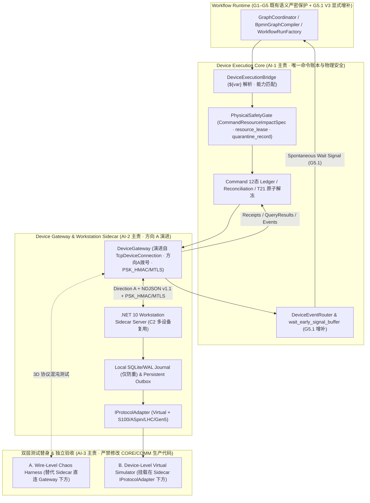

# PHASE3B_MASTER_CONTRACT — LabOS 设备执行体系核心契约与 4-AI 协作总纲（Draft v1.1 · 冻结评审版）

> **状态**：`Draft v1.1（For Freeze Sign-Off）` — 合并三轮独立审阅与现场网络/路线确认后的修订版；**需先合入「阶段 0 契约冻结骨架 PR」后，再拉出 4 条实现分支并行开发**。  
> **统一基线**：`origin/main` @ `2e2e0eaffbb21ceadbbbe71bd201e8e22ddae692`（统一并取代此前审阅过程中出现过的 `c650e271` 与 `4b8e9d76` 历史快照引用）。  
> **配套核心契约文件**：
> - 核心执行与物理安全：[DEVICE_EXECUTION_CORE_CONTRACT.md](./DEVICE_EXECUTION_CORE_CONTRACT.md)（AI-1 主责）
> - 网关通信与 Sidecar 协议：[DEVICE_GATEWAY_PROTOCOL.md](./DEVICE_GATEWAY_PROTOCOL.md)（AI-2 主责）
> - 数据库 `006` DDL 草案：[006_device_execution_contract_v1.draft.sql](./ddl/006_device_execution_contract_v1.draft.sql)（阶段 0 冻结校验后正式迁入 `db/workflow_runtime/`）
> - 历史基线审计与盘点：[DEVICE_INFRASTRUCTURE_AUDIT.md](./DEVICE_INFRASTRUCTURE_AUDIT.md) · [REAL_WORKFLOW_INVENTORY.md](./REAL_WORKFLOW_INVENTORY.md) · [DEVICE_EXECUTION_CONTRACT_V1.md](./DEVICE_EXECUTION_CONTRACT_V1.md)

---

## 0. 已拍板路线与四条工程红线

### 0.1 经项目负责人最终拍板的架构前提（2026-11-21 确认）
1. **零历史兼容与全新建工艺（已拍板权衡）**：
   - 新设备执行体系完全脱离旧设备链路与旧流程历史包袱：废除 `#!LABSEP!#` 协议（从新链路移除 `LabSepWireCodec` 与 `labsep://` scheme）、废除 Redis `labos:link:*` 在线权威、废除 Sidecar 直连旧接口 `POST /api/device-events`、废除旧 `TcpDriverAdapter` / `TcpPersistentDriver`、`public.*` 命令表、`labos-kernel/sidecar-dotnet/` 与 `labos-gateway/`；
   - **历史旧代码仅可作为业务参数、设备时序与故障场景参考，绝不允许成为新系统的任何代码、数据结构或接口隐性依赖**；
   - 历史工艺 `1001017` / `1001041` **原样封存、不做 `__awaitEvent` 迁移**，直接在新引擎与新契约上从头构建 `EXT-STD-SINGLE-V1`（单板首发）与 `EXT-STD-BATCH4-V1`（四机并行）；
   - **显式权衡确认**：已正式接受「Phase 3E 前不走旧生产流量，全链路通过 Phase 3D 混沌模拟器压测 + Phase 3E 新建标准工艺独立验收」的推进路线。
2. **目标部署形态：C2（工位级 Sidecar Host）**：
   - **生产唯一目标架构（C2）**：每台工控机运行一个 `.NET 10` Sidecar Host，向下统一管理该工控机挂载的多台串口 / Vendor DLL / COM / OLE 设备，向上复用单一认证 TCP 会话；
   - **临时验证形态（C1）**：单设备独立端口仅允许在自动化集成测试或纯虚拟设备调试时临时使用，不得替代生产 C2 设计。
3. **TCP 连接方向与安全认证已锁定：方向 A + 分级认证**：
   - **连接方向（已确认实验室局域网中控可直连各工控机固定 `IP:Port`）**：锁定 **方向 A（Kernel TCP Client 主动连接先启动监听的 Sidecar TCP Server）**；
   - **演进种子明确**：现有 [TcpDeviceConnection.java](../workflow-runtime/src/main/java/com/labos/kernel/workflow/runtime/gateway/TcpDeviceConnection.java) 已具备主动拨号 + `ndjson://` 架构基础，作为方向 A 网关的**正式演进种子**（剥离 `LabSepWireCodec` 并升级为工位级多设备复用 + 认证握手），而非推倒重造；
   - **传输认证分级**：不再使用裸明文 ID 准入，通信框架必须内建三档 `TransportSecurityMode`——`DEV_LOOPBACK`（仅本地回环单测）、**`PSK_HMAC_CHALLENGE`（Phase 3B/3C/3E 首发强制默认：双向随机 `nonce` + 预共享工位密钥 HMAC-SHA256 挑战认证 + Kernel 白名单校验）**、**`MTLS`（Phase 3F 生产加固平滑切换，上层 NDJSON 帧零修改）**。
4. **单实例运行前提不变**：V1 `PhysicalSafetyGate`（PG 行锁 `resource_lease` / `quarantine_record`）与网关 `connection_generation` 均严格运行在既有的单 Kernel `SingleInstanceHostLock` 假设之上；未来若演进为多活集群，须同步升级为分布式租约与真正分布式仲裁协议，并在本次文档与 `002` 校验中明确豁免边界。

### 0.2 四条安全与隔离红线
1. **禁止触碰脏主工作区**：原始开发主目录保留不动，一切契约与开发分支必须基于干净 `origin/main` worktree 创建。
2. **禁止直连共享库执行未审批迁移**：Phase 3B–3D 测试只允许使用本地或 CI 隔离 PostgreSQL 17 实例，严禁未授权对 `192.168.124.2:5432/labdb` 运行 `006` 或压测写入。
3. **保持 `RuntimeHost` 默认关闭**：[WorkflowRuntimeHostProperties.java](../labos-kernel/src/boot/java/com/labos/boot/WorkflowRuntimeHostProperties.java#L46) 中 `labos.workflow.runtime.host.enabled` 维持 `false` 至 Phase 3F 单独评审启用。
4. **禁止未授权向真实实验室硬件发送命令**。

---

## 1. 系统边界全景图（不混淆业务编排、执行内核、通信层与测试替身）

---

## 2. 四 AI 权限矩阵、分支与文件所有权隔离

### 2.1 公共契约只读锁（阶段 0 合入后 4 条分支一律禁止擅改）
在 4 个 AI 创建开发分支前，由集成负责人合入一次**「阶段 0 契约冻结骨架 PR」**。合入 `main` 后，以下目录与文件成为**四分支只读基线**；若 AI-1/AI-2 发现契约接口缺陷，必须提契约变更提案由集成负责人合入公共分支后再统一 rebase，**禁止任何 AI 在个人分支私自改动**：
- 核心契约三文档及冻结 DDL：`docs/PHASE3B_MASTER_CONTRACT.md`、`docs/DEVICE_EXECUTION_CORE_CONTRACT.md`、`docs/DEVICE_GATEWAY_PROTOCOL.md`、`db/workflow_runtime/006_device_execution_contract_v1.sql`；
- 契约守卫与 CI 断言：`db/workflow_runtime/002_schema_contract.sql`、`.github/workflows/workflow-runtime-db.yml`（全数更新 3 处表计数 `32 -> 35`：[L86/L102/L111](../.github/workflows/workflow-runtime-db.yml#L86-L111)）；
- 共享 Java 契约包：`workflow-runtime/src/main/java/com/labos/kernel/workflow/runtime/device/contract/**`（含将原 [DeviceCommandAdapter.java:16](../workflow-runtime/src/main/java/com/labos/kernel/workflow/runtime/command/DeviceCommandAdapter.java#L16) 中的 `DeviceCommandEnvelope` **整体迁入替换**于此包，**禁止新旧同名 record 并存**）；
- G5.1 增补扩展：`GraphPlan` `SCHEMA_VERSION_V3`（完整保留 V1/V2 既有校验与测试）及 `WaitSpec.deadlinePolicy` 编译支持（严格门控审批，AI-1 不可自行扩改 G1–G5 调度规则）；
- Spring Boot 端点与配置适配：[WorkflowRuntimeHostProperties.java](../labos-kernel/src/boot/java/com/labos/boot/WorkflowRuntimeHostProperties.java#L164-L204)（剥离 `labsep://` 与补充多设备工位映射结构）与 `WorkflowRuntimeKernelConfiguration.java`（继续锁定 `host.enabled=false`）；
- 跨语言黄金报文与 6 条契约不变式测试骨架：`workflow-runtime/src/test/resources/contract-v1_1-fixtures/*.json` 及契约不变式测试清单。

### 2.2 四 AI 严格权限分工表

> 关键治理原则：**AI-4 编写标准工艺与验收场景，但绝不给自己签发最终 `PASS`；所有系统级黑盒验收统一由 AI-3 独立执行并出具带日志/SHA 的四态证据，集成负责人最终裁决。**

| 维度 | AI-1（主力 1 · Core） | AI-2（主力 2 · Gateway & Sidecar） | AI-3（辅助 1 · Simulator & 独立验收） | AI-4（辅助 2 · Workflow & Runbook） |
| :--- | :--- | :--- | :--- | :--- |
| **独立分支** | `feat/phase3-device-execution-core` | `feat/phase3-device-gateway-sidecar` | `feat/phase3-device-simulator-chaos` | `feat/phase3-standard-workflows` |
| **Runtime 命令核心 & 安全** | **主责**（12 态执行、T21 原子解冻、`PhysicalSafetyGate`、G5.1 早到路由） | 禁止 | 禁止修改核心代码（仅黑盒测试） | 禁止 |
| **Gateway & Sidecar** | 禁止 | **主责**：`3C-1`（方向 A 网关 + .NET Sidecar WAL/Outbox + 虚拟适配器）→ `3C-2`（S100/ASpin/LHC/Gen5 迁移） | 协议一致性与断连测试 | 禁止 |
| **公共契约 & Schema (`device/contract`, `002`, `006`, `boot`)** | 只读消费（变更须提 RFC） | 只读消费（变更须提 RFC） | 只读测试验证 | 只读消费 |
| **Simulator & Chaos** | 配合修复 bug | 配合修复 bug & Adapter SPI 对齐 | **主责**：Wire Chaos Harness + Device Virtual Simulator | 使用运行工艺 |
| **标准工艺 (`EXT-STD-*`)** | 提供 Core/SafetyGate API | 提供能力注册 | **黑盒独立验收** | **主责**（工艺建模、参数、Runbook、验收场景集） |
| **排他目录清单** | `workflow-runtime/.../command/**` `workflow-runtime/.../bridge/**` `workflow-runtime/.../safety/**` `workflow-runtime/.../recovery/**` `workflow-runtime/.../persistence/DeviceExecution*Repository.java` **定点独占**：仅 AI-1 可按核心契约修改 [WorkflowRuntimeRepository.java](../workflow-runtime/src/main/java/com/labos/kernel/workflow/runtime/persistence/WorkflowRuntimeRepository.java) 的 3 个精确切片（L1700 `resolveUnknownCommand` / L4428 状态矩阵 / L5355 恢复过滤） | `workflow-runtime/.../gateway/**` `sidecar-dotnet/**` （含从 `DeviceCommandAdapter` 下游剥离遗留 codec 后全归网关与端到端实现） | `workflow-runtime/src/test/java/.../chaos/**` `simulators/device-virtual-sim/**` `scripts/test-phase3d-*`、`scripts/verify-phase3-*` | `workflow-runtime/src/main/resources/workflows/standard/**` 新工艺 Seeder、`scripts/test-phase3e-*` `docs/runbooks/**`、验收数据剧本 |

---

## 3. 五阶段推进路线与验收铁律

| 阶段 | 前置条件 | 核心交付与执行重点 | 退出门禁 |
| :--- | :--- | :--- | :--- |
| **阶段 0：契约冻结** | 三方审阅本修订包签字 | 合并「契约冻结骨架 PR」（Core + Protocol + 正式 `006` SQL + `002`/CI 35 表 + Java `device/contract` 替换迁移 + G5.1 V3 + `WorkflowRuntimeHostProperties` + Golden Fixtures + 6 不变式测试用例框架），拿到统一 `origin/main` SHA | PG17 CI + 全量单测绿；零 `#!LABSEP!#` 残留 |
| **阶段 1：主力并行 + 混沌/工艺起步** | 阶段 0 合入 | AI-1 实现 Core/SafetyGate/T21/G5.1；AI-2 优先交付 **`3C-1` 关键路径**（并行拆分 `3C-2` 硬件驱动迁移不阻塞联调）；AI-3 构建双层模拟器；AI-4 编写 `EXT-STD-SINGLE-V1` 规范与场景 | 各分支自测通过且零越权文件修改 |
| **阶段 2：3D 核心混沌联调** | AI-1 + AI-2(`3C-1`) + AI-3 就绪 | AI-3 使用 Wire Chaos Harness + Virtual Device Simulator 注入断连、RST、黑洞、丢回执、重包、Sidecar WAL 崩溃、存储损坏(`FRESH_STORAGE`)、早到事件竞态与资源隔离 | 6 条硬契约不变式 + 混沌压测 100% 收敛且零误判 `CONFIRMED_SUCCEEDED` |
| **阶段 3：3E 标准工艺落地** | 阶段 2 混沌通过 | 先集成并独立验收 **`EXT-STD-SINGLE-V1`**（单板 12 步 + 等待 + 故障恢复 + T21）；通过后再推进 **`EXT-STD-BATCH4-V1`**（四机并行 + `rail:`/`turntable:` 物理竞争 + `deadlinePolicy=ESCALATE_MANUAL`） | 单板与四机连续跑通正常+注入故障场景 |
| **阶段 4：3F 独立验收与退役准备** | 阶段 3 全通 | **AI-3 独立执行黑盒验收**，集成负责人逐项复核四态结论：**`PASS` / `FAIL` / `BLOCKED` / `UNKNOWN`**（严禁虚报或跳过项记 PASS）；同步盘点确认 `labos-gateway/` 等旧模块已无生产调用方后，再安排独立灰度启用评审（`host.enabled`）与旧链路退役 | 完整独立验收包、命令日志、精确 SHA 归档 |
