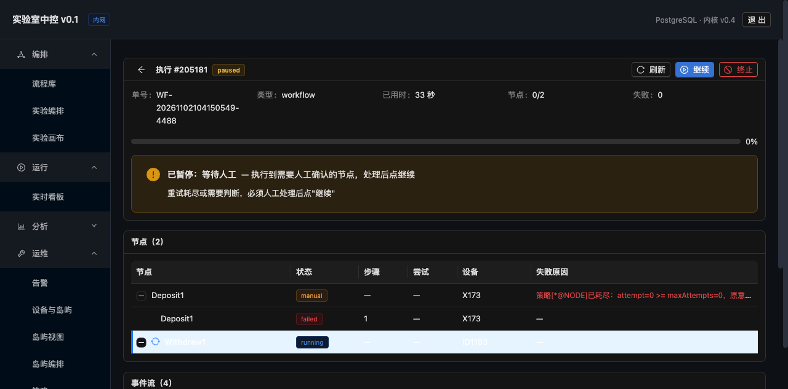

# Execution Monitoring UI

> **English edition.** The Chinese original is [`docs/执行监控界面.md`](../执行监控界面.md);
> this is a line-for-line translation. Numbers, commit hashes and file paths are identical to
> the Chinese source — if they ever disagree, the Chinese original wins.

> While an experiment is running you can **see in real time which step it has reached**,
> and pause / continue / stop it.
> The same is true for a simulated run.



---

## 1. What this page has to answer

When an operator is watching the screen, there are three things they most want to know:

| Question | Where it is on the interface |
|---|---|
| **Which step has it reached?** | The progress bar at the top + "Running: Withdraw1 · Step 2 · Device X173" |
| **Why did it stop?** | The pause banner: the kind (device fault / waiting for operator / plate position unknown) + the reason + the condition for resuming |
| **What should I do?** | Buttons: Continue / Stop (a correction dialog pops up when the plate position is unknown) |

---

## 2. The three pause states do not look alike

| Kind | Colour | Banner text | Condition for resuming |
|---|---|---|---|
| `paused_fault` | Red | "Device fault" | **It continues automatically once the device heartbeat recovers; no human is needed** |
| `waiting_human` | Orange | "Waiting for operator" | The retries are exhausted or a decision is needed, **a human must handle it and then press Continue** |
| `paused_unknown` | Volcano | "Plate position unknown" | **Someone has to count the plate on site and enter the actual position** |

**Why they are separated**: merged into one "paused", the operator cannot tell whether
they should step in or not.

- With `paused_fault`, pressing Continue yourself can even interrupt the automatic
  recovery
- With `paused_unknown`, pressing Continue without entering the correction makes **every
  later position check wrong**

---

## 3. The key details

### 3.1 While paused it must not show "Running"

**The pitfall we hit**: after a pause, `run_node.status` is still `running` (because the
node status was not changed), so the interface rendered from the node status and ended up
showing "Paused" and "Running" at the same time.

**The fix**: only show "Running" when `run.status === 'running'`.

```tsx
{current && run?.status === 'running' && (
  <Alert icon={<SyncOutlined spin />} message={`Running: ${current.name}`} />
)}
```

### 3.2 The device shows its code, not its id

**The pitfall we hit**: the interface showed "Device 200171", and the operator had no idea
which machine that was.

**The fix**: the backend adds `resourceCode` to the nodes in the `run` detail (JOIN
`resource_node`), and the frontend prefers the code and falls back to the id.

```
Device 200171  →  Device X173
```

### 3.3 The row that is currently executing has to be recognisable at a glance

```css
.row-running > td { background: #e6f4ff !important; }
.row-running > td:first-child { box-shadow: inset 3px 0 0 #1677ff; }
```

**A pale blue background + a blue bar on the left** — one glance tells you how far it
has got.

### 3.4 Refresh frequency

**Polling every 2 seconds while running / paused**, no polling once it has finished.

**One notch faster than the backend**: after pressing the "Pause" button the state change
is visible within 2 seconds, so there is no "I pressed it and nothing happened"
impression.

---

## 4. ⚠ A real problem fixed along the way: MANUAL was treated as a failure

**Found while taking the screenshot**: after the execution finished, the status was
`failed` (red), but the event said "the policy is exhausted: hand over to an operator".

**The root cause**:

```java
// in settleRun
boolean bad = p.count(NodeStatus.MANUAL) > 0 || p.aborted();
String status = bad ? "failed" : "completed";
```

**The semantics of `MANUAL` are "it cannot recover automatically, hand over to a
human"** — that is **not a failure**, it is **a pause waiting for a person**.

**The consequences**:

- The interface shows a red "Failed", and the operator thinks the workflow is broken
- The only reaction is to **re-run the whole workflow**, instead of pressing "Continue"
- A re-run starts from the beginning, wasting the nodes that already completed

**The fix**:

```java
if (aborted) {
    status = "failed";                    // a real failure
} else if (manual) {
    status = "paused";                    // hand-over to an operator = paused
    pause_kind = "waiting_human";
    pause_reason = "执行到需要人工确认的节点，处理后点继续";
} else {
    status = "completed";
}
```

**After the change**: for the same workflow the interface shows a golden `paused` + a
"Continue" button, and the operator **knows at a glance where to click**.

---

## 5. Acceptance

```
① Live progress       refreshes every 2 seconds while running, progress bar + elapsed time
② Current step        Running: Withdraw1 · Device X173
③ Pause state         golden paused + the pause reason + a hint about the resume condition
④ Continue / Stop     the buttons are visible and usable
⑤ Continue takes effect   paused → running (the API returns ok)
⑥ Device code         X173 rather than 200171
⑦ Row highlight       the current row has a pale blue background + a blue bar on the left
```

**Measured**:

```
Create a paused_unknown → screenshot: the yellow banner "plate position unknown, someone has to count it on site"
Press the recover button → the correction dialog pops up (plate ID + actual position)
A MANUAL node → status paused/waiting_human (not failed)
Press Continue → the status becomes running
```

---

## 6. The frontend API wrappers

`webapp/src/api/client.ts` gains 6:

| Method | Endpoint |
|---|---|
| `pauseRun(id, kind, reason, nodeKey)` | `POST /api/runs/{id}/pause` |
| `resumeRun(id, action, corrections)` | `POST /api/runs/{id}/resume` |
| `pausedRuns()` | `GET /api/runs/paused` |
| `canStart(workflowId)` | `GET /api/workflows/{id}/can-start` |
| `unknownPlates()` | `GET /api/plates/unknown` |
| `locatePlate(barcode, location)` | `POST /api/plates/{barcode}/locate` |

**The last five are there for the later interfaces** (the preflight screen, the paused
list, the plate inventory),
**this round built the run detail page**.
