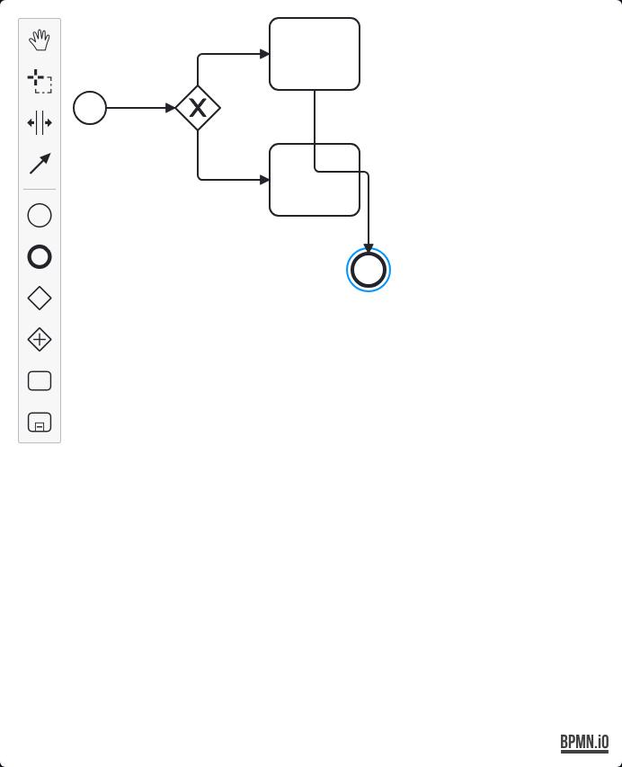
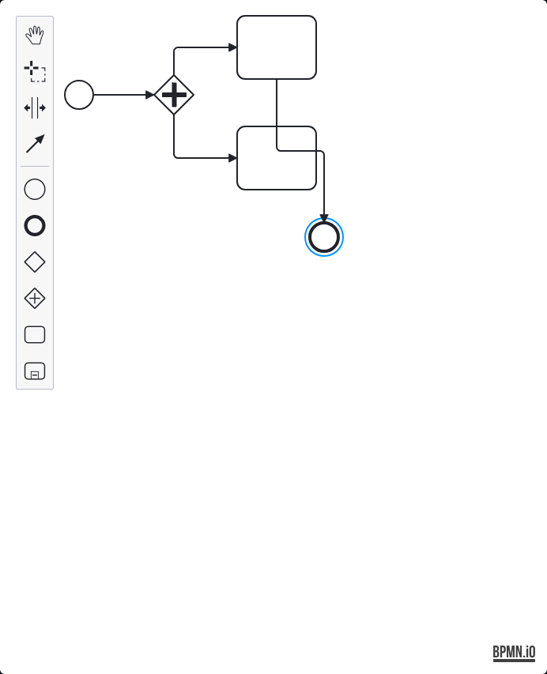

# Live Page Exercise Report · Multiple Parallel Gateways + Multiple Gateways + Variables (2026-11-05)

> Answers one question: **if you really drag a graph with multiple parallel gateways +
> multiple exclusive gateways + variable nodes on the page, does the execution side
> accept it? Do the parallel branches really run in parallel, and does the join wait for
> all of them?**
>
> Script: `scripts/e2e-multi-parallel.py` (gate section 4.14, threshold `MIN_MULTIPAR=21`)
> Re-run: `python3 scripts/e2e-multi-parallel.py --base http://localhost:5173`
> Environment: macOS, frontend `5173` + API `18080` + PostgreSQL `192.168.124.2:5432/labdb`
> Result: **21 / 0 all green** (identical across 3 consecutive runs)

---

## 1. One-line conclusion

| Capability | Status | Evidence |
|---|---|---|
| **Multiple parallel gateways coexisting** (P1 + nested P2) | ✅ supported, **and accepted when dragged on the page** | graph holds `parallelGateway ×4` (2 gateways × open/close tag), all three branches `completed` on a real run |
| **Multiple exclusive gateways coexisting** | ✅ supported | graph holds `exclusiveGateway ×4`, each branch takes exactly one outgoing edge |
| **Variables flowing across branches** | ✅ supported | `counter=1` written by SET, both exclusive conditions `${counter} == 1` match |
| **Parallel join waits for all branches** | ✅ supported | all three parallel branches `completed` **and** the whole run `completed` |
| **Graph drawn on the page = graph the execution side sees** | ✅ seam closed | all 12 nodes / 13 edges persisted, then really ran to `completed` |

**The gap this closes**: the backend matrix's `parallel` case is posted directly via
`build_xml()` — **it bypasses the UI**. The page track had only ever drawn a **single**
exclusive gateway (`e2e-flow-matrix.py` section F). A graph with **two parallel gateways +
two exclusive gateways + variables** on the same canvas had **never been dragged by anyone**.
This round closes that.

---

## 2. What the two gateways look like (real screenshots)

The designer palette has two gateway entries — **the icon is the fastest way to tell them apart**:

| palette label | Icon | Parser type | Execution semantics |
|---|---|---|---|
| **Create gateway** | **✕-shaped** diamond (hollow X) | `exclusiveGateway` | **exclusive**: when splitting it takes **only one** branch; when joining, any arriving branch releases it |
| **Create parallel gateway** | **＋-shaped** diamond | `parallelGateway` | **parallel**: when splitting it takes **all** branches; when joining, it waits until **every incoming branch** has arrived |

The two pictures below were **really dragged in the designer** (captured by
`scripts/shot-gateways.py`; the flow shape is identical, only the gateway differs):

**A · Exclusive gateway (Create gateway, ✕ shape)**



**B · Parallel gateway (Create parallel gateway, ＋ shape)**



> Look at the 6th and 7th icons in the left palette: **hollow diamond = exclusive (✕)**,
> **diamond with a cross = parallel (＋)**. The ＋-shaped parallel gateway entry is what this
> project added in batch 2 (`webapp/src/bpmn/WorkflowPalette.ts`, `create.parallel-gateway`) —
> bpmn-js only offered the exclusive one by default, so a parallel split previously had to be
> written as raw XML.

## 3. The shape of the graph (really dragged on the page)

```
   S ── SET ── P1 ──┬── A ── X ── C ──┐
  start  var   par │  var  xor  expr │
                     │                  │
                     └── P2 ──┬── B ── X2 ── D ──┤
                       par │  var  xor  expr    │
                           │                     │
                           └── F ────────────────┤
                             var                 │
                                                  │
                                              E (end)
```

| Role | Node | Type | Setting made on the page |
|---|---|---|---|
| Start | S | startEvent | — |
| Variable source | SET | `__setVar` | `counter = 1` |
| Parallel gateway 1 | P1 | parallelGateway | splits into two (A / P2) |
| Parallel gateway 2 | P2 | parallelGateway | nested inside one P1 branch, splits into B / F |
| Variables | A / B / F | `__setVar` | `branchA` / `branchB` / `branchF` = `yes` |
| Exclusive gateways | X / X2 | exclusiveGateway | outgoing edge condition `${counter} == 1` |
| Expressions | C / D | `__expr` | `hitC` / `hitD` = `${counter}` |
| Join | E | endEvent | all three lines arrive here |

**12 nodes / 13 edges** in total, all dragged on the page and persisted.

---

## 4. Evidence from the real run

### 4.1 Structure after saving

```
13 条连线全部连上并落库（13 条）
13 条连线都落了库（13 条）
图里有 2 个并行网关（parallelGateway ×4）
图里有 2 个异或网关（exclusiveGateway ×4）
两条连线条件进了图（conditionExpression ×4）
变量节点参数进了图（methodParams 带 counter）
```

> `parallelGateway ×4` / `exclusiveGateway ×4` counts the **open and close tag** of each
> gateway, so the real node count is 2 (the assertion checks `>= 2`).

### 4.2 Real execution result

```
触发真执行（run #207135 → completed）
整单 completed
SET 执行过（页面上设的 __setVar 被执行侧认到）
并行分支 A 执行了（P1 的第一支）
并行分支 B 执行了（P2 的第一支）
并行分支 F 执行了（P2 的第二支）
异或分支 1 命中 C（${counter} == 1 生效）
异或分支 2 命中 D（${counter} == 1 生效）
三条并行分支都 completed（汇合等齐了：只完成一支不会是这个结果）
整单 completed 说明所有分支都汇合到 end 后才收尾

通过 21 / 失败 0
```

`run_node` detail in the database (`run #207135`, level=0):

```
Activity_1hebpxc | completed     ← SET
Activity_1vvwcsz | completed     ← A
Activity_0xerap2 | completed     ← B
Activity_1yt7xt0 | completed     ← C
Activity_0is03an | completed     ← D
Activity_0riptu9 | completed     ← F
```

`run` table: `207135 | WF-20261105204534599-0346 | completed`

---

## 5. Four pitfalls hit along the way (all real UI-layer fragilities)

### 5.1 The canvas is only ~690px wide, and an out-of-range coordinate **silently** drops the node

The "devices by island" panel on the left squeezes `.djs-container` down to `width≈691.9`
(at a 1500px viewport). Measured: `x=900` succeeded, `x=980` returned `None`, and `x=90`
also returned `None` — **no error, no warning, the node simply never appears**. The first
version of the layout was spaced logically (x up to 1120), so nodes C / D / E just vanished.

**Fix**: all coordinates squeezed into `x ∈ [140, 700]`, and the constraint documented in
the script.

### 5.2 Clicking the source inside the shape's own box → that edge never connects

bpmn-js's `global-connect-tool` is a two-step "click source → click target". When the
source click lands on the shape's own frame it hits its own connection anchor. Measured:
of 13 edges, **only `D→E` failed to connect**, and it kept failing across 3 retries;
moving E away made the very same edge connect immediately.

**Fix**: `connect_retry()` — after connecting, save and verify against the database;
if the edge is missing, press `Esc` to leave the connection context and retry, up to 3
times. The criterion is "the edge in the database after saving", not the canvas DOM,
because "present in the DOM" does not mean "visible to the execution side".

### 5.3 A plain `task` node looks for a device, and turns manual when it cannot find one

The first version set A / B / C / D as plain tasks (device tasks). The real run produced
`manual` nodes and a run stuck in `paused`, with `run_node` holding a mix of `manual` and
`running`.

This is **not** a product defect — it is correct semantics: a device task with no matching
device instance in the database must stop and wait for a human. What this round wants to
verify is the **orchestration** semantics of "parallel + gateway + variable", not device
addressing.

**Fix**: A / B / C / D / F all switched to **built-in nodes** (`__setVar` / `__expr`),
which never touch a device.

### 5.4 The join point E is an end event and **never enters `run_node` at all**

The first version asserted "E is `completed` in `run_node`", which can never hold. Reason:
`WorkflowGraphParser.java:208` builds `endEvent` as `Kind.END`, while `GraphRunner` only
calls `progress.complete` in the `Kind.TASK` / `Kind.BUILTIN` branches — **only task-like
and built-in nodes report a node status**.

**Fix**: the observable criterion for the join became "all three parallel branches are
`completed` **and** the whole run is `completed`" — if the join did not wait (i.e. it
finished after only one branch), the other branches would not be `completed`. This is a
stronger claim than asserting on the end event.

---

## 6. A real bug fixed along the way: `q()` failing silently

While investigating 4.3 I was misled for a full round: the script reported "the run did not
finish", yet the run in the database was actually `completed`.

Root cause: the `q()` helper in `scripts/e2e-flow-matrix.py` queries the database through a
`psql` subprocess. **Without `PGPASSWORD`, psql asks for the password interactively → the
query fails → `q()` returns an empty string**, and the caller reads that empty string as
"status is empty". The symptom was a whole block of assertions going red, which looks
exactly like a broken execution side but was in fact a query that never ran.

**Fix**: `q()` now **raises an exception carrying stderr** whenever psql exits non-zero,
instead of silently returning an empty string. Verified: deliberately withholding
`PGPASSWORD` now immediately reports
`SQL 执行失败：SELECT 1 | stderr: Password for user labos: psql: error: ... no password supplied`.

> This fix applies to **every** script that reuses `q()` (`e2e-flow-matrix.py` /
> `e2e-multi-parallel.py` / `verify-s3-2-residuals.py` all share this database-access
> convention).

---

## 7. Boundaries and what is still uncovered (honest list)

| Item | Status | Note |
|---|---|---|
| Real device (not simulator) | ❌ not covered | this round is all built-in nodes and never touches a device; real-device parallel timing remains blank |
| Device tasks + parallel gateway | ❌ not covered | device tasks need a real device instance; honest-list item 10 (backend does not auto-insert robot-arm transfer) still stands |
| **Elapsed-time** comparison of parallel branches | ❌ not covered | this round only asserts "both ran", not "genuinely overlapped in time" — built-in nodes are too fast to show overlap |
| `subProcess` + parallel | ❌ not covered | the `subProcess` silent-skip issue is still unfixed (honest-list item 12) |
| Nested parallelism (parallel inside parallel) | ✅ covered this round | P2 nested inside one P1 branch |
| Loop + parallel combination | ❌ not covered | honest-list item 3 |

---

## 8. How to re-run

```bash
export LABOS_DB_HOST=192.168.124.2 LABOS_DB_NAME=labdb \
       LABOS_DB_USER=labos LABOS_DB_PASS='***' LABOS_DB_PORT=5432

# standalone
python3 scripts/e2e-multi-parallel.py --base http://localhost:5173   # → 21 / 0

# gate (section 4.14)
./scripts/ci-gate.sh --all
```

Requires: frontend `5173` + API `18080` running; **`LABOS_DB_*` must be set** (without it the
section SKIPs). The script cleans up the workflows / runs / nodes it creates and leaves no
test residue.

---

## 9. Gate integration

`scripts/ci-gate.sh` gains a new **section 4.14**, threshold `MIN_MULTIPAR=21`:

```bash
MIN_MULTIPAR=21   # 2026-11-05：页面实操 · 多并行网关 + 多异或网关 + 变量节点（页面拖 12 节点/13 连线 → 真跑 → 三条并行分支都 completed）
```

The gate section count goes **16 → 18** (adding "0. thresholds-may-only-rise check" and
"4.14 live page exercise · multi-parallel"). `docs/测试用例总表.md` and its English mirror
both record the script and the threshold (Chinese/English 1:1).
