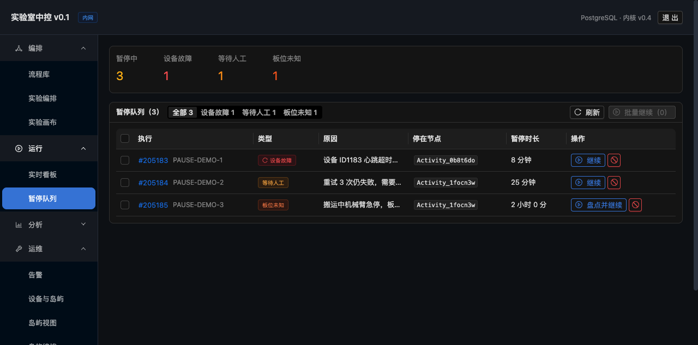
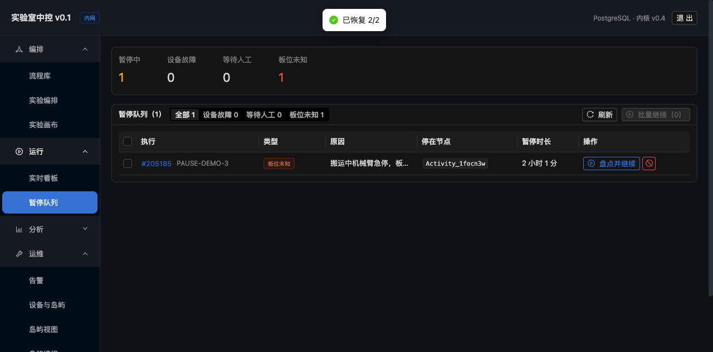

# Paused Queue UI

> **English edition.** The Chinese original is [`docs/暂停队列界面.md`](../暂停队列界面.md);
> this is a line-for-line translation. Numbers, commit hashes and file paths are identical to
> the Chinese source — if they ever disagree, the Chinese original wins.

> **Every execution that has stopped is collected on one page**, grouped by kind, with the
> handling entry point right there.
> Route: `/paused` (navigation: Run → Paused Queue)



---

## 1. Why this page is needed

**The executions are scattered across hundreds of records**, so in the morning you cannot
"see at a glance how many got stuck last night".

To find out whether a given execution had stopped, you had to:
1. Open the Live Board
2. Page through them one by one
3. Click into each one to see its status

**Now**: one page shows everything, grouped by kind, handled directly.

---

## 2. The structure of the page

### Top-level statistics

```
Paused 3    Device fault 1    Waiting for operator 1    Plate position unknown 1
```

**Four numbers**: the total + the three kinds. **Whichever one is not 0 says there is a
problem**.

### Filters

```
[All 3] [Device fault 1] [Waiting for operator 1] [Plate position unknown 1]
```

**When you switch to a kind, the handling hint for that kind appears below**:

| Kind | Hint |
|---|---|
| Device fault | "Resumes on its own once the device heartbeat recovers; usually no action is needed. If it has not recovered after 10 minutes, check the device." |
| Waiting for operator | "Retries are exhausted or a decision is required — confirm on site, then press continue." |
| Plate position unknown | "The plate location is unknown; it must be counted on site and the actual position recorded." |

### Table

| Column | Content |
|---|---|
| **Run** | `#205185` (clickable, opens the detail) + the run no. |
| **Kind** | A coloured tag; `paused_fault` carries a refresh icon (a hint that it recovers on its own) |
| **Reason** | The reason written when it paused |
| **Stopped at node** | `Activity_1focn3w` (monospace font) |
| **Paused for** | "8 min" / "25 min" / "2 h 0 min" (computed live) |
| **Action** | Continue / Dismiss; `paused_unknown` shows **"Count and continue"** |

---

## 3. ⚠ The key design: a batch resume must skip `paused_unknown`

**Why**: `paused_unknown` needs **the plate position correction to be filled in one by
one**; a batch resume has no correction data → **after the resume every position check is
wrong**.

**The implementation**:

```tsx
async function resumeBatch() {
  const targets = rows.filter((r) => selectedRows.includes(r.runId));
  const normal = targets.filter((r) => r.pauseKind !== 'paused_unknown');
  if (normal.length === 0) {
    message.warning('All selected runs have an unknown plate position — they must be counted one by one');
    return;
  }
  // Only resume the normal ones
}
```

**Verified by measurement**:

```
Select 3 rows (including 1 paused_unknown) → press the batch resume
  → "Resumed 2/2"
  → PAUSE-DEMO-1 (paused_fault)   → running  ✅
  → PAUSE-DEMO-2 (waiting_human)  → running  ✅
  → PAUSE-DEMO-3 (paused_unknown) → still paused  ✅ correctly skipped
```



**The statistics update in step**: Paused 3 → 1, Device fault 1 → 0, Waiting for operator
1 → 0, Plate position unknown still 1.

---

## 4. The pause duration is rendered in "human" terms

```tsx
const sec = (now - pausedAt) / 1000;
if (m < 1)  return 'Less than 1 minute';
if (m < 60) return `${m} min`;
return `${Math.floor(m / 60)} h ${m % 60} min`;
```

**Why the exact number of seconds is not shown**: nobody can immediately work out that
`7325 seconds` means "2 hours".

---

## 5. The plate inventory dialog

Clicking "Count and continue" on a `paused_unknown` row:

```
⚠ Continuing without a correction makes every later position check wrong
   Go to the site and confirm where the plate is, then fill in the plate ID and the
   actual position. Enter LOST if the plate is missing.

[Plate ID (e.g. PL-001)              ]
[Actual position (e.g. ID1183-L2), or LOST]
```

**On submit**: `PUT /api/runs/{id}/resume?action=continue` + `{corrections: {plate ID: position}}`

---

## 6. Refresh strategy

**Automatic refresh every 20 seconds**.

**Why it is slower than the execution monitoring page (2 seconds)**:

| Page | Refresh | Reason |
|---|---|---|
| Execution monitoring | 2 seconds | Watching a single execution, it has to be live |
| **Paused Queue** | **20 seconds** | This is an "overview", it does not change often, refreshing too fast wastes requests |

**But a paused state can recover on its own** (`paused_fault` continues automatically once
the device heartbeat recovers),
so it still has to refresh periodically, otherwise the list keeps entries that have
already recovered.

---

## 7. The empty state

```tsx
{list.length === 0 ? (
  <Empty image={<CheckCircleOutlined color="#52c41a" />}
    description="No paused runs
    Device faults recover on their own; the ones that need a human show up here" />
) : ...}
```

**A green tick + an explanation**: **no paused runs is good news**, do not use a grey "no
data" that makes people think something is broken.

---

## 8. Acceptance

```
✅ Statistic cards: Paused 3 / Device fault 1 / Waiting for operator 1 / Plate position unknown 1
✅ Filters: 4 segments, each switch shows the matching handling hint
✅ Table: the run no. is clickable, the kind is a coloured tag, plus the reason, the node it stopped at and the pause duration
✅ paused_fault carries a refresh icon (a hint that it recovers automatically)
✅ The paused_unknown button reads "Count and continue" (not "Continue")
✅ Select 2 rows → the "Continue selected (2)" button becomes usable
✅ Press the batch resume → "Resumed 2/2", the statistics update in step
✅ paused_unknown is correctly skipped (it is still paused)
✅ The empty state uses a green tick + an explanation, not a grey "no data"
```

---

## 9. The three pages are now connected

```
Workflows (press Execute)
  ↓ Preflight: a dialog pops up if the resources are not enough
Execution monitoring (watch the progress live)
  ↓ Something goes wrong: device fault / needs a human / plate position unknown
Paused Queue (handle it in one place)
  ↓ Count + continue
Back to the execution monitoring page to carry on running
```

**An operator's day**:

```
Open it in the morning → the Paused Queue (1 plate position unknown)
  → go to the site and find out where the plate is
  → fill in the correction, continue
  → watch the execution monitoring page run it to the end
```

---

## 10. Not done yet

| Item | Explanation |
|---|---|
| Alerting when the pause duration exceeds a threshold | A `paused_fault` longer than 10 minutes should raise an alert (at the moment it is only mentioned in the hint text) |
| Batch termination | The batch resume exists, the termination does not (a dangerous operation, deliberately left out) |
| Filtering by island / by workflow | Needed once there are many paused runs |
