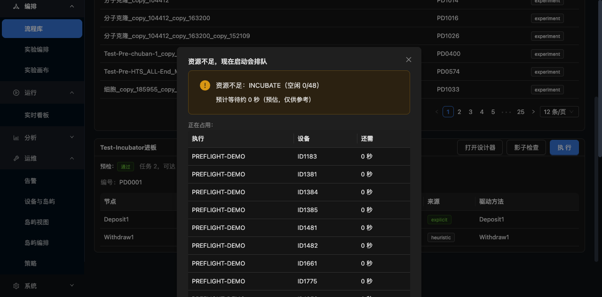

# Preflight UI

> **English edition.** The Chinese original is [`docs/启动前预检界面.md`](../启动前预检界面.md);
> this is a line-for-line translation. Numbers, commit hashes and file paths are identical to
> the Chinese source — if they ever disagree, the Chinese original wins.

> Before pressing "Execute" you already know **whether the resources are enough, who is holding them, and how much longer you have to wait**.
> What the backend M3 computes is now visible in the interface.



---

## 1. What this settles

**After M3 was finished**: the backend can compute `canStart / reason / blocking / estimatedWait`, but **the user cannot see any of it** — pressing "Execute" still starts the run straight away, and it gets stuck halfway through waiting for a device.

**The feeling is still "I pressed it and nothing happened".**

**Now**: press Execute → preflight first → if the resources are not enough a dialog pops up, **and the user decides**.

---

## 2. What the dialog says

```
Title: Not enough resources — starting now will queue the run

⚠ 资源不足：INCUBATE（空闲 0/48）
   Estimated wait Less than 1 minute (estimate only)    ← was "0 s", changed to "Less than 1 minute"

Held by:
  Run                Device    Still needed
  PREFLIGHT-DEMO     ID1183    Less than 1 minute
  PREFLIGHT-DEMO     ID1381    Less than 1 minute
  ...

Start anyway (danger colour)   Run later
```

**All three pieces of information are indispensable**:

| Information | Why |
|---|---|
| **Which capability is short** | The user knows whether it is "not enough incubators" or "not enough plate readers" |
| **Who is holding it** | The user can go and find the holder, or wait for it to finish |
| **How much longer to wait** | There is an expectation, so it does not look like a hang |

The `reason` line is the literal string the backend builds (`资源不足：INCUBATE（空闲 0/48）` = "not enough resources: INCUBATE (free 0/48)"); the English interface shows it unchanged, because it comes from the kernel rather than from the message pack.

---

## 3. Why it is a "recommendation" and not a "block"

**The coarse screening can be wrong** (see the M3 document):

- It only counts the main path, but the run actually took a non-main branch → it counted too few
- The duration estimate is inaccurate → `estimatedWait` is only a reference

**So the dialog gives a "recommendation", and the user decides in the end**:

- **Start anyway** → it goes into the queue (the backend's fine-grained control is the backstop, no deadlock)
- **Run later** → cancel

**If it were a hard block**, a misjudged coarse screening would leave the user unable to run at all.

---

## 4. ⚠ A design mistake: a failed preflight must not execute automatically

**The original implementation**:

```tsx
} catch (e) {
  message.warning('Preflight failed, executing directly');
  await runNow(id);       // ← wrong
}
```

**Why it is wrong**: **a failed preflight means the resource state is unknown**. Running blindly in an unknown state can cause a collision.

**Changed to**:

```tsx
} catch (e) {
  message.error(`Preflight failed, nothing was started: ${...}`);
  // Do not execute — let the user decide
}
```

**The principle**: **"I don't know" is not the same as "there is no problem"**.

---

## 5. Added along the way: deep-link support

**The problem**: the workflow library list only fetches the first 300 rows, `239` is not among them, so there is no way to click into it from the interface.

**The solution**: support `/workflows?wf=239` and select it directly.

```tsx
const [sp] = useSearchParams();
const [selected, setSelected] = useState<number | null>(() => {
  const v = Number(sp.get('wf'));
  return Number.isFinite(v) && v > 0 ? v : null;
});
```

**What it is for**:
- Arriving from an alert (a workflow keeps failing → jump straight to it)
- Clicking "run it again" on the monitoring page → jumping back to the workflow library with it selected
- Remote guidance during on-site support

---

## 6. The execution flow rework

```
Press Execute
  ↓
GET /api/workflows/{id}/can-start
  ↓
├─ canStart=true  →  start asynchronously → jump to the /runs/{runId} monitoring page
└─ canStart=false →  dialog → the user picks "Start anyway" / "Run later"
```

**Why the asynchronous start**: `api.execute` used to be synchronous, so **the interface froze for the whole execution** and the progress could not be seen.

Now `async: 1` returns the `runId` immediately, **jumps to the monitoring page to watch the live progress**, and the run can be paused at any time.

---

## 7. Acceptance

```
✅ The dialog appears when canStart=false
✅ It shows the reason: "资源不足：INCUBATE（空闲 0/48）"
✅ It shows estimatedWait (an estimate, marked as reference only)
✅ It shows the blocking table (Run / Device / Still needed)
✅ Two buttons: Start anyway (danger colour) / Run later
✅ 0 s is displayed as "Less than 1 minute" (to avoid the "it will be fine in a moment" misreading)
✅ A failed preflight does not execute automatically
✅ The deep link ?wf=239 selects the workflow
```

**See the screenshot**: `docs/images/preflight-gate.png`

---

## 8. The pitfalls we hit

| Pitfall | Symptom | Root cause |
|---|---|---|
| Pressing Execute does nothing | Neither a dialog nor an execution | A silent `return` when `selected` is null, with no message at all |
| The search box content is appended | Typing "PD0001" produces "IncubatPD0001" | It was not cleared first |
| The click does not hit | `click @ref` had no effect | The button is outside the viewport, `scrollintoview` is needed first |

**The first one is a design problem**: **a silent return is the worst possible interaction** — the user pressed it and nothing happened, with no way to tell whether the button is broken or the condition is not met.

**Changed to**: when `selected == null`, `message.warning('Select a workflow first')`, and the button is also `disabled={selected == null}`.
