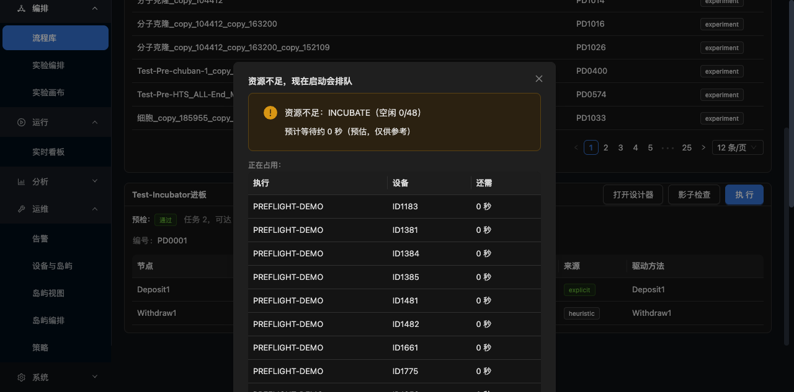

# 启动前预检界面

> 点"执行"之前就知道**资源够不够、被谁占、还要等多久**。
> 后端 M3 算的能力，现在界面上能看到。



---

## 一、解决什么

**M3 做完后**：后端能算 `canStart / reason / blocking / estimatedWait`，
但**用户完全看不到** —— 点"执行"还是直接跑，跑到一半卡在抢设备上。

**感受还是"点了没反应"。**

**现在**：点执行 → 先预检 → 资源不够就弹窗，**让用户自己决定**。

---

## 二、弹窗说什么

```
标题：资源不足，现在启动会排队

⚠ 资源不足：INCUBATE（空闲 0/48）
   预计等待约 0 秒（预估，仅供参考）        ← 原来是"0 秒"，改成"不足 1 分钟"

正在占用：
  执行              设备      还需
  PREFLIGHT-DEMO    ID1183   不足 1 分钟
  PREFLIGHT-DEMO    ID1381   不足 1 分钟
  ...

仍然启动（危险色）   稍后再跑
```

**三个信息缺一不可**：

| 信息 | 为什么 |
|---|---|
| **哪个能力不足** | 用户知道是"孵箱不够"还是"读板机不够" |
| **被谁占着** | 用户能去找占用方，或等它跑完 |
| **还要等多久** | 有预期，不会以为卡死了 |

---

## 三、为什么是"建议"不是"阻止"

**粗筛可以错**（见 M3 文档）：

- 只按主链算，实际走了非主链 → 算少了
- 时长预估不准 → `estimatedWait` 只是参考

**所以弹窗给的是"建议"，最终由用户决定**：

- **仍然启动** → 进入排队（后端细管兜底，不会死锁）
- **稍后再跑** → 取消

**如果是硬性阻止**，粗筛误判时用户就没法跑了。

---

## 四、⚠ 一个设计错误：预检失败不能自动执行

**最初的实现**：

```tsx
} catch (e) {
  message.warning('预检失败，直接执行');
  await runNow(id);       // ← 错
}
```

**为什么错**：**预检失败 = 资源状态未知**。
状态未知时闷头跑，可能撞车。

**改成**：

```tsx
} catch (e) {
  message.error(`预检失败，未启动：${...}`);
  // 不执行，让用户自己决定
}
```

**原则**：**"不知道" 不等于 "没问题"**。

---

## 五、顺带加的：深链支持

**问题**：流程库列表只取前 300 条，`239` 不在里面，没法从界面点进去。

**解法**：支持 `/workflows?wf=239` 直接选中。

```tsx
const [sp] = useSearchParams();
const [selected, setSelected] = useState<number | null>(() => {
  const v = Number(sp.get('wf'));
  return Number.isFinite(v) && v > 0 ? v : null;
});
```

**用途**：
- 从告警点进来（某个流程反复失败 → 直接跳到它）
- 从监控页点"再跑一次" → 跳回流程库并选中
- 现场支持时远程指路

---

## 六、执行流程改造

```
点执行
  ↓
GET /api/workflows/{id}/can-start
  ↓
├─ canStart=true  →  异步启动 → 跳转 /runs/{runId} 监控页
└─ canStart=false →  弹窗 → 用户选"仍然启动" / "稍后再跑"
```

**为什么改异步启动**：

原来 `api.execute` 是同步的，**整个执行期间界面卡住**，看不到进度。

现在 `async: 1` 立刻返回 `runId`，**跳转到监控页看实时进度**，
还能随时暂停。

---

## 七、验收

```
✅ canStart=false 时弹窗出现
✅ 显示 reason："资源不足：INCUBATE（空闲 0/48）"
✅ 显示 estimatedWait（预估，标注仅供参考）
✅ 显示 blocking 表格（执行 / 设备 / 还需）
✅ 两个按钮：仍然启动（危险色）/ 稍后再跑
✅ 0 秒显示为"不足 1 分钟"（避免误解为"马上就好"）
✅ 预检失败不自动执行
✅ 深链 ?wf=239 能选中
```

**截图见** `docs/images/preflight-gate.png`

---

## 八、踩的坑

| 坑 | 现象 | 根因 |
|---|---|---|
| 点执行无反应 | 既没弹窗也没执行 | `selected` 为 null 时静默 return，没有任何提示 |
| 搜索框内容叠加 | 输入 "PD0001" 变成 "IncubatPD0001" | 没有先清空 |
| 点击命中不到 | `click @ref` 没生效 | 按钮在视口外，需要先 `scrollintoview` |

**第 1 条是设计问题**：**静默返回是最糟的交互** ——
用户点了没反应，不知道是按钮坏了还是条件不满足。

**改成**：`selected == null` 时 `message.warning('先选一个流程')`，
按钮也 `disabled={selected == null}`。
