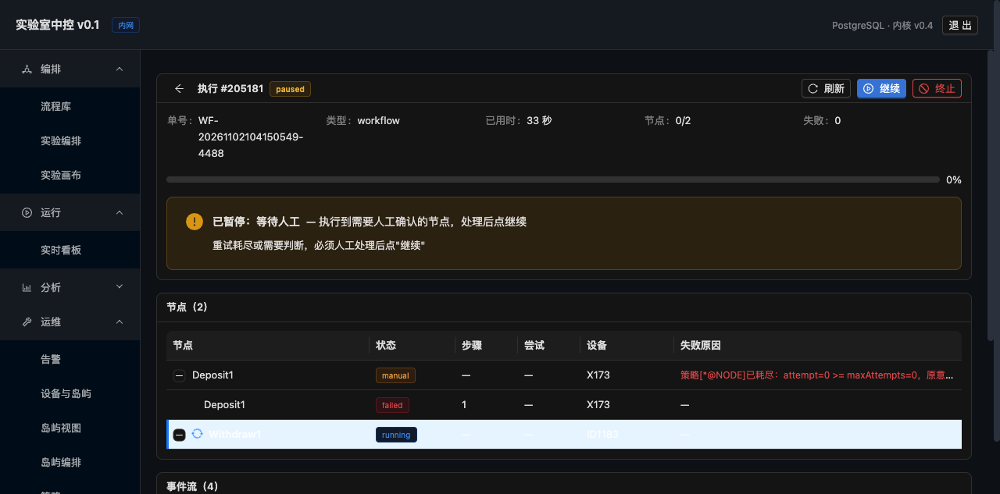

# 执行监控界面

> 跑实验时**实时看到跑到哪一步**，并能暂停/继续/终止。
> 即使是模拟跑也一样。



---

## 一、这页要回答什么

操作员盯着屏幕时，最想知道三件事：

| 问题 | 界面上在哪 |
|---|---|
| **跑到第几步了？** | 顶部进度条 + "正在执行：Withdraw1 · 第 2 步 · 设备 X173" |
| **为什么停了？** | 暂停横幅：类型（设备故障/等待人工/板位未知）+ 原因 + 恢复条件 |
| **我该做什么？** | 按钮：继续 / 终止（板位未知时弹校正框） |

---

## 二、三种暂停态长得不一样

| 类型 | 颜色 | 提示文案 | 恢复条件 |
|---|---|---|---|
| `paused_fault` | 红 | "设备故障" | **设备恢复心跳后自动继续，不需要人工** |
| `waiting_human` | 橙 | "等待人工" | 重试耗尽或需要判断，**必须人工处理后点继续** |
| `paused_unknown` | 火山 | "板位未知" | **必须到现场盘点并填写实际位置** |

**为什么要分开**：混成一个"暂停"，操作员不知道该不该动手。

- `paused_fault` 你去点继续，反而可能打断自动恢复
- `paused_unknown` 你不填校正就点继续，**后面的板位判断全是错的**

---

## 三、关键细节

### 3.1 暂停时不能显示"正在执行"

**踩到的坑**：暂停后 `run_node.status` 还是 `running`（因为没改节点状态），
界面照着节点状态渲染，就出现了"已暂停"和"正在执行"同时显示。

**修法**：只在 `run.status === 'running'` 时才显示"正在执行"。

```tsx
{current && run?.status === 'running' && (
  <Alert icon={<SyncOutlined spin />} message={`正在执行：${current.name}`} />
)}
```

### 3.2 设备显示编号不显示 id

**踩到的坑**：界面显示"设备 200171"，操作员看不懂是哪台。

**修法**：后端 `run` 详情里的 nodes 补 `resourceCode`（JOIN `resource_node`），
前端优先显示编号，回退到 id。

```
设备 200171  →  设备 X173
```

### 3.3 当前执行的行要一眼看出来

```css
.row-running > td { background: #e6f4ff !important; }
.row-running > td:first-child { box-shadow: inset 3px 0 0 #1677ff; }
```

**淡蓝底 + 左侧蓝条**，扫一眼就知道跑到哪。

### 3.4 刷新频率

**运行中/暂停中 2 秒轮询**，已结束不轮询。

**比后端还快一档**：点了"暂停"按钮，2 秒内就能看到状态变化，
不会出现"点了没反应"的错觉。

---

## 四、⚠ 顺带修的一个真问题：MANUAL 被当成失败

**截图时发现的**：执行结束后状态是 `failed`（红色），
但事件里写着"策略已耗尽：转人工"。

**根因**：

```java
// settleRun 里
boolean bad = p.count(NodeStatus.MANUAL) > 0 || p.aborted();
String status = bad ? "failed" : "completed";
```

**`MANUAL` 的语义是"无法自动恢复，转人工"** —— 这**不是失败**，是**暂停等人**。

**后果**：

- UI 上看到红色"失败"，操作员以为流程坏了
- 唯一反应是**重跑整个流程**，而不是"点继续"
- 重跑要重头来，白费前面跑完的节点

**修法**：

```java
if (aborted) {
    status = "failed";                    // 真失败
} else if (manual) {
    status = "paused";                    // 转人工 = 暂停
    pause_kind = "waiting_human";
    pause_reason = "执行到需要人工确认的节点，处理后点继续";
} else {
    status = "completed";
}
```

**改完之后**：同样的流程，UI 显示金色 `paused` + "继续"按钮，
操作员**一眼知道该点哪里**。

---

## 五、验收

```
① 实时进度       运行中 2 秒刷新，进度条 + 已用时
② 当前步骤       正在执行：Withdraw1 · 设备 X173
③ 暂停态         金色 paused + 暂停原因 + 恢复条件提示
④ 继续/终止      按钮可见可用
⑤ 继续生效       paused → running（API 返回 ok）
⑥ 设备编号       X173 而不是 200171
⑦ 行高亮         当前行淡蓝底 + 左蓝条
```

**实测**：

```
造 paused_unknown → 截图：黄色横幅"板位未知，必须到现场盘点"
恢复按钮 → 弹校正框（板号 + 实际位置）
MANUAL 节点 → 状态 paused/waiting_human（不是 failed）
点继续 → 状态变 running
```

---

## 六、前端 API 封装

`webapp/src/api/client.ts` 新增 6 个：

| 方法 | 接口 |
|---|---|
| `pauseRun(id, kind, reason, nodeKey)` | `POST /api/runs/{id}/pause` |
| `resumeRun(id, action, corrections)` | `POST /api/runs/{id}/resume` |
| `pausedRuns()` | `GET /api/runs/paused` |
| `canStart(workflowId)` | `GET /api/workflows/{id}/can-start` |
| `unknownPlates()` | `GET /api/plates/unknown` |
| `locatePlate(barcode, location)` | `POST /api/plates/{barcode}/locate` |

**后五个是为了后面的界面**（启动前预检、暂停列表、板位盘点），
**这一轮先做了执行详情页**。
