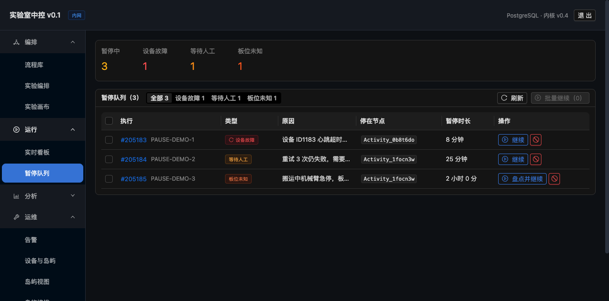
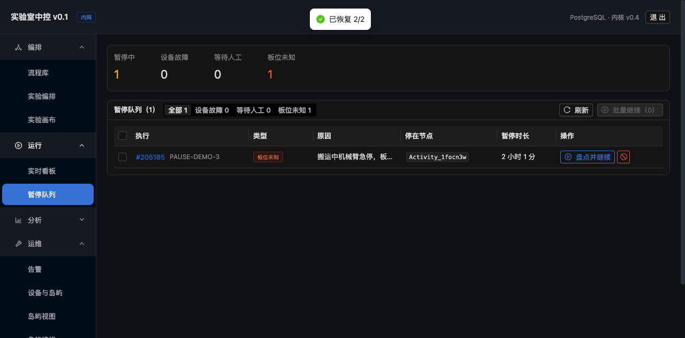

# 暂停队列界面

> **所有停下来的执行集中在一页**，按类型分组，直接给处置入口。
> 路由：`/paused`（导航：运行 → 暂停队列）



---

## 一、为什么需要这一页

**执行散在几百条记录里**，早上来上班没法"一眼看到昨晚有几个卡住了"。

原来要看某个执行是不是停了，得：
1. 进实时看板
2. 一条条翻
3. 点进去看状态

**现在**：一页看全，按类型分，直接处置。

---

## 二、页面结构

### 顶层统计

```
暂停中 3    设备故障 1    等待人工 1    板位未知 1
```

**四个数字**：总数 + 三种类型。**哪个不为 0 就说明有问题**。

### 筛选

```
[全部 3] [设备故障 1] [等待人工 1] [板位未知 1]
```

**切到某个类型时，下方会出现该类型的处置提示**：

| 类型 | 提示 |
|---|---|
| 设备故障 | "心跳恢复后会自己继续，通常不用管；超过 10 分钟建议检查设备" |
| 等待人工 | "重试耗尽或需要判断，确认现场后点继续" |
| 板位未知 | "板在哪不确定，必须到现场盘点后填写实际位置" |

### 表格

| 列 | 内容 |
|---|---|
| **执行** | `#205185`（可点进详情）+ 单号 |
| **类型** | 彩色标签，`paused_fault` 带刷新图标（暗示会自动恢复） |
| **原因** | 暂停时写的原因 |
| **停在节点** | `Activity_1focn3w`（代码字体） |
| **暂停时长** | "8 分钟" / "25 分钟" / "2 小时 0 分"（实时算） |
| **操作** | 继续 / 终止；`paused_unknown` 显示 **"盘点并继续"** |

---

## 三、⚠ 关键设计：批量继续必须跳过 `paused_unknown`

**为什么**：`paused_unknown` 需要**逐个填板位校正**，
批量恢复没有校正数据 → **恢复后板位判断全错**。

**实现**：

```tsx
async function resumeBatch() {
  const targets = rows.filter((r) => selectedRows.includes(r.runId));
  const normal = targets.filter((r) => r.pauseKind !== 'paused_unknown');
  if (normal.length === 0) {
    message.warning('选中的都是板位未知，必须逐个盘点');
    return;
  }
  // 只恢复 normal
}
```

**实测验证**：

```
勾选 3 条（含 1 条 paused_unknown）→ 点批量继续
  → "已恢复 2/2"
  → PAUSE-DEMO-1 (paused_fault)   → running  ✅
  → PAUSE-DEMO-2 (waiting_human)  → running  ✅
  → PAUSE-DEMO-3 (paused_unknown) → 仍是 paused  ✅ 正确跳过
```



**统计同步更新**：暂停中 3 → 1，设备故障 1 → 0，等待人工 1 → 0，板位未知仍 1。

---

## 四、暂停时长用"人话"

```tsx
const sec = (now - pausedAt) / 1000;
if (m < 1)  return '不足 1 分钟';
if (m < 60) return `${m} 分钟`;
return `${Math.floor(m / 60)} 小时 ${m % 60} 分`;
```

**为什么不显示精确秒数**：`7325 秒` 没人能立刻反应过来是"2 小时"。

---

## 五、板位盘点弹窗

点 `paused_unknown` 行的"盘点并继续"：

```
⚠ 不填校正就继续，后面的板位判断全是错的
   到现场确认板在哪，填写板号与实际位置。填 LOST 表示板已丢失。

[板号（如 PL-001）        ]
[实际位置（如 ID1183-L2），或填 LOST]
```

**提交后**：`PUT /api/runs/{id}/resume?action=continue` + `{corrections: {板号: 位置}}`

---

## 六、刷新策略

**20 秒自动刷新**。

**为什么比执行监控页（2 秒）慢**：

| 页面 | 刷新 | 理由 |
|---|---|---|
| 执行监控 | 2 秒 | 盯着单条执行看，要实时 |
| **暂停队列** | **20 秒** | 这是"总览"，变化不频繁，刷太快浪费请求 |

**但暂停状态可能被自动恢复**（`paused_fault` 设备心跳恢复后自动继续），
所以还是要定期刷新，不然列表会留着已经恢复的条目。

---

## 七、空状态

```tsx
{list.length === 0 ? (
  <Empty image={<CheckCircleOutlined color="#52c41a" />}
    description="没有暂停的执行
    设备故障会自动恢复；需要人工的会出现在这里" />
) : ...}
```

**绿色对勾 + 说明文字**：**没有暂停是好事**，不要用灰色"暂无数据"让人以为坏了。

---

## 八、验收

```
✅ 统计卡：暂停中 3 / 设备故障 1 / 等待人工 1 / 板位未知 1
✅ 筛选：4 个分段，切换时显示对应处置提示
✅ 表格：执行号可点、类型彩色标签、原因、停在节点、暂停时长
✅ paused_fault 带刷新图标（暗示自动恢复）
✅ paused_unknown 按钮文字是"盘点并继续"（不是"继续"）
✅ 勾选 2 条 → "批量继续（2）"按钮可用
✅ 点批量继续 → "已恢复 2/2"，统计同步更新
✅ paused_unknown 被正确跳过（仍是 paused）
✅ 空状态用绿色对勾 + 说明，不是灰色"暂无数据"
```

---

## 九、现在三个页面串起来了

```
流程库（点执行）
  ↓ 预检：资源不够就弹窗
执行监控（实时看进度）
  ↓ 出问题：设备故障/需要人/板位未知
暂停队列（集中处置）
  ↓ 盘点 + 继续
回到执行监控继续跑
```

**操作员的一天**：

```
早上打开 → 暂停队列（1 条板位未知）
  → 去现场看板在哪
  → 填校正，继续
  → 看着执行监控跑完
```

---

## 十、还没做的

| 项 | 说明 |
|---|---|
| 暂停时长超阈值告警 | `paused_fault` 超过 10 分钟应该推告警（现在只在提示文案里说） |
| 批量终止 | 批量继续有了，终止没做（危险操作，故意不做） |
| 按岛/按流程筛选 | 暂停多的时候需要 |
