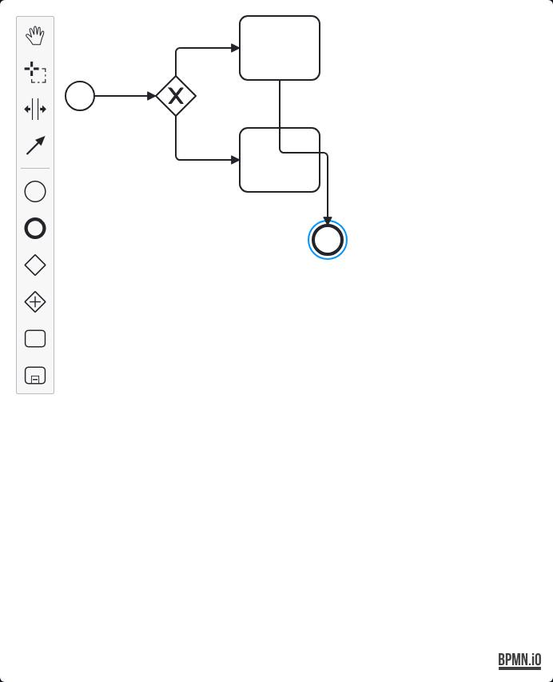
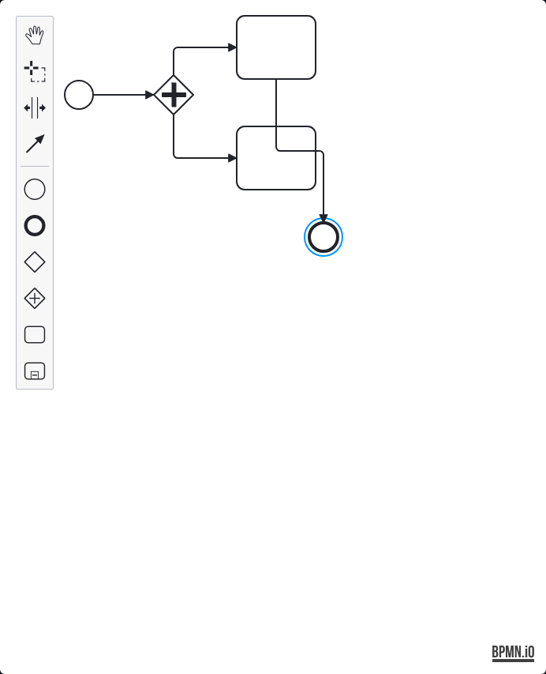
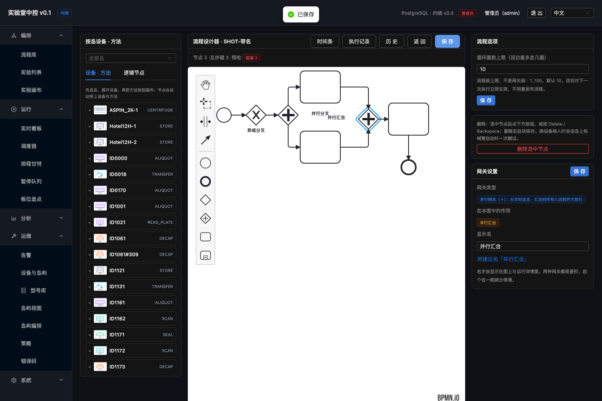
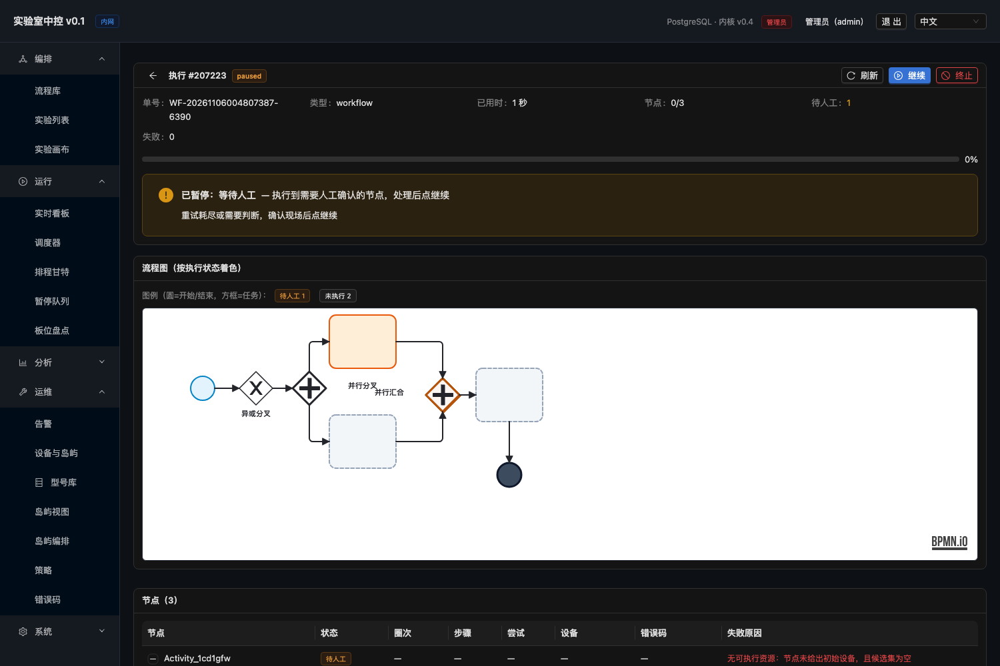
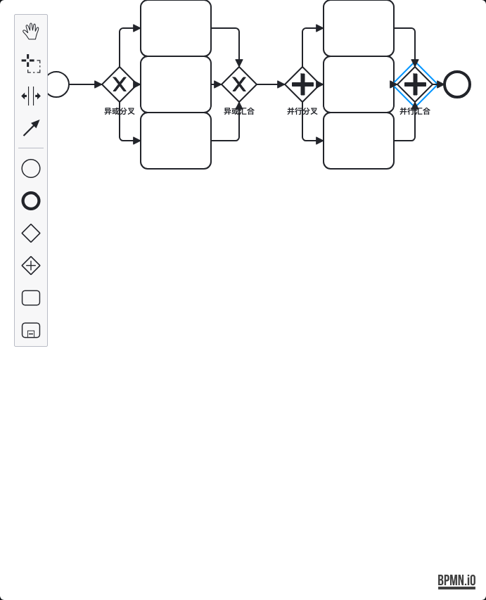
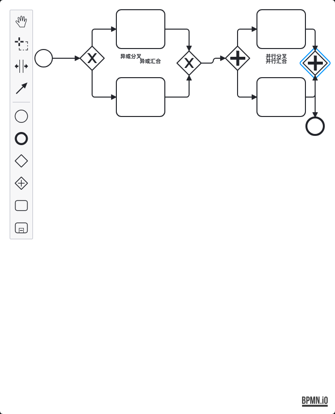

# 页面实操验证报告 · 多并行网关 + 多网关 + 变量节点（2026-11-05）

> 回答一个问题：**在页面上真的拖一张「多个并行网关 + 多个异或网关 + 变量节点」的图，
> 保存后执行侧认不认？并行分支会不会真并行、汇合会不会等齐？**
>
> 脚本：`scripts/e2e-multi-parallel.py`（门禁 4.14 段，阈值 `MIN_MULTIPAR=21`）
> 复跑：`python3 scripts/e2e-multi-parallel.py --base http://localhost:5173`
> 环境：macOS，前端 `5173` + API `18080` + PostgreSQL `192.168.124.2:5432/labdb`
> 结论：**21 / 0 全绿**（连跑 3 次一致）

---

## 1. 一句话结论

| 能力 | 现状 | 证据 |
|---|---|---|
| **多个并行网关共存**（P1 + P2 嵌套） | ✅ 支持，**页面拖出来也认** | 图里 `parallelGateway ×4`（2 个网关 × 开闭标签）、真跑三条分支全 `completed` |
| **多个异或网关共存** | ✅ 支持 | 图里 `exclusiveGateway ×4`、两条分支各命中一条出边 |
| **变量节点跨分支传值** | ✅ 支持 | `counter=1` 由 SET 写入，两条异或条件 `${counter} == 1` 都命中 |
| **并行汇合等齐** | ✅ 支持 | 三条并行分支全 `completed` **且** 整单 `completed` |
| **页面拖出来的图 = 执行侧认的图** | ✅ 接缝打通 | 12 节点 / 13 连线全部落库后真跑 `completed` |

**补的是什么缺口**：后端矩阵的 `parallel` 用 `build_xml()` 直 POST，**绕过界面**；
页面轨此前只画过**单异或**（`e2e-flow-matrix.py` F 节）。「页面上同时出现两个并行网关
+ 两个异或网关 + 变量节点」这张图，**从来没被人拖过**。本轮补上。

---

## 2. 两种网关长什么样（真实截图）

设计器左栏 palette 里有两个网关入口，**图标就是最快的区分方式**：

| palette 文案 | 图标 | 解析器类型 | 执行语义 |
|---|---|---|---|
| **Create gateway** | **✕ 形**菱形（空心 X） | `exclusiveGateway` | **异或**：分叉时**只走一条**，汇合时任一条到达即放行 |
| **Create parallel gateway** | **＋ 形**菱形 | `parallelGateway` | **并行**：分叉时**全走**，汇合时**所有入边到齐**才放行 |

下面两张是**在设计器里真拖出来的**（`scripts/shot-gateways.py` 截的图，
流程结构完全相同，只换一个网关）：

**A · 异或网关（Create gateway，✕ 形）**



**B · 并行网关（Create parallel gateway，＋形）**



> 注意左栏 palette 的第 6、7 个图标：**空心菱形 = 异或（✕）**，
> **带十字的菱形 = 并行（＋）**。本项目在批 2 补的就是「＋形并行网关」这个入口
> （`webapp/src/bpmn/WorkflowPalette.ts` 的 `create.parallel-gateway`）——
> 此前 bpmn-js 默认只给异或，并行只能手写 XML。

## 3. 完整图的形状（本轮实跑的那张）

```
   S ── SET ── P1 ──┬── A ── X ── C ──┐
  start  var    并行 │  var   异或  expr │
                     │                  │
                     └── P2 ──┬── B ── X2 ── D ──┤
                       并行 │  var   异或  expr    │
                           │                     │
                           └── F ────────────────┤
                             var                 │
                                                  │
                                              E（end）
```

| 角色 | 节点 | 类型 | 页面上的设置 |
|---|---|---|---|
| 起点 | S | startEvent | — |
| 变量源 | SET | `__setVar` | `counter = 1` |
| **并行网关 1** | **P1** | **parallelGateway（＋形）** | 一分为二（A / P2） |
| **并行网关 2** | **P2** | **parallelGateway（＋形）** | 嵌在 P1 的一支里，再分 B / F |
| 变量 | A / B / F | `__setVar` | `branchA` / `branchB` / `branchF` = `yes` |
| **异或网关** | **X / X2** | **exclusiveGateway（✕形）** | 出边条件 `${counter} == 1` |
| 表达式 | C / D | `__expr` | `hitC` / `hitD` = `${counter}` |
| 汇合 | E | endEvent | 三条线都汇到这里 |

**共 12 个节点 / 13 条连线**，全部在页面上拖出并保存落库。

> ⚠ **「分叉」还是「汇合」不用手动选**：引擎按连线数自动判定
> （`WorkflowGraphParser.java:240-246`）——入边 > 1 是汇合、出边 > 1 是分叉、
> 都 > 1 按汇合处理（先等再分）、单进单出等价于直通。
> 同一形状连不同方向的线即可。

---

## 4. 实跑证据

### 4.1 图落库后的结构

```
13 条连线全部连上并落库（13 条）
13 条连线都落了库（13 条）
图里有 2 个并行网关（parallelGateway ×4）
图里有 2 个异或网关（exclusiveGateway ×4）
两条连线条件进了图（conditionExpression ×4）
变量节点参数进了图（methodParams 带 counter）
```

> `parallelGateway ×4` / `exclusiveGateway ×4` 是**开闭标签各一次**的计数，
> 实际节点数是 2 个（断言判的是 `>= 2`）。

### 4.2 真执行结果

```
触发真执行（run #207135 → completed）
整单 completed
SET 执行过（页面上设的 __setVar 被执行侧认到）
并行分支 A 执行了（P1 的第一支）
并行分支 B 执行了（P2 的第一支）
并行分支 F 执行了（P2 的第二支）
异或分支 1 命中 C（${counter} == 1 生效）
异或分支 2 命中 D（${counter} == 1 生效）
三条并行分支都 completed（汇合等齐了：只完成一支不会是这个结果）
整单 completed 说明所有分支都汇合到 end 后才收尾

通过 21 / 失败 0
```

库内 `run_node` 明细（`run #207135`，level=0）：

```
Activity_1hebpxc | completed     ← SET
Activity_1vvwcsz | completed     ← A
Activity_0xerap2 | completed     ← B
Activity_1yt7xt0 | completed     ← C
Activity_0is03an | completed     ← D
Activity_0riptu9 | completed     ← F
```

`run` 表：`207135 | WF-20261105204534599-0346 | completed`

---

## 5. 过程中踩到的四个坑（都是页面层的真实脆弱点）

### 5.1 画布容器只有 ~690px 宽，坐标超界会**静默**落不上

左侧「按岛设备」面板把 `.djs-container` 压到 `width≈691.9`（视口 1500 时）。
实测：`x=900` 成功、`x=980` 返回 `None`、`x=90` 也返回 `None` —— **不报错、不提示，
就是没生成节点**。第一版布局按逻辑排布（x 到 1120），结果 C/D/E 三个节点直接消失。

**修法**：所有坐标压到 `x ∈ [140, 700]`，并把这条约束写进脚本注释。

### 5.2 点源落在图元自身框内 → 这条线连不上

`bpmn-js` 的 `global-connect-tool` 是「点源 → 点目标」两步。源点被自身框遮挡时
会命中自己的连接锚点。实测 13 条线里**只有 `D→E` 连不上**，重试 3 次仍失败；
把 E 挪开后同一条立刻连上。

**修法**：`connect_retry()` —— 连完保存、查库验证，没连上就 `Esc` 退出连接上下文再试，
最多 3 次。判据用「保存后库里的连线」而不是画布 DOM，因为 DOM 里存在 ≠ 执行侧能看见。

### 5.3 普通 `task` 节点会去找设备，找不到就转人工

第一版把 A/B/C/D 设成普通 task（设备任务）。真跑结果：节点转 `manual`、整单卡 `paused`，
`run_node` 出现 `manual` / `running` 混合状态。

这不是产品缺陷，是**语义正确**——设备任务在库里没有对应设备实例时就该停下等人。
要验的是「并行 + 网关 + 变量」的**编排语义**，不是设备寻址。

**修法**：A/B/C/D/F 全改成**内置节点**（`__setVar` / `__expr`），不碰设备。

### 5.4 汇合点 E 是 end 事件，**本来就不进 `run_node`**

第一版断言「E 在 `run_node` 里 completed」，永远不成立。原因：
`WorkflowGraphParser.java:208` 把 `endEvent` 建成 `Kind.END`，而 `GraphRunner` 的
`progress.complete` 只在 `Kind.TASK` / `Kind.BUILTIN` 分支调用 —— **只有任务类和内置节点
才上报节点状态**。

**修法**：汇合的可观测判据改成「三条并行分支都 `completed` **且** 整单 `completed`」——
若汇合没等齐（只跑完一支就收尾），其余支不会 `completed`。这比断言 end 事件更强。

---

## 6. 顺带修掉的一个**真问题**：`q()` 静默失败

排查 4.3 时被误导过一轮：脚本报了「整单没跑完」，但库里那个 run 其实是 `completed`。

根因：`scripts/e2e-flow-matrix.py` 的 `q()` 用 `psql` 子进程查库，**缺 `PGPASSWORD` 时
psql 交互式要口令 → 查询失败 → 返回空串**，而调用方把空串当成「状态为空」。
表现是整段断言全红，看起来像执行侧坏了，实际是查询本身没跑成。

**修法**：`q()` 在 `psql` 返回码非 0 时**抛异常并带上 stderr**，不再静默返回空串。
验证：故意不给 `PGPASSWORD` → 立刻报
`SQL 执行失败：SELECT 1 | stderr: Password for user labos: psql: error: ... no password supplied`。

> 这条修复对**所有**复用 `q()` 的脚本生效（`e2e-flow-matrix.py` / `e2e-multi-parallel.py` /
> `verify-s3-2-residuals.py` 共用同一套查库约定）。

---

## 7. 边界与未覆盖（诚实清单）

| 项 | 状态 | 说明 |
|---|---|---|
| 真机（非模拟器） | ❌ 未覆盖 | 本轮全是内置节点，不碰设备；真实设备上的并行时序仍是空白 |
| 设备任务 + 并行网关 | ❌ 未覆盖 | 设备任务需要真实设备实例；诚实清单第 10 条（后端不自动补机械臂搬运）依旧成立 |
| 并行分支**耗时对比** | ❌ 未覆盖 | 本轮只断言「都执行了」，没断言「真并行（时间上重叠）」—— 内置节点太快，测不出重叠 |
| `subProcess` 子流程 + 并行 | ❌ 未覆盖 | `subProcess` 静默跳过问题仍未修（见诚实清单第 12 条） |
| 嵌套并行（并行里再并行） | ✅ 本轮覆盖 | P2 嵌在 P1 的一支里 |
| 循环 + 并行组合 | ❌ 未覆盖 | 诚实清单第 3 条 |

---

## 8. 复跑方式

```bash
export LABOS_DB_HOST=192.168.124.2 LABOS_DB_NAME=labdb \
       LABOS_DB_USER=labos LABOS_DB_PASS='***' LABOS_DB_PORT=5432

# 单跑
python3 scripts/e2e-multi-parallel.py --base http://localhost:5173   # → 21 / 0

# 门禁（4.14 段）
./scripts/ci-gate.sh --all
```

需要：前端 `5173` + API `18080` 在跑；**必须给 `LABOS_DB_*`**（缺了会 SKIP）。
脚本会清理自己造的流程 / run / 节点，不留测试残留。

---

## 9. 网关可读性改造（2026-11-06 追加）

用户看完上面两张对照图后指出：**「这两个仅仅这样放着，有的时候很容易混淆呀。
尤其是结束那里，如果没有对应的结束标识，不容易看清楚的」**。

查下来是产品缺三样东西，不是图画得不好：

1. **两种网关都是菱形**（✕ / ＋），缩小后几乎分不出；
2. **设计器根本没有命名 UI** —— 节点设置卡挂在 compile 结果上（compile 只认 task），
   网关选中后右栏只显示「还没保存，先保存画布才能绑定设备与方法」，
   **想给网关起个名都做不到**；
3. **end 事件底色是 `#f8fafc`（近白）**，和 `rg-bypassed` 几乎一样 ——
   浅色画布上「流程在哪结束」根本看不出来。

### 9.1 改造后的效果（真实截图）

**设计器画布** —— 网关各自带名字，右栏有独立的「网关设置」卡：



**运行详情图** —— end 事件变成深底实心圆（一眼认出流程在哪结束），
汇合点（入边 2 条）带橙色描边：



### 9.2 改了什么

| 位置 | 改动 |
|---|---|
| 设计器右栏 | 新增**网关专用卡片**：网关类型（并行/异或 + 一句话语义）、**在本图中的作用**、显示名输入框 |
| 自动推荐名 | 按入/出边数推出「并行分叉 / 并行汇合 / 异或分叉 / 异或汇合」，一键「用建议名」。**规则与后端 `WorkflowGraphParser` 同源**（入边>1 汇合、出边>1 分叉、都是则按汇合、单进单出直通） |
| 名字存储 | 写进 BPMN 的 `name` 属性（解析侧本来就读它，运行详情里作为节点名列显示） |
| 运行视图 | end 事件改深底（`#334155` + 3px 深边）；网关按类型给不同描边粗细；**入边>1 的汇合点加橙色标记** |
| 标签样式 | `.djs-label` 强制不换行 + 网关标签加粗放大（中文名否则被挤成竖排） |

### 9.3 验证

- 页面上真拖「异或分叉 → 并行分叉 → 并行汇合并命名」→ **3/3 成功，三个名字都进了 XML**
- 截图确认：图上三个标签清晰不重叠；右栏「在本图中的作用」正确显示「并行汇合」
- `ci-gate.sh --all` **18 道零 SKIP 全绿**；`verify-en-docs.py` 硬错误 0

### 9.4 踩的三个坑（改前端才知道的）

1. **`incoming` / `outgoing` 挂在 `businessObject` 上，不在 element 上** ——
   读错位置拿到 undefined，边数恒为 0，于是**所有网关都被判成「直通（单进单出）」**。
   第一版右栏显示「直通」时一度怀疑后端口径不对，查 bpmn-moddle 的关联属性才发现是前端读错。
2. **bpmn-js 的 context-pad 会盖住 palette** —— 选中元素后的悬浮工具栏挡住下一个 palette 点击，
   Playwright 一直 retry 到超时（`text-annotation entry intercepts pointer events`）。
   点画布空白处**也**挡（它就挂在画布上）；可靠做法是 `Esc` + 把 `.djs-context-pad-parent`
   从 DOM 摘掉。
3. **网关原本没有「该叫汇合还是分叉」的入口** —— 不是加个输入框的事，
   得先给它一张**自己的卡片**（网关不绑定设备/方法，挂 task 的卡上根本进不去）。

### 9.5 边界

- 命名只做了**网关**；task 的节点设置卡里没加名称输入框（那是另一张卡，
  且 task 的名字目前由设备/方法决定）
- `rg-join` 的「双线边框」用 drop-shadow 模拟，不是真正的双线描边
- 跨流程并行仍未实现（P2 批 5，见评审包 `02`）

---

## 10. 网关「成对」与多分支（2026-11-06 追加）

用户继续指出：**「异或不对……异或后面应该要两条以上的一起跑，也要测试两个或者三个以上的场景；
而且异或一样，需要有异或开始和异或结束作为一起的才能看清楚」**。

这一查，发现上一版（§3 那张图）的**名字与结构对不上**：

| 网关 | 实际入/出边数 | 真实角色 | 当时给的名字 |
|---|---|---|---|
| P1 | 入 1 出 2 | 分叉 | 并行分叉 ✓ |
| P2 | 入 1 出 2 | 分叉 | 并行分叉 ✓ |
| **X** | **入 1 出 1** | **直通** | ~~异或分叉~~ ✗ 名实不符 |
| **X2** | **入 1 出 1** | **直通** | ~~异或分叉~~ ✗ 名实不符 |

即：**整张图里一个汇合点都没有**，异或那两个是直通不是分叉 —— 名字是脚本硬写的，
没经过任何校验。用户「看不清」是**对的**，而且比看得清更严重：**图在骗人**。

### 10.1 新增测试：网关成对 · N=2 与 N=3

`scripts/e2e-gateway-pairs.py`（门禁 4.15 段，阈值 `MIN_GWPAIR=34`）：

```
图 1（N=2）                        图 2（N=3）
S ─ XS ─┬─ A ─┐                    S ─ XS ─┬─ A ─┐
         └─ B ─┴─ XJ ─ PS ─┬─ C ─┐          ├─ B ─┼─ XJ ─ PS ─┬─ P ─┐
                            └─ D ─┴─ PJ ─ E  └─ C ─┘           ├─ Q ─┼─ PJ ─ E
                                                                    └─ R ─┘
XS=异或分叉  XJ=异或汇合  PS=并行分叉  PJ=并行汇合
```

**四张图（N=2/N=3 × 异或/并行）各自都满足：分叉与汇合成对出现。**

**N=3 的真实截图**（四个网关成对站在一起，结构一眼可读）：





### 10.2 三条关键设计

1. **命名不硬写，走页面上的「用建议名」按钮** ——
   这样断言的是「**引擎按入/出边数推出的角色**」与「图上显示的名字」一致。
   上一版就是硬写名字，才会写出「叫异或分叉、实际是直通」这种名实不符。
2. **角色判定规则与后端同源** —— 入边 > 1 是汇合、出边 > 1 是分叉、
   都 > 1 按汇合（先等再分）、单进单出等价于直通（`WorkflowGraphParser`）。
3. **执行语义分开断言** —— 并行的 N 条**全跑**；异或**恰好走 1 条**，其余 `bypassed`。

### 10.3 踩坑：异或走哪条是**不确定**的

`choose()` 在无条件、无 default 时按**目标节点 id 字典序**取第一条
（`GraphRunner.choose`），而节点 id 是 bpmn-js 随机生成的（`Activity_0ajn4aq` 这类）——
**走哪条支路每次都可能不同**。所以断言只能写「恰好走了一条」，
不能写「走了 B」（第一版就是这么写的，两次跑分别走了 A 和 C）。

### 10.4 踩坑：分支节点必须**全部**是内置节点

第一版只把「期望会跑的分支」设成内置节点，结果**异或走的那条支路上的节点还是普通 task**
（设备任务）→ 找不到设备 → 转 `manual` 并停下 → 整单卡 `paused`
（实测 N=2/N=3 都失败：节点是 `manual`/`running` 而不是 `completed`）。
**所有**分支节点都得设成内置节点。

### 10.5 验证

- 两张图 × 四个网关 = **8 个角色判定全对**，全部来自页面「用建议名」
- 四个名字（异或分叉/异或汇合/并行分叉/并行汇合）**都进了图 XML**
- 入/出边数与预期完全一致（N=2：入1出2/入2出1；N=3：入1出3/入3出1）
- 真跑两次均 `completed`：并行 N 条全跑、异或恰好 1 条其余 `bypassed`
- **通过 34 / 失败 0**

---

## 11. 门禁接入

`scripts/ci-gate.sh` 新增 **4.14 段**，阈值 `MIN_MULTIPAR=21`：

```bash
MIN_MULTIPAR=21   # 2026-11-05：页面实操 · 多并行网关 + 多异或网关 + 变量节点（页面拖 12 节点/13 连线 → 真跑 → 三条并行分支都 completed）
```

门禁段数由 **16 → 18**（新增「0. 阈值只许涨校验」与「4.14 页面实操·多并行」）。
`docs/测试用例总表.md` 与英文镜像已登记脚本与阈值（中英 1:1）。
